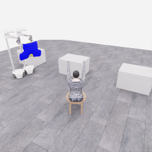

# 공개 시연 갤러리

[저장소 소개](../../README.md) · [상세 수집 기록](../collection/README.ko.md)

두 로봇이 옷에 접근하고, 잡고, 옮기는 실제 기록을 영상과 장면으로 살펴봅니다. 사람의 부분 시연, Astra의 과제 시도, 짧은 연결 시험을 각각 표시했습니다. 이 갤러리는 참가자 저장소의 공개 기록입니다.

**[E07 중간 검토](../collection/experiments/2026-11-06-coordinated-first5-review.ko.md)에서 두 로봇이 옷을 함께 지지하며 들어 올리고, 회전 뒤 마네킹 방향으로 이동한 장면을 확인했습니다. 공식 픽업 부분 점수는 5/50점이며 최종 착의 성공은 아직 확인하지 않았습니다. 아래 E05 영상은 한 로봇 부분 점수의 기존 기록으로 보존합니다.**

아래 큰 GIF는 페이지에서 자동으로 반복 재생됩니다. 기존 MP4의 전체 구간을 사용했으며 원본 영상도 함께 열 수 있습니다. AI 장면은 **원본 256×256 화면을 확대 표시**한 것입니다.

| 보기 | 제어 | 확인한 과정 | 평가 상태 |
|---|---|---|---|
| [Astra의 함께 들기·회전·마네킹 방향 이동](../collection/experiments/2026-11-06-coordinated-first5-review.ko.md) | `gpt-6-astra` / `ultra` | 양쪽 지지·들기 → 손목 감김·복구 → 협력 회전·이동 | **진행 중 고정 PNG 검토** · 공식 픽업 5점 · 최종 평가·안정적인 양쪽 파지 인증과 구분 |
| [Astra의 한 로봇 픽업 부분 점수 5점](20261106-astra-pickup-hold5-001.ko.md) | `gpt-6-astra` / `ultra` | 접근 → 파지 실패 → 재파지 → 들기·유지 → 리뷰 종료 | **한 로봇 픽업 부분 점수 5/50점** · 협력 들기 미확인 · 착의 `success=false` |
| [사람의 파지·들기·운반](20261026-human-pickup-transport.ko.md) | 사람이 두 로봇을 조작 | 고정 연습 배치의 접근 → 양쪽 파지 → 들기 → 운반 | 공식 점수·전체 착의 성공 미확인 |
| [Astra의 접근·파지 시도](20261106-astra-dressing-001.ko.md) | `gpt-6-astra` / `ultra` | 접근 → 닫기 → 시험 들기 → 다시 접근 | 공식 0/50점 · `success=false` |
| [Astra의 작은 움직임·정지](20261106-codex-robot-wiring-r5.ko.md) | `gpt-6-astra` / `ultra` | 작은 리프트 명령 → 정지 → 종료 | 연결 시험 · 공식 0/50점 · `success=false` |
| [한 응답에 담은 세 행동](20261106-exec-plan3-wiring-001.ko.md) | `gpt-6-astra` / `ultra`, 모델 1호출 | 한 목록의 작은 리프트 명령 → 정지 → 종료 | 연결 시험 · 공식 0/50점 · `success=false` |

## Astra의 함께 들기·회전·마네킹 방향 이동

**정지 사진 · 2026-11-06 05:18:51 UTC 고정 검토 · 전이 경계 530·에피소드 26.5초**입니다. 원본 256×256 PNG를 확대 표시했습니다. [양쪽 머리·손목 사진과 행동·복구 과정](../collection/experiments/2026-11-06-coordinated-first5-review.ko.md) · [공개 상태·출처 SHA](../collection/assets/20261106-coordinated-first5-review/snapshot.json)

양쪽 손끝 사이에서 옷을 유지하며 회전한 뒤 실제로 함께 전진했습니다. 회전 뒤 2초 구간의 베이스 수평 시작·끝점 변위는 각각 약 0.645m·0.678m입니다. 손목 회전 명령과 천이 감기는 형태, 반대 회전 복구도 함께 남겼습니다. 공식 첫 픽업 5점은 전이 경계 356이며, 두 그립의 안정성이나 마네킹 도착·착의 완료를 인증하는 점수는 아닙니다. 수집 중인 자료의 선별 사진이고 연속 영상·최종 평가·기술 검사는 후속 기록입니다.

## Astra의 한 로봇 픽업 부분 점수 5점

자동 반복 · 전체 253프레임, 50.6초, 5fps · 약 4.08MB · **4배 느리게** · 원본 256×256 확대 표시

**[▶ 원본 MP4](../collection/attempts/20261106-astra-pickup-hold5-001/overview.mp4)** · [짧은 행동 설명과 원본 관측](20261106-astra-pickup-hold5-001.ko.md) · [GIF 출처](assets/20261106-astra-pickup-hold5-001/provenance.json) · [최초 5점 순간·전이 246](../collection/milestones/20261106-astra-pickup-hold5-001/README.ko.md)

**로봇 0만 옷자락을 잡아 올려 부분 점수 5/50점**을 얻었습니다. 두 로봇이 함께 옷을 든 협력 성공 시연은 아닙니다. 당시에는 첫 5점 감시 조건으로 종료했습니다. 공식 유지 시간은 **3.35초**이며, 5초 행동 목표의 완료나 전체 착의 성공을 뜻하지 않습니다. 착의 `success=false`입니다.

## 사람의 파지·들기·운반

자동 반복 · 33.0초 · 640×453, 4fps · 약 4.82MB · [GIF 변환 출처](assets/20261026-human-pickup-transport/provenance.json)

**[▶ 33.08초 영상](../videos/20261026-human-pickup-transport.mp4)** · [장면과 과정 보기](20261026-human-pickup-transport.ko.md)

옷을 양쪽에서 잡아 들어 올리고 마네킹 쪽으로 운반한 부분 시연입니다. 원본 기록을 재생해 렌더링한 편집 영상이며 구간별 배속이 다릅니다. 공식 점수와 전체 착의 성공은 확인하지 않았습니다.

## Astra의 접근·파지 시도

자동 반복 · 33.4초, 5fps · 원본 256×256을 512×512 GIF로 확대, 표시 너비 720px · [GIF 변환 출처](assets/20261106-astra-dressing-001/provenance.json)

**[▶ 33.4초 영상](../collection/attempts/20261106-astra-dressing-001/overview.mp4)** · [원본 관측과 짧은 행동 응답 보기](20261106-astra-dressing-001.ko.md)

15개 완료 판단에서 접근·그리퍼 닫기·작은 시험 들기·재정렬을 시도했습니다. 파지 성공은 확인되지 않았으며 공식 결과는 **0점·success=false**입니다. 8.35초의 물리 진행을 **4배 느리게** 보여 줍니다.

## Astra의 작은 움직임·정지

자동 반복 · 3초, 1fps · 원본 256×256 확대 표시 · [GIF 변환 출처](assets/20261106-codex-robot-wiring-r5/provenance.json)

**[▶ 3초 영상](../collection/attempts/20261106-codex-robot-wiring-r5/overview.mp4)** · [세 응답과 시작·종료 화면 보기](20261106-codex-robot-wiring-r5.ko.md)

모델의 행동 응답을 로봇에 전달하고 정지·종료하는 연결 시험입니다. 3전이·0.15초의 물리 진행을 **20배 느리게** 보여 주며, 움직임이 매우 작습니다. 파지나 착의를 시도한 자료가 아닙니다.

## 한 응답에 담은 세 행동

자동 반복 · 3초, 1fps · 원본 256×256 확대 표시 · [GIF 변환 출처](assets/20261106-exec-plan3-wiring-001/provenance.json)

**[▶ 3초 영상](../collection/attempts/20261106-exec-plan3-wiring-001/overview.mp4)** · [한 번에 받은 행동 목록 보기](20261106-exec-plan3-wiring-001.ko.md)

모델 호출 1회에서 세 구간을 미리 받아 적용했습니다. 총 3전이·0.15초를 **20배 느리게** 보여 주는 연결 시험이며, 중간 관측을 보고 다시 판단하는 조건부 계획은 아닙니다.

각 영상의 배속은 시뮬레이션 시간 기준입니다. 모델 응답을 기다린 실제 시간은 Astra 영상에 포함되지 않습니다. 자료별 페이지에 원본 화면과 출처를 연결했으며, 재현·분석은 [상세 수집 기록](../collection/README.ko.md)에서 확인할 수 있습니다.
