# 시연 갤러리

[저장소 소개](../../README.md) · [현재 상태](../project/STATUS.md) · [이번 세션 기록](../project/sessions/20261106-evening-resume.ko.md)

**최신 E27 · 새 파지로 운반하고 팔에 접근한 뒤 복구**

<a href="assets/20261107-e27-arm-approach/event.mp4">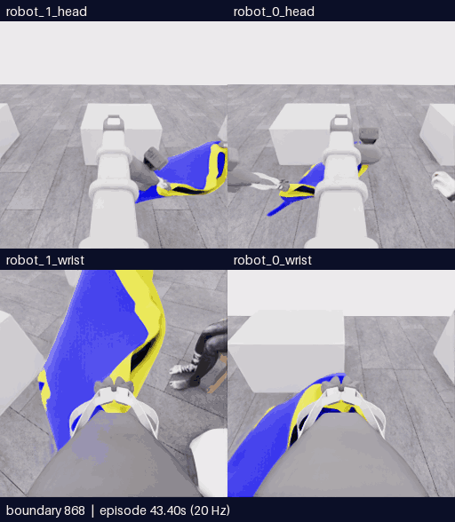</a>

[**MP4 크게 보기**](assets/20261107-e27-arm-approach/event.mp4) · [**운반·전체 영상**](20261107-astra-regrasp698-progress-named-001.ko.md) · [**분석**](../collection/reviews/20261107-astra-regrasp698-progress-named-001.ko.md) · [**피드백 남기기**](https://github.com/leonyoon-3dai/PhyRC_2027_phase1/issues/new?title=%5BE27+%ED%94%BC%EB%93%9C%EB%B0%B1%5D+%EC%83%88+%ED%8C%8C%EC%A7%80+%EC%9A%B4%EB%B0%98%C2%B7%ED%8C%94+%EC%A0%91%EA%B7%BC%C2%B7%EB%B3%B5%EA%B5%AC&body=%EC%8B%9C%EB%8F%84%3A+E27+%2F+20261107-astra-regrasp698-progress-named-001%0A%EC%98%81%EC%83%81+%EC%8B%9C%EA%B0%81+%EB%98%90%EB%8A%94+%EA%B2%BD%EA%B3%84%3A%0A%EC%B9%B4%EB%A9%94%EB%9D%BC%3A%0A%0A%EB%B3%B4%EC%9D%B4%EB%8A%94+%EC%82%AC%EC%8B%A4%3A%0A%0A%ED%95%B4%EC%84%9D%C2%B7%EC%A7%88%EB%AC%B8%3A%0A%0A%EB%8B%A4%EC%9D%8C%EC%97%90+%EB%B9%84%EA%B5%90%ED%95%A0+%EB%B0%A9%EB%B2%95%3A%0A)

**공식 원점수 5/50 · 픽업5 · 착의0 · `success=false` · 1,159/1,159기록 검사 통과.** E25에서 바꾼 파지로 실제 운반과 팔 접근을 수행했습니다. 928경계에서는 전완이 노란 띠 사이 큰 공간을 가로질러 보였고, 후반에는 관절 오차와 시야가 일부 회복됐습니다. **연속 소매 통과는 미확인이고 추가 득점은 없습니다.** 22개 행동을 사용한 뒤 판단 예산으로 종료했습니다. 최고5점, 중간 목표10점은 아직 미달성입니다.

868–968경계 · 101프레임 · 20.2초 · 4배 느리게. [출처](assets/20261107-e27-arm-approach/provenance.json) · [새 파지 상승·운반698–842 MP4](assets/20261107-e27-lift-transport/event.mp4) · [학습 검토 구간](../collection/reviews/20261107-astra-regrasp698-progress-named-001-learning-segments.json)

전체 **1,159전이·시뮬레이션57.95초**, 새 구간은 **461전이·23.05초**입니다. 실제 **40분50.624초**가 걸렸고, 698재실행+334모델 행동+126자동 정착+1예산 종료 중립입니다. **23모델 호출·22행동·모델 종료판단0**, 깊이 질의1회6유효점·질의 중 물리0입니다. 전이1개는 관측→행동→다음 관측의0.05초 기록이며 모델 판단 횟수와 다릅니다.

**사용자 요청으로 E27에서 시연을 마감하고 새 실행을 중지했습니다. 최고5점·목표10점 미달성이며 E28은 시작하지 않았습니다.** 서버 종료 후 오프라인 리뷰·전략 검토를 거쳐 후속 후보를 다시 선택합니다. E27/928·과거890/906의 같은 팔 연속 진행 후보는 준비됐지만 **실행 보류** 상태이고 자동 재개 계획은 없습니다. 후보의 전체325CPU·통합166개 해시 대조 통과와 실제 착의 효과 미검증을 구분합니다. 카메라 방향 보조는 미적용입니다. [후보 근거](../collection/research/2026-11-07-e27-single-arm-continuation.ko.md) · [후보 검사](../project/sessions/20261107-single-arm-progress-validation.json) · [통합 대조](../project/sessions/20261107-single-arm-integration-verification.json)

[E27 원본 고정 백업](../project/sessions/20261107-e27-backup-verification.json)은 재다운로드와254개 구성 파일 SHA 검증을 완료했습니다. 두 영상은 같은 실행의 구간이고 독립 성공 시연이 아니며, 학습 승인은 `unreviewed`입니다.

[출발점 비교](20261107-support-startpoints.ko.md) · [출발점·방법 데이터베이스](../collection/catalog/README.ko.md) · [0→5→10 구간 조합 장기계획](../collection/research/2026-11-07-composable-scoring-data-plan.ko.md)

<details>
<summary>E26과 이전 갤러리·당시 계획 이력</summary>

> 아래는 각 게시 당시 기록입니다. 현재 실행 여부는 위 내용과 STATUS를 따릅니다.

**E26 당시 최신 · 방향 변경·자세 보상과 손 관측**

<a href="assets/20261107-e26-view-orbit/event.mp4">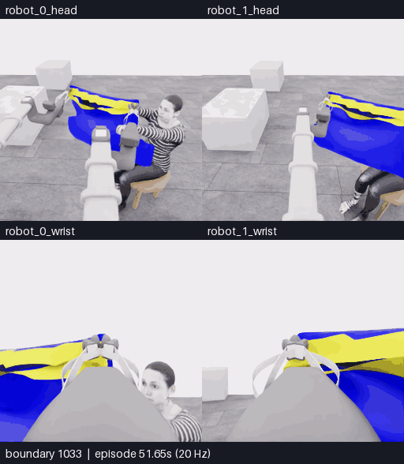</a>

[**MP4 크게 보기**](assets/20261107-e26-view-orbit/event.mp4) · [**전체·세 구간 영상**](20261107-astra-hand-swap787-named-001.ko.md) · [**분석**](../collection/reviews/20261107-astra-hand-swap787-named-001.ko.md) · [**피드백 남기기**](https://github.com/leonyoon-3dai/PhyRC_2027_phase1/issues/new?title=%5BE26+%ED%94%BC%EB%93%9C%EB%B0%B1%5D+%EB%B0%A9%ED%96%A5+%EB%B3%80%EA%B2%BD%C2%B7%EC%9E%90%EC%84%B8+%EB%B3%B4%EC%83%81%C2%B7%EC%86%90+%EA%B4%80%EC%B8%A1&body=%EC%8B%9C%EB%8F%84%3A+E26+%2F+20261107-astra-hand-swap787-named-001%0A%EC%98%81%EC%83%81+%EC%8B%9C%EA%B0%81+%EB%98%90%EB%8A%94+%EA%B2%BD%EA%B3%84%3A%0A%EC%B9%B4%EB%A9%94%EB%9D%BC%3A%0A%0A%EB%B3%B4%EC%9D%B4%EB%8A%94+%EC%82%AC%EC%8B%A4%3A%0A%0A%ED%95%B4%EC%84%9D%C2%B7%EC%A7%88%EB%AC%B8%3A%0A%0A%EB%8B%A4%EC%9D%8C%EC%97%90+%EB%B9%84%EA%B5%90%ED%95%A0+%EB%B0%A9%EB%B2%95%3A%0A) · [이전 E25 새 파지](20261107-astra-opposing563-named-001.ko.md)

**공식 원점수 5/50 · 픽업5 · 착의0 · `success=false` · 1,139/1,139기록 검사 통과.** 다른 초기 목표 손을 선택하고 파지 배치·접근 방향·높이를 바꿨습니다. 두 손 관계가 다시 보인 구간과 큰 자세 변화에서 그리퍼 위치를 근사 유지한 조작, 손 후보를 더 잘 드러낸 보상 회전을 확인했습니다. **손 정체·소매 경계의 연속 통과는 미확인이고 추가 득점은 없습니다.** 양쪽 파지를 유지한 채 모델이 자율 종료했습니다. 최고5점, 중간 목표10점은 아직 미달성입니다.

1033–1139경계 · 107프레임 · 21.4초 · 4배 느리게입니다. 위는 로봇0/1 머리, 아래는 로봇0/1 손목이며 모델 대기는 제외했습니다. [영상 출처](assets/20261107-e26-view-orbit/provenance.json) · [학습 검토 구간](../collection/reviews/20261107-astra-hand-swap787-named-001-learning-segments.json)

[E27 현재 상태](../project/STATUS.md) · [E26 고정 원본 백업](../project/sessions/20261107-e26-backup-verification.json)

**이전 E25 · 한쪽 가장자리 재파지와 국소 천 동행 검사**

<a href="assets/20261107-e25-rim-regrasp/event.mp4">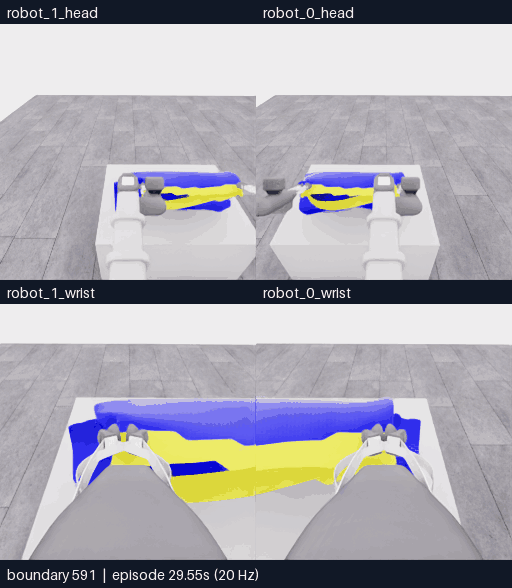</a>

[**MP4 크게 보기**](assets/20261107-e25-rim-regrasp/event.mp4) · [**전체·지지 검사 영상**](20261107-astra-opposing563-named-001.ko.md) · [**분석**](../collection/reviews/20261107-astra-opposing563-named-001.ko.md) · [**피드백 남기기**](https://github.com/leonyoon-3dai/PhyRC_2027_phase1/issues/new?title=%5BE25+%ED%94%BC%EB%93%9C%EB%B0%B1%5D+%ED%95%9C%EC%AA%BD+%EC%9E%AC%ED%8C%8C%EC%A7%80%EC%99%80+%EC%A7%80%EC%A7%80+%EA%B2%80%EC%82%AC&body=%EC%8B%9C%EB%8F%84%3A+E25+%2F+20261107-astra-opposing563-named-001%0A%EC%98%81%EC%83%81+%EC%8B%9C%EA%B0%81+%EB%98%90%EB%8A%94+%EA%B2%BD%EA%B3%84%3A%0A%EC%B9%B4%EB%A9%94%EB%9D%BC%3A%0A%0A%EB%B3%B4%EC%9D%B4%EB%8A%94+%EC%82%AC%EC%8B%A4%3A%0A%0A%ED%95%B4%EC%84%9D%C2%B7%EC%A7%88%EB%AC%B8%3A%0A%0A%EB%8B%A4%EC%9D%8C%EC%97%90+%EB%B9%84%EA%B5%90%ED%95%A0+%EB%B0%A9%EB%B2%95%3A%0A) · [이전 E24 진입·복구](20261107-astra-progress1179-named-001.ko.md)

**공식 원점수 5/50 · 픽업5 · 착의0 · `success=false` · 698/698기록 검사 통과.** 테이블 위에서 로봇0 쪽 지지를 유지하고 로봇1을 열어 낮은 곡선 경계로 옮겼습니다. 한 번 위치를 보정해 다시 닫은 뒤, 약2.7cm 상승에 새 파지 부근 천이 따라오는 모습을 확인했습니다. **국소 동행의 잠정 근거는 있지만, 반대인 두 입구 경계의 개방은 미확인입니다.** 차등 움직임·시점 복구 뒤 모델이 자율 종료했으며 운반·진입은 실행하지 않았습니다. 최고5점, 중간 목표10점은 아직 미달성입니다.

591–698경계 · 108프레임 · 21.6초 · 4배 느리게입니다. 위는 로봇0/1 머리, 아래는 로봇0/1 손목이며 모델 대기는 제외했습니다. [영상 출처](assets/20261107-e25-rim-regrasp/provenance.json) · [학습 검토 구간](../collection/reviews/20261107-astra-opposing563-named-001-learning-segments.json)

전체 **698전이·시뮬레이션34.9초**, 새 구간은 **135전이·6.75초**입니다. 실제20분26초, 563재실행+93모델 행동+42정착이며 15호출·13행동+자율종료1판단입니다. 깊이 질의1회6유효점·질의 중 물리0, 추가 마감 전이0입니다. 전이1개는 관측→행동→다음 관측의0.05초 기록입니다.

**E25 페이지 게시 당시 E26 시작 이력 · 05:51:36 UTC:** E18/787·history719/771에서 `coordinated-leading-hand-swap`을 실제 시작했습니다. Astra/ultra·22판단/max1400/settle6·source`53a58bb4e9fa4ff5366b66485c8690b0784ad71f`·시작clean입니다. 당시에는 준비 행동 재실행 단계였습니다. E26 종료 결과는 이 페이지 상단과 현재 STATUS를 따릅니다. [현재 상태·명령](../project/STATUS.md) · [방법 설명](../collection/research/2026-11-07-leading-hand-candidate.ko.md)

[**출발점 화면 5개 비교·피드백**](20261107-support-startpoints.ko.md) · [**출발점·방법 데이터베이스**](../collection/catalog/README.ko.md) · [**0→5→10 구간 조합 장기계획**](../collection/research/2026-11-07-composable-scoring-data-plan.ko.md)

**10점은 중간 목표이며 공식 확인 후 다음 득점 항목으로 계속 진행합니다.** 실패·복구와 원본을 보존하고, 합성 자료 확대는 장기 계획으로 구분합니다.

<details>
<summary>E24까지 갤러리·당시 계획 이력</summary>

> 아래는 당시 기록입니다. 현재 상태는 위 내용을 따릅니다.

**최신 E24 · 손–가장자리 정렬 뒤 진입 시도, 부분 시야 복구**

<a href="assets/20261107-e24-entry-recovery/event.mp4"></a>

[**MP4 크게 보기**](assets/20261107-e24-entry-recovery/event.mp4) · [**전체·보조 영상**](20261107-astra-progress1179-named-001.ko.md) · [**분석**](../collection/reviews/20261107-astra-progress1179-named-001.ko.md) · [**피드백 남기기**](https://github.com/leonyoon-3dai/PhyRC_2027_phase1/issues/new?title=%5BE24+%ED%94%BC%EB%93%9C%EB%B0%B1%5D+%EC%A7%84%EC%9E%85+%EC%8B%9C%EB%8F%84%EC%99%80+%EB%B6%80%EB%B6%84+%EB%B3%B5%EA%B5%AC&body=%EC%8B%9C%EB%8F%84%3A+E24+%2F+20261107-astra-progress1179-named-001%0A%EC%98%81%EC%83%81+%EC%8B%9C%EA%B0%81+%EB%98%90%EB%8A%94+%EA%B2%BD%EA%B3%84%3A%0A%EC%B9%B4%EB%A9%94%EB%9D%BC%3A%0A%0A%EB%B3%B4%EC%9D%B4%EB%8A%94+%EC%82%AC%EC%8B%A4%3A%0A%0A%ED%95%B4%EC%84%9D%C2%B7%EC%A7%88%EB%AC%B8%3A%0A%0A%EB%8B%A4%EC%9D%8C%EC%97%90+%EB%B9%84%EA%B5%90%ED%95%A0+%EB%B0%A9%EB%B2%95%3A%0A) · [이전 E23 팔 노출](20261107-astra-progress787-named-001.ko.md)

**공식 원점수 5/50 · 픽업5 · 착의0 · `success=false` · 1,610/1,610기록 검사 통과.** 높이와 접근 방향을 바꾸면서 손과 옷 경계가 함께 보였지만, 몸쪽 진입 동작 뒤 큰 천 면이 손과 틈을 가렸습니다. 마지막 후퇴·들기에서는 어두운 틈이 일부 다시 드러났습니다. **부분 시야 복구는 있었고, 공식 소매 통과·착의 득점은 없었습니다.** 22회 행동 후 감독 종료했으며, 모델 자율 종료나30판단 예산 소진과 구분합니다. 최고5점, 중간 목표10점은 아직 미달성입니다.

1483–1610경계 · 128프레임 · 25.6초 · 4배 느리게입니다. 위는 로봇0/1 머리, 아래는 로봇0/1 손목이며 모델 대기는 제외했습니다. [영상 출처](assets/20261107-e24-entry-recovery/provenance.json) · [학습 검토 구간](../collection/reviews/20261107-astra-progress1179-named-001-learning-segments.json) · [목표·실제 팔 운동 대조](../collection/reviews/20261107-astra-progress1179-named-001-motion.ko.md)

전체 **1,610전이·시뮬레이션80.5초**, 새 구간은 **431전이·21.55초**입니다. 실제50분26초, 1179재실행+304모델 행동+126정착+1감독 마감이며 26호출/22행동, 깊이 질의3회16유효점·질의 중 물리0입니다. 마지막 질의 후 행동 응답은 실행하지 않았습니다. 전이1개는 관측→행동→다음 관측의0.05초 기록입니다.

**E25 실행 중 · 05:18:00 UTC 시작:** E18/563·history510/542에서 `coordinated-opposing-rim`을 실제 시작했습니다. Astra/ultra·30판단/max1400·source`68658c9d9bb7e47591fb330f08f4f996ec4fcbfb`·시작clean입니다. 563개 준비 행동을 마친 뒤 첫2행동으로 옷을 함께 낮췄습니다(D1뒤591경계). 몸판이 테이블에 더 넓게 놓이고 양 jaw 부근 천은 남습니다. 로봇0을 anchor·로봇1을 바꿔 잡을 쪽으로 선택했으며, 아직 release·새 파지는 없습니다. 잔류 하강이 남아 테이블 지지와 새 파지를 별도로 확인합니다. 최종 점수는 미확인입니다. [현재 상태·명령](../project/STATUS.md) · [방법 설명](../collection/research/2026-11-07-opposing-rim-candidate.ko.md)

[**출발점 화면 5개 비교·피드백**](20261107-support-startpoints.ko.md) · [**출발점·방법 데이터베이스**](../collection/catalog/README.ko.md) · [**0→5→10 구간 조합 장기계획**](../collection/research/2026-11-07-composable-scoring-data-plan.ko.md)

[더 이른5점 출발 후보](../collection/research/2026-11-07-earlier-support-startpoints.ko.md) · [의복 방향·경계의 경쟁 가설](../collection/research/2026-11-07-garment-direction-hypotheses.ko.md) · [다른 조작 대안](../collection/research/2026-11-07-post-overhead-method-options.ko.md) · [전체 갤러리](README.ko.md)

**10점은 중간 목표이며 공식 확인 후 다음 득점 항목으로 계속 진행합니다.** 실패·복구와 원본을 보존하고, 합성 자료 확대는 장기 계획으로 구분합니다.

<details>
<summary>E23까지 갤러리·당시 계획 이력</summary>

> 아래는 당시 기록입니다. 현재 상태는 위 내용을 따릅니다.

**최신 E23 · 방향 반전 뒤 팔 노출, 머리 접근까지 진행**

<a href="assets/20261107-e23-arm-head-progress/event.mp4">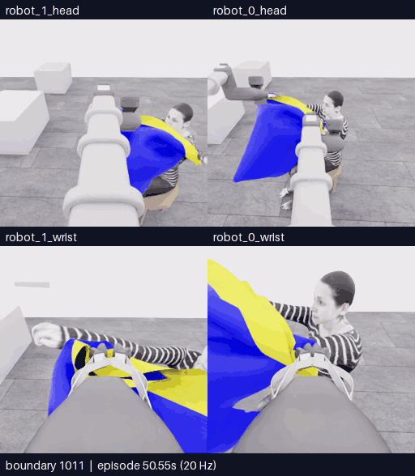</a>

[**MP4 크게 보기**](assets/20261107-e23-arm-head-progress/event.mp4) · [**방향 반전·전체 갤러리**](20261107-astra-progress787-named-001.ko.md) · [**분석**](../collection/reviews/20261107-astra-progress787-named-001.ko.md) · [**피드백 남기기**](https://github.com/leonyoon-3dai/PhyRC_2027_phase1/issues/new?title=%5BE23+%ED%94%BC%EB%93%9C%EB%B0%B1%5D+%ED%8C%94+%EB%85%B8%EC%B6%9C%EA%B3%BC+%EB%A8%B8%EB%A6%AC+%EC%A0%91%EA%B7%BC&body=%EC%8B%9C%EB%8F%84%3A+E23+%2F+20261107-astra-progress787-named-001%0A%EC%98%81%EC%83%81+%EC%8B%9C%EA%B0%81+%EB%98%90%EB%8A%94+%EA%B2%BD%EA%B3%84%3A%0A%EC%B9%B4%EB%A9%94%EB%9D%BC%3A%0A%0A%EB%B3%B4%EC%9D%B4%EB%8A%94+%EC%82%AC%EC%8B%A4%3A%0A%0A%ED%95%B4%EC%84%9D%C2%B7%EC%A7%88%EB%AC%B8%3A%0A%0A%EB%8B%A4%EC%9D%8C%EC%97%90+%EB%B9%84%EA%B5%90%ED%95%A0+%EB%B0%A9%EB%B2%95%3A%0A) · [이전 E22 짧은 탐색](20261107-astra-probe787-named-001.ko.md)

**공식 원점수 5/50 · 픽업5 · 착의0 · `success=false` · 1,180/1,180기록 검사 통과.** 경계의 전후 방향을 바꾸고 측면으로 이동한 뒤, 한쪽 경계를 올리면서 손·전완이 천 옆으로 더 드러났습니다. 이어 머리 높이로 올렸다 내렸지만 머리 통과는 확인되지 않았습니다. **시각적 팔 노출은 공식 소매 통과와 다르며, 착의 득점은 아직 없습니다.** 18판단 예산을 모두 사용해 종료했습니다. 최고5점, 중간 목표10점은 아직 미달성입니다.

1011–1180경계 · 170프레임 · 34초 · 4배 느리게입니다. 위는 로봇0/1 머리, 아래는 로봇0/1 손목이며 모델 대기는 제외했습니다. [영상 출처](assets/20261107-e23-arm-head-progress/provenance.json) · [학습 검토 구간](../collection/reviews/20261107-astra-progress787-named-001-learning-segments.json)

전체 **1,180전이·시뮬레이션59초**, 새 구간은 **393전이·19.65초**입니다. 실제31분46초, 787재실행+284모델 행동+108정착+1예산 마감이며 18호출/18행동, 실제 depth 질의0회입니다. 전이1개는 관측→행동→다음 관측의0.05초 기록입니다.

**E24 실행 중 · 04:11:53 UTC 시작:** E23/1179까지 준비 행동을 재실행한 뒤 같은 `coordinated-task-progress`를 최대30판단 이어갑니다. history1077/1161·Astra/ultra·source`b0513d43a87c813397c57d8a4fa6ec4e6ff6ba03`·시작clean입니다. 1179개 준비 행동 뒤 하강·방향 변경을 수행했습니다. 한쪽 팔의 목표와 실제 움직임 차이를 확인해 목표·자세를 조정했고, 공개 깊이6점 조회 후 뒤·옆 방향으로 이동했습니다. D8까지(1361경계) 얼굴·몸통과 손–경계 관계가 더 드러났지만 입구 통과·최종 점수는 아직 미확인입니다. [공개 관절 수치 대조](../collection/reviews/20261107-astra-progress1179-named-001-motion.ko.md) [현재 상태·설정](../project/STATUS.md)

[**출발점 화면 5개 비교·피드백**](20261107-support-startpoints.ko.md) · [**출발점·방법 데이터베이스**](../collection/catalog/README.ko.md) · [**0→5→10 구간 조합 장기계획**](../collection/research/2026-11-07-composable-scoring-data-plan.ko.md)

[더 이른5점 출발 후보](../collection/research/2026-11-07-earlier-support-startpoints.ko.md) · [의복 방향·경계의 경쟁 가설](../collection/research/2026-11-07-garment-direction-hypotheses.ko.md) · [다른 조작 대안](../collection/research/2026-11-07-post-overhead-method-options.ko.md) · [전체 갤러리](README.ko.md)

**10점은 중간 목표이며 공식 확인 후 다음 득점 항목으로 계속 진행합니다.** 실패·복구와 원본을 보존하고, 합성 자료 확대는 장기 계획으로 구분합니다.

<details>
<summary>E22 이전 갤러리·당시 계획 이력</summary>

> 아래는 당시 기록입니다. 현재 상태는 위 내용을 따릅니다.

**최신 E22 · 짧은 전진·시점 보정 뒤 진입 전 자율 종료**

<a href="assets/20261107-e22-entry-probe/event.mp4">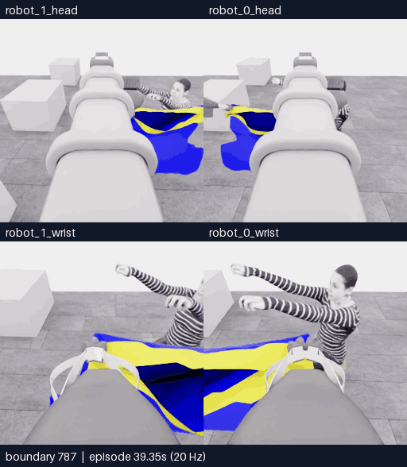</a>

[**MP4 크게 보기**](assets/20261107-e22-entry-probe/event.mp4) · [**구간별 갤러리**](20261107-astra-probe787-named-001.ko.md) · [**분석**](../collection/reviews/20261107-astra-probe787-named-001.ko.md) · [**피드백 남기기**](https://github.com/leonyoon-3dai/PhyRC_2027_phase1/issues/new?title=%5BE22+%ED%94%BC%EB%93%9C%EB%B0%B1%5D+%EC%A7%A7%EC%9D%80+%EC%A7%84%EC%9E%85+%ED%83%90%EC%83%89%EA%B3%BC+%EC%A1%B0%EA%B8%B0+%EC%A2%85%EB%A3%8C&body=%EC%8B%9C%EB%8F%84%3A+E22+%2F+20261107-astra-probe787-named-001%0A%EC%98%81%EC%83%81+%EC%8B%9C%EA%B0%81+%EB%98%90%EB%8A%94+%EA%B2%BD%EA%B3%84%3A%0A%EC%B9%B4%EB%A9%94%EB%9D%BC%3A%0A%0A%EB%B3%B4%EC%9D%B4%EB%8A%94+%EC%82%AC%EC%8B%A4%3A%0A%0A%ED%95%B4%EC%84%9D%C2%B7%EC%A7%88%EB%AC%B8%3A%0A%0A%EB%8B%A4%EC%9D%8C%EC%97%90+%EB%B9%84%EA%B5%90%ED%95%A0+%EB%B0%A9%EB%B2%95%3A%0A) · [이전 E21 하강·재파지 영상](20261107-astra-overhead470-named-001.ko.md)

**공식 원점수 5/50 · 픽업5 · 착의0 · `success=false` · 813/813기록 검사 통과.** 검수된5점 출발점에서 단일4단계 전진 탐색, 손목 시점 보정, 중립 대기를 수행했습니다. 새 진입 관계를 얻지 못해 모델이 종료했고 공식 평가는 `no_contact`입니다. 18판단 예산 중4판단만 사용했으며, 충분한 진입 동작을 시험한 결과로 확대하지 않습니다. 최고5점, 중간 목표10점은 아직 미달성입니다.

787–813경계 · 27프레임 · 5.4초 · 4배 느리게 · 새 구간 전체입니다. 위는 로봇0/1 머리, 아래는 로봇0/1 손목이며 모델 대기는 제외했습니다. [출처](assets/20261107-e22-entry-probe/provenance.json) · [학습 검토 구간](../collection/reviews/20261107-astra-probe787-named-001-learning-segments.json)

전체 **813전이·시뮬레이션40.65초**, 새 구간은 **26전이·1.3초**입니다. 실제17분13초, 787재실행+14모델 행동+12정착이며 5호출/4판단(3act+finish), depth 질의1회는 물리 진행0입니다. 전이1개는 관측→행동→다음 관측의0.05초 기록입니다.

**E23 실행 중 · 2026-11-07 03:30:54 UTC 시작:** 같은 E18/787 출발점에서, 시야가 완전히 명료해지는 것만을 진행 조건으로 삼지 않고 현재 관측에 근거한 목적 있는 유한 이동을 비교합니다. 공식 최대20단계와 물리·관절 한계는 유지하고, 한 행동 뒤 실제 옷의 진전을 다시 평가합니다. Astra/ultra·18판단 후보이며 통합302CPU검사를 통과했습니다. 공개소스`952ec8d`·시작clean입니다. 787개 준비 행동을 마친 뒤 두 차례 전진과 손목 각도 조정까지 수행했습니다. 손과 경계의 투영 겹침은 새로 보이지만 통과·최종 점수는 아직 미확인입니다. [현재 상태·검증·명령](../project/STATUS.md)

[**출발점 화면 5개 비교·피드백**](20261107-support-startpoints.ko.md) · [**출발점·방법 데이터베이스**](../collection/catalog/README.ko.md) · [**0→5→10 구간 조합 장기계획**](../collection/research/2026-11-07-composable-scoring-data-plan.ko.md)

[입구·손의 국소 깊이 검토](../collection/reviews/20261107-astra-overhead470-named-001-local-depth.ko.md) · [실제 조작 대안과 전환 기준](../collection/research/2026-11-07-post-overhead-method-options.ko.md) · [전체 갤러리](README.ko.md)

**10점은 중간 목표이며 공식 확인 후 다음 득점 항목으로 계속 진행합니다.** 실패·복구와 원본을 보존하고, 합성 자료 확대는 장기 계획으로 구분합니다.

<details>
<summary>E21 이전 갤러리·당시 계획 이력</summary>

> 아래는 당시 기록입니다. 현재 상태는 위 내용을 따릅니다.

**최신 E21 · 두 하강 접근 뒤 테이블로 복귀해 한쪽 재파지**

<a href="assets/20261107-e21-overhead-entry/event.mp4">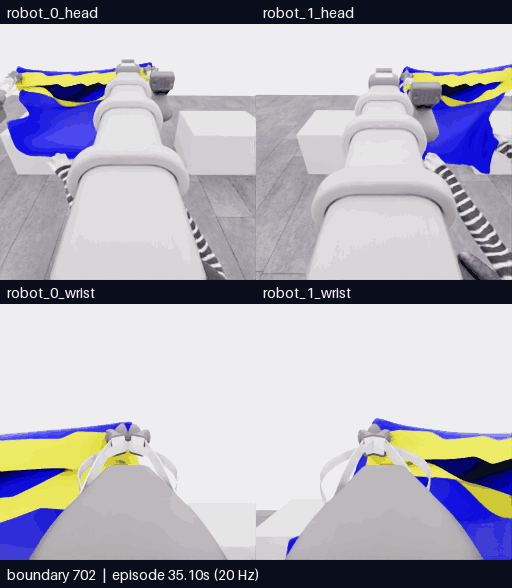</a>

[**MP4 크게 보기**](assets/20261107-e21-overhead-entry/event.mp4) · [**테이블 재파지 영상**](assets/20261107-e21-table-regrasp/event.mp4) · [**구간별 갤러리**](20261107-astra-overhead470-named-001.ko.md) · [**분석**](../collection/reviews/20261107-astra-overhead470-named-001.ko.md) · [**피드백 남기기**](https://github.com/leonyoon-3dai/PhyRC_2027_phase1/issues/new?title=%5BE21+%ED%94%BC%EB%93%9C%EB%B0%B1%5D+%ED%95%98%EA%B0%95+%EC%A0%91%EA%B7%BC%EA%B3%BC+%ED%85%8C%EC%9D%B4%EB%B8%94+%EC%9E%AC%ED%8C%8C%EC%A7%80&body=%EC%8B%9C%EB%8F%84%3A+E21+%2F+20261107-astra-overhead470-named-001%0A%EC%98%81%EC%83%81+%EC%8B%9C%EA%B0%81+%EB%98%90%EB%8A%94+%EA%B2%BD%EA%B3%84%3A%0A%EC%B9%B4%EB%A9%94%EB%9D%BC%3A%0A%0A%EA%B4%80%EC%B8%A1%ED%95%9C+%EC%9E%A5%EB%A9%B4%3A%0A%0A%ED%95%B4%EC%84%9D%C2%B7%EC%A7%88%EB%AC%B8%3A%0A%0A%EB%8B%A4%EC%9D%8C+%EB%B9%84%EA%B5%90+%EB%8F%99%EC%9E%91%3A%0A)

**공식 원점수 5/50 · 픽업5 · 착의0 · `success=false` · 1111/1111기록 검사 통과.** 높은 위치에서 두 차례 하강 접근과 시야·방향 보정을 했지만 손 통과·안착은 확인하지 못했습니다. 테이블로 돌아와 한쪽을 놓고 새 위치에 다시 닫았으며, 그 뒤 들기·유지 검사가 없어 마지막 파지는 검증된 지지로 분류하지 않습니다. 최고5점, 중간 목표10점은 아직 미달성입니다.

위 영상은702–856경계·155프레임·31초·4배 느리게입니다. 별도 재파지 영상은1018–1111경계·94프레임·18.8초입니다. 위는 로봇0/1 머리, 아래는 로봇0/1 손목이며 모델 대기는 제외했습니다. [영상 출처](assets/20261107-e21-overhead-entry/provenance.json) · [학습 검토 구간](../collection/reviews/20261107-astra-overhead470-named-001-learning-segments.json) · [원본 백업 검증](../project/sessions/20261107-e21-backup-verification.json)

전체 **1111전이·시뮬레이션55.55초**, 실제 **52분29초**입니다. 470재실행+412모델 행동+228정착+1예산 종료 중립이며, 40행동 판단·44모델 호출(추가질의4회)입니다. 전이1개는 관측→행동→다음 관측의0.05초 기록이고 질의 중 물리는 진행하지 않습니다.

**E22 실행 중 · 2026-11-07 03:01:21 UTC 시작:** 검수된 E18/787의5점 출발점에서 기존 양측 파지를 유지하고, 부분 가림의 두 해석을 구분할 짧은 진입 탐색을 비교합니다. Astra/ultra·18판단 예산이며 통합295CPU검사를 통과했습니다. 공개 소스`11faab3`의 깨끗한 상태에서 시작했으며 현재 초기화·행동 재실행 단계입니다. [후보 범위](../collection/research/2026-11-07-entry-probe-candidate.ko.md) · [현재 상태·명령](../project/STATUS.md)

[**출발점·방법 조합 데이터베이스**](../collection/catalog/README.ko.md) · [**0→5→10 구간 조합 장기계획**](../collection/research/2026-11-07-composable-scoring-data-plan.ko.md)

**10점은 중간 목표이며 공식 확인 후 다음 득점 항목으로 계속 진행합니다.** 합성 자료 확대는 장기 계획으로 보존하고, 현재는 실제5→10 구간의 지지·진입·실패 비교를 우선합니다.

[공식 시연 검토](../collection/research/2026-11-07-official-demo-route-review.ko.md) · [BEHAVIOR 우승 자료 검토](../collection/research/2026-11-07-behavior-champion-visual-transfer.ko.md) · [지난 시도 전체 갤러리](README.ko.md)

| 시도 | 실제 바꾼 접근 | 결과·한계 |
|---|---|---|
| [E21](20261107-astra-overhead470-named-001.ko.md) | 두 하강 접근·방향/시야 보정·테이블 복귀와 새 위치 재파지 | 5/50·통과 미확인·마지막 새 파지 유지 미검증 |
| [E20](20261107-astra-neckline470-named-001.ko.md) | 목선 후보로 양쪽 순차 재파지 | 0/50·준비 종료 |
| [E19](20261107-astra-entry801-named-001.ko.md) | 세 접근·관측 방향 변경 | 5/50·손 통과 미확인 |
| [E18](20261106-astra-guide470-depth-001.ko.md) | 운반·접근 변경 | 5/50·추가 roll 오류와 복구 |
| [E17](20261106-astra-layer352-001.ko.md) | 다른 lower-rim 후보 재파지 | 5/50·새 지지 미확인 |
| [E16](20261106-astra-support264-002.ko.md) | 순차 지지 진단·복구 | 0/50·입구 미확인 |

<details>
<summary>E20 이전 갤러리·당시 계획 이력</summary>

> 아래는 당시 기록입니다. 현재 상태는 위 내용을 따릅니다.

## 최신 E20 · 목선 후보 재파지와 입구 확인

<a href="assets/20261107-e20-neckline-regrasp/event.mp4"></a>

[**MP4 크게 보기**](assets/20261107-e20-neckline-regrasp/event.mp4) · [**전체 갤러리**](README.ko.md) · [**E20 분석**](../collection/reviews/20261107-astra-neckline470-named-001.ko.md) · [**영상 피드백 남기기**](https://github.com/leonyoon-3dai/PhyRC_2027_phase1/issues/new?title=%5BE20+%ED%94%BC%EB%93%9C%EB%B0%B1%5D+%EB%AA%A9%EC%84%A0+%EC%9E%AC%ED%8C%8C%EC%A7%80%EC%99%80+%EC%9E%85%EA%B5%AC+%ED%99%95%EC%9D%B8&body=%EC%8B%9C%EB%8F%84%3A+E20+%2F+20261107-astra-neckline470-named-001%0A%EC%98%81%EC%83%81+%EC%8B%9C%EA%B0%81+%EB%98%90%EB%8A%94+%EA%B2%BD%EA%B3%84%3A%0A%EC%B9%B4%EB%A9%94%EB%9D%BC%3A+%EB%A1%9C%EB%B4%870+%EB%A8%B8%EB%A6%AC+%2F+%EB%A1%9C%EB%B4%871+%EB%A8%B8%EB%A6%AC+%2F+%EB%A1%9C%EB%B4%870+%EC%86%90%EB%AA%A9+%2F+%EB%A1%9C%EB%B4%871+%EC%86%90%EB%AA%A9%0A%0A%EA%B4%80%EC%B8%A1%ED%95%9C+%EC%9E%A5%EB%A9%B4%3A%0A%0A%ED%95%B4%EC%84%9D%C2%B7%EC%A7%88%EB%AC%B8%3A%0A%0A%EB%8B%A4%EC%9D%8C%EC%97%90+%EB%B9%84%EA%B5%90%ED%95%98%EB%A9%B4+%EC%A2%8B%EC%9D%84+%EB%8F%99%EC%9E%91%3A%0A)

**공식 원점수 0/50 · 착의 0 · `success=false` · 726/726기록 검사 통과.** 기존 밑단 파지를 한쪽씩 놓고 목선 후보 두 곳에 새로 닫았습니다. 국소 천 동행은 보였으나, 높이·간격·시점을 바꿔도 연속 목 입구가 불명확해 테이블 지지 쪽으로 낮추고 종료했습니다. 머리·소매 진입은 시도하지 못했습니다. 최고 기록은 5점으로 목표 10점은 아직 미달성입니다.

470~726경계 · 257프레임 · 51.4초 재생 · 4배 느리게 · 모델 응답 대기 제외. 위는 로봇0·1 머리, 아래는 로봇0·1 손목입니다. [구간별 설명](20261107-astra-neckline470-named-001.ko.md) · [영상 출처](assets/20261107-e20-neckline-regrasp/provenance.json) · [학습 검토 구간](../collection/reviews/20261107-astra-neckline470-named-001-learning-segments.json)

전체 **726전이·시뮬레이션 36.3초**, 실제 약 **29분 43초**입니다. 470재실행+154모델 행동+102제어기 정착이며, 25모델 호출은 행동23회·종료판단1회·추가질의1회입니다. 전이 1개는 관측→행동→다음 관측의 0.05초 기록이고, 질의 중 물리는 진행하지 않았습니다.

**E21은 2026-11-07 01:56:25 UTC에 시작**했고 공식 시연에 가까운 **몸통 입구의 상방 배치→하강·안착 경로**를 비교합니다. 후보 통합 후 전체277CPU검사를 통과했으며 실제 착의 효과는 아직 미검증입니다. [후보 범위](../collection/research/2026-11-07-overhead-drape-candidate.ko.md) · [현재 실행 상태](../project/STATUS.md)

[**공식 시연의 실제 순서 검토**](../collection/research/2026-11-07-official-demo-route-review.ko.md) · [**BEHAVIOR 우승 자료: 그림·영상과 후속 수집 후보**](../collection/research/2026-11-07-behavior-champion-visual-transfer.ko.md) · [공식 집계·텍스트 근거](../collection/research/2026-11-07-behavior-champion-text-review.ko.md)

| 시도 | 실제 바꾼 접근 | 결과·한계 |
|---|---|---|
| [E20](20261107-astra-neckline470-named-001.ko.md) | 목선 후보로 양쪽 순차 재파지 | 0/50. 국소 동행은 보였으나 입구 미확인·운반 전 종료 |
| [E19](20261107-astra-entry801-named-001.ko.md) | 명명 명령, 세 접근과 관측 방향 변경 | 5/50. 축 불일치 미재발, 손 통과 미확인 |
| [E18](20261106-astra-guide470-depth-001.ko.md) | 공개 depth와 운반 대형·접근 변경 | 5/50. 추가 roll 오류 두 번, 감독 종료 |
| [E17](20261106-astra-layer352-001.ko.md) | 다른 lower-rim 후보 재파지 | 5/50. 반대층·양측 지지 미확인 |
| [E16](20261106-astra-support264-002.ko.md) | 순차 지지 진단·같은 가장자리 복구 | 0/50. 연속 입구 미확인 |

피드백에는 영상 시각 또는 경계·카메라·관측한 관계를 적어 주세요. 링크는 작성 화면을 열며 자동 제출하지 않습니다. 같은 E07 출처의 분기이므로 구간을 독립 성공 시연으로 세지 않으며 학습 승인은 unreviewed입니다. [E20 원본 백업 검증](../project/sessions/20261107-e20-backup-verification.json)을 완료했습니다.

<details>
<summary>E19 당시 영상과 다음 계획</summary>

> 아래는 E19 종료 당시 기록입니다.

## 최신 E19 · 세 접근과 시야 변경 후 자율 종료

<a href="assets/20261107-e19-named-entry/event.mp4">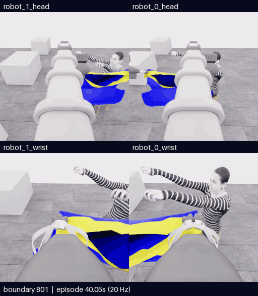</a>

[**MP4 크게 열기**](assets/20261107-e19-named-entry/event.mp4) · [구간별 설명](20261107-astra-entry801-named-001.ko.md) · [공개 분석](../collection/reviews/20261107-astra-entry801-named-001.ko.md) · [**피드백 남기기**](https://github.com/leonyoon-3dai/PhyRC_2027_phase1/issues/new?title=%5BE19+%ED%94%BC%EB%93%9C%EB%B0%B1%5D+%EC%98%81%EC%83%81+%EA%B5%AC%EA%B0%84%EA%B3%BC+%EA%B4%80%EC%B8%A1&body=%EC%8B%9C%EB%8F%84%3A+E19+%2F+20261107-astra-entry801-named-001%0A%EC%98%81%EC%83%81+%EC%8B%9C%EA%B0%81+%EB%98%90%EB%8A%94+%EA%B2%BD%EA%B3%84%3A%0A%EC%B9%B4%EB%A9%94%EB%9D%BC%3A+%EB%A1%9C%EB%B4%870+%EB%A8%B8%EB%A6%AC+%2F+%EB%A1%9C%EB%B4%871+%EB%A8%B8%EB%A6%AC+%2F+%EB%A1%9C%EB%B4%870+%EC%86%90%EB%AA%A9+%2F+%EB%A1%9C%EB%B4%871+%EC%86%90%EB%AA%A9%0A%0A%EA%B4%80%EC%B8%A1%ED%95%9C+%EC%9E%A5%EB%A9%B4%3A%0A%0A%ED%95%B4%EC%84%9D+%EB%98%90%EB%8A%94+%EC%A7%88%EB%AC%B8%3A%0A%0A%EB%8B%A4%EC%9D%8C%EC%97%90+%EB%B9%84%EA%B5%90%ED%95%98%EB%A9%B4+%EC%A2%8B%EC%9D%84+%EB%8F%99%EC%9E%91%3A%0A%0A%EA%B0%A4%EB%9F%AC%EB%A6%AC%3A+https%3A%2F%2Fgithub.com%2Fleonyoon-3dai%2FPhyRC_2027_phase1%2Fblob%2Fmain%2Fdocs%2Fgallery%2FREADME.ko.md%0A)

**5/50 · 픽업 5 · 착의 0 · success=false · 932/932기록 검사 통과.** 12개 행동에서 설명과 다른 축 적용을 발견하지 않았습니다. 한쪽 높이·의도적 회전·상방/측면 시야를 바꾼 세 접근 모두 손 통과가 미확인으로 남아 후퇴 후 종료했습니다. 같은 파지에서 단순 전진을 더 반복할 근거가 약해졌습니다.

801~932경계 · 132프레임 · 26.4초 · 5fps·4배 느리게. 네 카메라 순서는 위 로봇0/1 머리, 아래 로봇0/1 손목입니다. 모델 대기 시간은 제외했습니다. [출처](assets/20261107-e19-named-entry/provenance.json) · [학습 검토 구간](../collection/reviews/20261107-astra-entry801-named-001-learning-segments.json). 의도적 회전과 오류 회전, 제안과 실제 실행, 복구와 종료를 구분하며 학습 승인은 unreviewed입니다. [E19 원본 고정 백업·재다운로드 SHA 검증](../project/sessions/20261107-e19-backup-verification.json)도 완료했습니다.

피드백에는 영상 시각 또는 경계, 카메라, 관측한 관계를 남겨 주세요. GitHub 링크는 작성 화면을 열며 자동 제출하지 않습니다.

전체 932전이는 **801재실행+59모델 행동+72제어기 정착**, 시뮬레이션 46.6초입니다. 실제 1577.537초(26분18초), 모델 14호출/13판단(행동12+종료1), depth 질의1회·물리0입니다. 같은 E07 출처의 분기이며 독립 성공 표본으로 세지 않습니다.

## 다음 비교

**E20 목 우선 경로는 2026-11-07 01:18:21 UTC에 시작했습니다.** E18의 테이블 준비 470경계에서 현재 목선·지지를 다시 판단하고, 목표 입구와 첫 착의 순서를 바꿉니다. [선택 근거](../collection/research/2026-11-07-post-named-route-choice.ko.md) · [실제 실행 상태·명령](../project/STATUS.md)

| 시도 | 실제 바꾼 접근 | 결과·한계 |
|---|---|---|
| [E19](20261107-astra-entry801-named-001.ko.md) | 명명 명령, 세 접근과 기울기·관측 방향 변경 | 5/50. 축 불일치 미재발, 입구 통과 미확인 |
| [E18](20261106-astra-guide470-depth-001.ko.md) | 공개 depth와 운반 대형·접근 변경 | 5/50. 추가 roll 오류 두 번, 감독 종료 |
| [E17](20261106-astra-layer352-001.ko.md) | 다른 lower-rim 후보 재파지 | 5/50. 반대층·양측 지지 미확인 |
| [E16](20261106-astra-support264-002.ko.md) | 순차 지지 진단·같은 가장자리 복구 | 0/50. 연속 입구 미확인 |


</details>

<details>
<summary>E18 당시 영상과 다음 계획 이력</summary>

> 아래는 E18 정리 당시 기록이며 현재 실행 상태가 아닙니다.

## 최신 E18 · 손 근처 접근과 손목 회전 오류·복구

<a href="assets/20261107-e18-roll-recovery/event.mp4">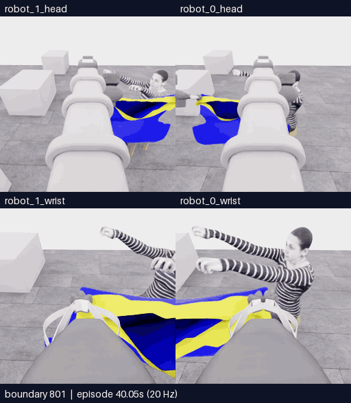</a>

[**MP4 크게 열기**](assets/20261107-e18-roll-recovery/event.mp4) · [전체 구간·실행 조건](20261106-astra-guide470-depth-001.ko.md) · [공개 분석](../collection/reviews/20261106-astra-guide470-depth-001.ko.md) · [영상 출처](assets/20261107-e18-roll-recovery/provenance.json)

**5/50 · 픽업5 · 착의0 · success=false · 전수 검사928/928 통과.** 기존 파지로 운반·접근 방향을 바꾸고 depth를3회 조회했습니다. 전진 설명에 없는 손목 roll이 D16·D21에 반복돼 복구 후 감독 중단했습니다. 계획했던 소매 쪽 가이드 재파지는 실제0회입니다. 최고5점·목표10점 미달성 상태입니다.

801~851경계 · 51프레임 · 10.2초 · 5fps·4배 느리게. 위는 로봇0·1 머리, 아래는 로봇0·1 손목입니다. 모델 응답 대기는 제외했고 각 카메라 원본은256×256입니다.

| 영상 | 범위·길이 | 확인할 내용 |
|---|---|---|
| [운반·대형 회전](assets/20261107-e18-transport/event.mp4) | 470~787 · 318프레임·63.6초 | 기존 파지로 들어 올리기, 횡이동·회전, 손 근처 접근 |
| [손 접근·두 오류와 복구·종료](assets/20261107-e18-entry-recovery/event.mp4) | 787~928 · 142프레임·28.4초 | 추가 roll 두 번과 반대 회전 복구, 질의 후 접근, 마지막 감독 중립1전이 |
| [첫 roll·복구 확대](assets/20261107-e18-roll-recovery/event.mp4) | 801~851 · 51프레임·10.2초 | 설명과 실제 명령의 불일치 및 시야 회복 |

세 영상은 같은 시도의 겹치는 구간이며 독립 시연3개가 아닙니다. [오류·복구 학습 검토 JSON](../collection/reviews/20261106-astra-guide470-depth-001-learning-segments.json)은 접근·오류·복구·질의·중단을 분리합니다. 원본은 보존했고 학습 승인은 `unreviewed`입니다. [E18 비공개 원본 고정 HF 백업·재다운로드 SHA 검증](../project/sessions/20261107-e18-backup-verification.json)을 완료했습니다.

[**이 영상에 피드백 남기기**](https://github.com/leonyoon-3dai/PhyRC_2027_phase1/issues/new?title=%5BE18+%ED%94%BC%EB%93%9C%EB%B0%B1%5D+%EC%98%81%EC%83%81+%EA%B5%AC%EA%B0%84%EA%B3%BC+%EA%B4%80%EC%B8%A1&body=%EC%8B%9C%EB%8F%84%3A+E18+%2F+20261106-astra-guide470-depth-001%0A%EC%98%81%EC%83%81+%EC%8B%9C%EA%B0%81+%EB%98%90%EB%8A%94+%EA%B2%BD%EA%B3%84%3A+%0A%EC%B9%B4%EB%A9%94%EB%9D%BC%3A+%EB%A1%9C%EB%B4%870+%EB%A8%B8%EB%A6%AC+%2F+%EB%A1%9C%EB%B4%871+%EB%A8%B8%EB%A6%AC+%2F+%EB%A1%9C%EB%B4%870+%EC%86%90%EB%AA%A9+%2F+%EB%A1%9C%EB%B4%871+%EC%86%90%EB%AA%A9%0A%0A%EA%B4%80%EC%B8%A1%ED%95%9C+%EC%9E%A5%EB%A9%B4%3A%0A%0A%EC%A0%9C+%ED%95%B4%EC%84%9D+%EB%98%90%EB%8A%94+%EC%A7%88%EB%AC%B8%3A%0A%0A%EB%8B%A4%EC%9D%8C%EC%97%90+%EB%B9%84%EA%B5%90%ED%95%98%EB%A9%B4+%EC%A2%8B%EC%9D%84+%EB%8F%99%EC%9E%91%3A%0A%0A%EA%B0%A4%EB%9F%AC%EB%A6%AC%3A+https%3A%2F%2Fgithub.com%2Fleonyoon-3dai%2FPhyRC_2027_phase1%2Fblob%2Fmain%2Fdocs%2Fgallery%2FREADME.ko.md%0A)

영상의 **시각 또는 경계와 카메라**를 적어 주세요. 링크는 GitHub 작성 화면만 열며 제출은 사용자가 합니다. 이 대화에도 아래처럼 남길 수 있습니다.

```text
E18 / 영상 시각 또는 경계:
카메라:
관측한 장면:
해석·질문 또는 다음에 바꿔볼 동작:
```

전이1개는 **관측 → 행동 → 다음 관측**의0.05초 기록입니다. E18은928전이·시뮬레이션46.4초, 실제 경과1862.366초(약31분2초)입니다. **모델 호출30회 시도 = 실행 행동26개 + 질의 초기 호출3개 + 중단된 호출1개**이며, 질의의 물리 진행은0입니다. 928전이는470재실행·313모델·144제어기 settle·1감독 중립으로 구성됩니다. 호출 수를 전이 수나 성공한 판단 수와 혼용하지 않습니다.

## 다음 비교와 최근 이력

**E19는2026-11-07 00:45:20 UTC에 시작했습니다.** 첫 roll 오류 직전 E18의801경계를 재실행하고 같은 B 전략·depth 질의를 유지하면서 명령을 축 이름으로 작성하는 기능을 비교합니다. 현재 재실행 중이며 최종 결과는 아직 없습니다. 과거 입력은 이번 재실행771·787경계입니다. 이 기능은 전체 CPU270검사·동일16이미지의 실제 CLI 합성2턴 및 [모델 없는 GPU3/3전이 전수 검사](../collection/assets/20261107-named-action-candidate/model-free-gpu-wiring.json)를 통과했습니다(실제 모델0회·fixture 질의1회·질의 물리0). E18에는 사용하지 않았고 실제 착의 효과는 미검증입니다. 목 우선 후보도 구현됐으나 실제로 실행하지 않았습니다.

| 시도 | 실제 바꾼 접근 | 결과·한계 |
|---|---|---|
| [E18](20261106-astra-guide470-depth-001.ko.md) | 공개 depth3회·기존 파지 운반 대형과 접근 방향 변경 | 5/50. 추가 roll 반복으로 감독 중단, 가이드 재파지 미실행 |
| [E17](20261106-astra-layer352-001.ko.md) | 다른 lower-rim 후보를 겨냥한 한쪽 재파지 | 5/50. 반대층·양측 지지 미확인 |
| [E16](20261106-astra-support264-002.ko.md) | 순차 지지 진단·같은 오른쪽 가장자리 재파지 | 0/50. 국소 천 동행 근거, 입구 미확인 |
| [E15](20261106-astra-opening264-001.ko.md) | 초기 입구 준비 후 운반 | 5/50. 손 근처 가림·입구 통과 미확인 |

시작 경계·입력·행동·예산이 달라 통제된 성공률 비교는 아닙니다. 기술 검사·과제 성공·학습 승인은 별도입니다.

</details>

<details>
<summary>E17 및 이전 시도 전체 · 당시 상태와 영상 보존</summary>

> 아래는 E17 정리 시점의 원문입니다. 당시 최신·다음 계획은 현재 실행 지시가 아닙니다.

# 시연 갤러리

[저장소 소개](../../README.md) · [현재 상태](../project/STATUS.md) · [이번 세션 기록](../project/sessions/20261106-evening-resume.ko.md)

## 최신 E17 · 다른 경계 재파지와 미확인으로 남은 입구

**다른 lower-rim 후보를 겨냥한 재파지는 실행했지만 실제 반대층 파지와 양측 지지는 확인하지 못했습니다. E17은5/50이며 최고5/50·목표10점 미달성 상태입니다.**

<a href="assets/20261106-e17-regrasp/event.mp4">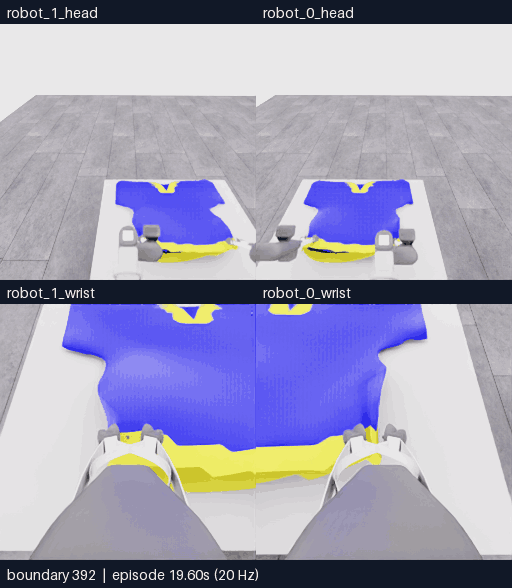</a>

[**MP4 크게 열기 · 재생 위치를 옮기며 보기**](assets/20261106-e17-regrasp/event.mp4) · [전체 시도·행동 분석](20261106-astra-layer352-001.ko.md) · [원본 경계·영상 출처](assets/20261106-e17-regrasp/provenance.json)

392~452경계 · 61프레임 · 12.2초 재생 · 4배 느리게 · 모델 응답 대기 제외. 위는 로봇0·1 머리, 아래는 로봇0·1 손목입니다. 원본은 카메라당256×256이며 확대해도 세부 정보가 늘어나지는 않습니다.

**결과:** 5/50 · 픽업5 · 첫 소매0 · `success=false` · 전수검사452/452. [공식 결과와 공개 분석](../collection/reviews/20261106-astra-layer352-001.ko.md). [E17 고정 HF 백업·재다운로드 SHA 검증](../project/sessions/20261106-e17-backup-verification.json)을 완료했습니다.

| 구분 | 이 영상에서 확인할 내용 |
|---|---|
| 관측·행동 | 로봇0만 열고 lower-rim 후보에 맞춰 하강·손목 회전·팔 당기기를 한 뒤 다시 닫았습니다. 이후 양측 짧은 lift와 복귀를 실행했습니다. |
| 해석 | 다른 후보를 겨냥한 조작은 실제 실행했습니다. 실제 반대 입구 층인지와 새 파지의 지지는 미확인입니다. 픽업5점을 파지 정답으로 사용하지 않습니다. |
| 다음 | E18 B는 E16의470경계에서 지지/가이드 역할 분담과 소매 쪽 가장자리 재파지를 비교할 계획입니다. 픽셀 depth 질의를 켤 예정이며 아직 실행하지 않았습니다. 목부터 접근하는 별도 후보도 준비 중입니다. |

[**이 영상에 피드백 남기기**](https://github.com/leonyoon-3dai/PhyRC_2027_phase1/issues/new?title=%5BE17+%ED%94%BC%EB%93%9C%EB%B0%B1%5D+%EC%98%81%EC%83%81+%EA%B5%AC%EA%B0%84%EA%B3%BC+%EA%B4%80%EC%B8%A1&body=%EC%8B%9C%EB%8F%84%3A+E17+%2F+20261106-astra-layer352-001%0A%EC%98%81%EC%83%81+%EC%8B%9C%EA%B0%81+%EB%98%90%EB%8A%94+%EA%B2%BD%EA%B3%84%3A+%0A%EC%B9%B4%EB%A9%94%EB%9D%BC%3A+%EB%A1%9C%EB%B4%870+%EB%A8%B8%EB%A6%AC+%2F+%EB%A1%9C%EB%B4%871+%EB%A8%B8%EB%A6%AC+%2F+%EB%A1%9C%EB%B4%870+%EC%86%90%EB%AA%A9+%2F+%EB%A1%9C%EB%B4%871+%EC%86%90%EB%AA%A9%0A%0A%EA%B4%80%EC%B8%A1%ED%95%9C+%EC%9E%A5%EB%A9%B4%3A%0A%0A%EC%A0%9C+%ED%95%B4%EC%84%9D+%EB%98%90%EB%8A%94+%EC%A7%88%EB%AC%B8%3A%0A%0A%EB%8B%A4%EC%9D%8C%EC%97%90+%EB%B9%84%EA%B5%90%ED%95%98%EB%A9%B4+%EC%A2%8B%EC%9D%84+%EB%8F%99%EC%9E%91%3A%0A%0A%EA%B0%A4%EB%9F%AC%EB%A6%AC%3A+https%3A%2F%2Fgithub.com%2Fleonyoon-3dai%2FPhyRC_2027_phase1%2Fblob%2Fmain%2Fdocs%2Fgallery%2FREADME.ko.md%0A)

영상의 **시각 또는 경계와 카메라**를 적으면 같은 장면을 비교할 수 있습니다. 위 링크는 GitHub 작성 화면을 열며 제출은 사용자가 합니다. 아래 양식으로 이 대화에 남겨도 됩니다.

```text
E17 / 영상 시각 또는 경계:
카메라:
관측한 장면:
해석·질문 또는 다음에 바꿔볼 동작:
```

전이1개는 **관측 → 행동 → 다음 관측**의0.05초 기록입니다. E17은452전이·시뮬레이션22.6초,12번의 모델 판단·실제 약13분44초입니다. 12판단은11개 act와 종료 판단1개이며 종료 판단 자체는 물리를 진행하지 않았습니다. 정지 명령도 물리 기록에 포함되므로 모델 판단 수와 전이 수를 같게 세지 않습니다.

## 최근 비교

| 시도 | 실제 바꾼 접근 | 결과·한계 |
|---|---|---|
| [E17](20261106-astra-layer352-001.ko.md) | 다른 lower-rim 후보를 겨냥한 한쪽 재파지 | 5/50. 반대층·양측 지지 미확인, 운반 없이 종료 |
| [E16](20261106-astra-support264-002.ko.md) | 순차 지지 진단·같은 오른쪽 가장자리 재파지 | 0/50. 국소 천 동행 근거, 입구 미확인 |
| [E15](20261106-astra-opening264-001.ko.md) | 초기264경계 입구 준비 후 운반 | 5/50. 손 근처 가림·입구 통과 미확인 |

시작 경계·입력·후속 행동·예산이 달라 통제된 성공률 비교는 아닙니다. 같은 원본의 재실행을 독립 시연으로 세지 않으며, 기술 검사·시각 판단·공식 점수·학습 승인은 별도입니다.

<details>
<summary>E16 및 이전 시도 전체 · 당시 상태와 영상 보존</summary>

> 아래는 E16 정리 시점의 원문입니다. 당시의 최신·다음 계획·진행 상태는 현재 실행 지시가 아닙니다.

# 시연 갤러리

[저장소 소개](../../README.md) · [현재 상태](../project/STATUS.md) · [이번 세션 기록](../project/sessions/20261106-evening-resume.ko.md)

## 최신 E16 · 각 파지를 따로 확인한 뒤 입구 접근

**로봇0 재파지 뒤 국소 천 동행을 관측했지만 입구를 확인하지 못해 운반 없이 종료했습니다. E16은0/50이며 최고 기록5/50과10점 미달성 상태는 그대로입니다.**

<a href="assets/20261106-e16-regrasp/event.mp4">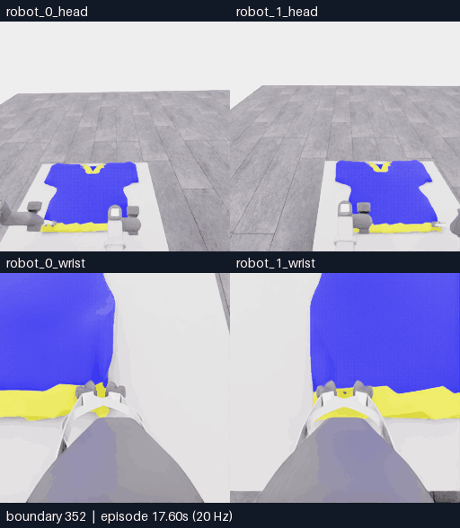</a>

[**MP4 크게 열기 · 재생 위치를 옮기며 보기**](assets/20261106-e16-regrasp/event.mp4) · [전체 시도·행동 분석](20261106-astra-support264-002.ko.md) · [원본 경계·영상 출처](assets/20261106-e16-regrasp/provenance.json)

352~440경계 · 89프레임 · 17.8초 재생 · 4배 느리게 · 모델 응답 대기 제외. 위는 로봇0·1 머리, 아래는 로봇0·1 손목입니다. 원본은 카메라당256×256이며 확대해도 세부 정보가 늘어나지는 않습니다.

**결과:** 0/50 · 첫 소매 0 · `success=false` · 전수검사 516/516. [공식 평가와 검수](../collection/reviews/20261106-astra-support264-002.ko.md) · [원본 보존·재다운로드 SHA 검증 완료](../project/sessions/20261106-e16-backup-verification.json)

| 구분 | 이 영상에서 확인할 내용 |
|---|---|
| 관측 | 위352~440경계는 로봇0만 열고 다시 잡은 뒤 따로 들어 확인한 구간입니다. 후반의 국소 천 접힘이 이동·유지·복귀하는 모습을 관측했습니다. |
| 해석 | 국소 지지의 시각적 근거를 얻었지만 두 지지점 사이의 연속 입구는 미확인입니다. 0점만으로 파지 실패를 단정하지 않으며, 국소 동행을 접촉 센서 판정으로 취급하지 않습니다. |
| 다음 | E16의352경계부터 다른 가시 입구 경계·층에서 한쪽 재파지를 비교하는 E17을 준비합니다. 기존 오른쪽 가장자리 회복과 구분하며 아직 실행하지 않았습니다. |

[**이 영상에 피드백 남기기**](https://github.com/leonyoon-3dai/PhyRC_2027_phase1/issues/new?title=%5BE16+%ED%94%BC%EB%93%9C%EB%B0%B1%5D+%EC%98%81%EC%83%81+%EA%B5%AC%EA%B0%84%EA%B3%BC+%EA%B4%80%EC%B8%A1&body=%EC%8B%9C%EB%8F%84%3A+E16+%2F+20261106-astra-support264-002%0A%EC%98%81%EC%83%81+%EC%8B%9C%EA%B0%81+%EB%98%90%EB%8A%94+%EA%B2%BD%EA%B3%84%3A+%0A%EC%B9%B4%EB%A9%94%EB%9D%BC%3A+%EB%A1%9C%EB%B4%870+%EB%A8%B8%EB%A6%AC+%2F+%EB%A1%9C%EB%B4%871+%EB%A8%B8%EB%A6%AC+%2F+%EB%A1%9C%EB%B4%870+%EC%86%90%EB%AA%A9+%2F+%EB%A1%9C%EB%B4%871+%EC%86%90%EB%AA%A9%0A%0A%EA%B4%80%EC%B8%A1%ED%95%9C+%EC%9E%A5%EB%A9%B4%3A%0A%0A%EC%A0%9C+%ED%95%B4%EC%84%9D+%EB%98%90%EB%8A%94+%EC%A7%88%EB%AC%B8%3A%0A%0A%EB%8B%A4%EC%9D%8C%EC%97%90+%EB%B9%84%EA%B5%90%ED%95%98%EB%A9%B4+%EC%A2%8B%EC%9D%84+%EB%8F%99%EC%9E%91%3A%0A%0A%EA%B0%A4%EB%9F%AC%EB%A6%AC%3A+https%3A%2F%2Fgithub.com%2Fleonyoon-3dai%2FPhyRC_2027_phase1%2Fblob%2Fmain%2Fdocs%2Fgallery%2FREADME.ko.md%0A)

영상의 **시각 또는 경계와 카메라**를 적으면 같은 장면을 바로 비교할 수 있습니다. 위 링크는 GitHub 작성 화면을 열며 제출은 사용자가 합니다. 아래 양식으로 이 대화에 남겨도 됩니다.

```text
E16 / 영상 시각 또는 경계:
카메라:
관측한 장면:
해석·질문 또는 다음에 바꿔볼 동작:
```

## 이전 시도와 비교

| 시도 | 바꾼 접근 | 확인된 결과 | 영상·근거 |
|---|---|---|---|
| E16 | 각 그리퍼 순차 지지 확인 | 0/50 · 첫 소매0 · 운반 없이 모델 종료 | [이번 분석](20261106-astra-support264-002.ko.md) |
| E15 | 초기264경계에서 입구 준비 후 운반 | 5/50 · 첫 소매0 · 착의 실패 | [준비·운반·복구](20261106-astra-opening264-001.ko.md) |
| E14 | 두 이동 뒤 중립 대기 경로 진단 | 5/50 · 감독 중단 · 정착 효과 미확인 | [짧은 진단](20261106-astra-hem-settle-001.ko.md) |
| E13 | 현재 손목 depth 패널 추가 | 5/50 · 입구와 손의 관계 불명확 | [진입·복구](20261106-astra-hem-depth-001.ko.md) |
| E12 | 밑단 진입→소매 출구 경로 | 5/50 · 테두리 통과 미확인 | [두 차례 시도](20261106-astra-hem-route-001.ko.md) |
| E11 | 같은 시도의 과거 RGB 추가 | 5/50 · 소매 통과 미확인 | [가장자리 비교](20261106-astra-sleeve-history-001.ko.md) |
| E10 | 700경계에서 소매 식별·시야 조정 | 5/50 · 손과 소매 관계 미확인 | [자세·시야 조정](20261106-astra-sleeve-branch700-003.ko.md) |

시작 경계·입력·후속 행동·예산이 달라 통제된 성능 비교는 아닙니다. 같은 실행의 여러 영상이나 같은 원본의 재실행 구간을 독립 시연으로 세지 않습니다. 기술 검사·시각 판단·공식 점수·학습 승인은 별도입니다.

전이1개는 **관측 → 행동 → 다음 관측**을 묶은0.05초 기록입니다. E16의516개 기록은 **시뮬레이션25.8초**이며,34번의 모델 판단·실제32분40초 실행과 구분합니다. 정지·기다림 명령도 기록에 포함됩니다.


<details>
<summary>이전 영상 전체 · E10~E15, E07, E05, 사람 시연과 연결 시험</summary>

> 아래는 E15 마감 시점의 영상·분석 원문입니다. 당시의 종료·다음 계획 문구는 현재 실행 지시가 아닙니다.

# 시연 갤러리 · 같은 네 카메라로 비교하기

[저장소 소개](../../README.md) · [E15 세 구간 전체 보기](20261106-astra-opening264-001.ko.md) · [현재 상태·재개 안내](../project/STATUS.md)

**아래로 스크롤하며 실제 영상을 비교하세요.** 위쪽은 robot0·1 머리, 아래쪽은 robot0·1 손목입니다. GIF는 자동 반복하며 MP4에서 재생 위치를 옮길 수 있습니다. 원본 카메라는 각각256×256이며 확대해도 세부 정보가 늘어나지는 않습니다.

**아래 E10~E15는 모두 원점수5/50·첫 소매0·착의 `success=false`입니다.** E15까지 종료했으며, 같은 실행의 여러 구간은 별도 시연이나 새 득점으로 세지 않습니다.

| 시도 | 바꾼 접근 | 최종 점수율 상태 |
|---|---|---|
| E15 | 초기264경계에서 입구 준비 후 운반 | `no_dressing_points / 0` |
| E13 | 현재 손목 depth 패널 추가 | `no_dressing_points / 0` |
| E12 | 밑단 진입→소매 출구 경로 | `no_dressing_points / 0` |
| E11 | 같은 시도의 과거 RGB 추가 | `no_contact / null` |
| E10 | 700경계 분기에서 소매 식별 | `no_contact / null` |

점수율 단위는 points/s이며 `null`은0과 다릅니다. 시작 조건·후속 행동·예산이 달라 통제된 성능 비교는 아닙니다.

## E15 · 손 근처 진입 시도→후퇴→한쪽 열기

**손의 입구 통과는 확인되지 않았고, 로봇0을 연 뒤 철수하면서 로봇1 쪽에 천이 남았습니다.**

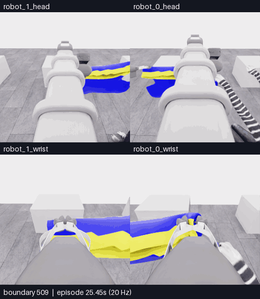

509~611경계 · 103프레임 · 20.6초 반복 · 4배 느리게 · GIF6.20MB. [MP4](assets/20261106-e15-hand-recovery/event.mp4) · [준비·운반·복구 세 구간](20261106-astra-opening264-001.ko.md) · [최종 원인 검토](../collection/reviews/20261106-astra-opening264-001.ko.md) · [출처](assets/20261106-e15-hand-recovery/provenance.json)

## E13 · 손목 depth를 보며 진입·복구 반복

**입구와 손의 관계가 끝내 불명확했고 모델이 종료했습니다. depth 추가의 과제 개선 효과는 확인되지 않았습니다.**


700~810경계 · 111프레임 · 22.2초 반복 · 4배 느리게 · GIF5.95MB. [MP4](assets/20261106-astra-hem-depth-001/event.mp4) · [입력·결과 비교](20261106-astra-hem-depth-001.ko.md) · [실제 첫16이미지](../collection/attempts/20261106-astra-hem-depth-001/first-call-images.json) · [출처](assets/20261106-astra-hem-depth-001/provenance.json)

## E12 · 밑단 진입 경로의 두 차례 시도

**평가기의 접촉 범위 조건은 기록됐지만, 손이 테두리를 통과했다는 증거는 확인하지 못했습니다.**


700~781경계 · 82프레임 · 16.4초 반복 · 4배 느리게 · GIF4.69MB. [MP4](assets/20261106-astra-hem-route-001/event.mp4) · [접촉 판정과 진입의 구분](20261106-astra-hem-route-001.ko.md) · [출처](assets/20261106-astra-hem-route-001/provenance.json)

## E11 · 과거 사진으로 가장자리 후보 비교

**모델의 가장자리 설명은 구체화됐지만, 검증된 소매 통과나 추가 득점으로 이어지지는 않았습니다.**


700~777경계 · 78프레임 · 15.6초 반복 · 4배 느리게 · GIF3.96MB. [MP4](assets/20261106-astra-sleeve-history-001/event.mp4) · [E10과 비교](20261106-astra-sleeve-history-001.ko.md) · [출처](assets/20261106-astra-sleeve-history-001/provenance.json)

## E10 · 소매를 찾기 위한 자세·시야 조정

**들기·펼치기·기울이기를 바꿨지만 소매와 손의 관계를 확인하지 못하고 종료했습니다.**


700~750경계 · 51프레임 · 10.2초 반복 · 4배 느리게 · GIF2.54MB. [MP4](assets/20261106-astra-sleeve-branch700-003/event.mp4) · [결과·실패 원인](20261106-astra-sleeve-branch700-003.ko.md) · [출처](assets/20261106-astra-sleeve-branch700-003/provenance.json)

선택 구간 안에서는 프레임을 생략하거나 시간 보간하지 않았습니다. 20Hz 관측을5fps로 재생하며 모델 응답 대기는 포함하지 않습니다. [영상 내보내기·정확한 경계 매핑](EVENT_EXPORT.ko.md)

<details>
<summary>E14 · 두 번의 이동 뒤 추가 중립 경로를 확인한 짧은 진단</summary>

## E14 · 두 번의 이동 뒤 추가 중립, 새 준비 방향으로 전환

**짧은 제어 진단 · 5/50 · 첫 소매 0 · 착의 `success=false` · 721/721전이 검사 통과.** 두 모델 이동 뒤 제어기가 중립 대기를 추가하는 경로를 확인하고, 더 이른 입구 준비를 시도하기 위해 감독 프로세스가 중단했습니다. 완주한 과제 성능 비교나 정착 효과 검증 결과로 해석하지 않습니다.


**새 구간 전체 700~721경계 · 22프레임 · 4.4초 반복 · 4배 느리게 · GIF 1.07MB.** 새 물리 진행 1.05초는 모델 이동 8전이, 제어기 중립 12전이, 종료 정리 1전이입니다. 3회 모델 호출 중 2개 결정만 적용했고, 중단 뒤 마지막 반환 행동은 폐기했습니다. 적용된 두 행동은 이동 베이스만 사용해 리프트·손목 목표 추종 개선은 시험하지 않았습니다. 공식 점수율 상태는 `no_contact / null`입니다.

[**정확한 행동 출처·중단 이유·E13 비교·다음 E15 계획**](20261106-astra-hem-settle-001.ko.md) · [새 구간 MP4](assets/20261106-astra-hem-settle-001/event.mp4) · [전체 기록](../collection/attempts/20261106-astra-hem-settle-001/README.ko.md) · [영상 출처](assets/20261106-astra-hem-settle-001/provenance.json)

</details>

<details>
<summary>이전 기록 · E07 공동 운반, E05 픽업, 사람 조작과 연결 시험</summary>

## 참고 영상 · E07의 평평한 옷에서 초기 들기까지

아래는 **이전 E07의 참고 영상**이며 E11의 새 행동이나 새 득점이 아닙니다. 테이블 위 옷의 전체 외곽과 들어 올린 가장자리의 연결을 비교합니다. E11 actor에는 이 원본 영상을 복사하지 않았으며, E11의 새 재실행 264·320경계에서 직접 얻은 카메라 사진을 제공했습니다.


**원본 E07 264~320경계 · 57프레임 · 11.4초 반복 · 4배 느리게 · GIF 3.08MB.** V형 무늬가 있는 쪽과 넓은 반대편 가장자리의 위치를 추적할 수 있습니다. 잡은 구멍이 소매인지 밑단인지에 대한 판단은 영상에서 추론하며 내부 기하로 확인한 정답 라벨이 아닙니다.

[참고 구간 MP4](assets/20261106-e07-flat-to-lift/event.mp4) · [출처·변환 근거](assets/20261106-e07-flat-to-lift/provenance.json) · [E11 입력 비교와 실행 조건](../project/sessions/20261106-resume10.ko.md)

## E07 · 양쪽 머리·손목으로 보는 손 근처 접근

**같은 시각의 네 카메라를 함께 봅니다.** 위쪽은 로봇 0·1의 머리, 아래쪽은 로봇 0·1의 손목입니다. 옷과 각 그리퍼, 마네킹 손의 관계를 overview보다 가까이 확인할 수 있습니다.


**자동 반복 16.2초 · 경계 620~700 · 81프레임 · 5fps · 4배 느리게 · 약 4.58MB.** 선택 구간의 모든 원본 프레임을 유지했습니다. 카메라당 원본 256×256, 합성 화면 512×588이며 이름·전이 경계·상대 시간은 영상 바깥 띠에 표시합니다.

[**네 카메라 16.2초 MP4 열기**](assets/20261106-astra-coordinated-fresh-001-multiview/event.mp4) · [원본 SHA·정확한 경계·변환 조건](assets/20261106-astra-coordinated-fresh-001-multiview/provenance.json) · [사건 영상 내보내기](EVENT_EXPORT.ko.md)

**이 영상은 기존 E07의 접근 구간입니다. 새 시도나 소매 성공 영상이 아닙니다.** 아래의 더 긴 overview는 경계 356~700, 전체 원본 MP4는 1,067프레임을 보여 줍니다. 같은 실행의 다른 보기이므로 독립 시연으로 추가 집계하지 않습니다.

## E07 · 공동 운반과 손 근처 접근

**관측한 사건:** 픽업 첫 5점 경계 → 손목 회전·천 감김 → 반대 회전 복구 → 함께 회전·전진 → 마네킹 손 근처 접근.


**자동 반복 69.0초 · 경계 356~700 · 345프레임 · 5fps · 4배 느리게.** 약 6.25MB. 전체 1,067프레임 중 일부이며 선택 구간 내부의 프레임 생략은 없습니다. 이 GIF에는 이후 소매 진입 시도가 포함되지 않습니다.

[**전체 213.4초 MP4 열기**](../collection/attempts/20261106-astra-coordinated-fresh-001/overview.mp4) · [구간·행동·원본 관측](20261106-astra-coordinated-fresh-001.ko.md) · [정확한 득점·접근 프레임](../collection/milestones/20261106-astra-coordinated-fresh-001/README.ko.md) · [GIF 변환 출처](assets/20261106-astra-coordinated-fresh-001/provenance.json)

**결과:** 공식 원점수 5/50, 착의 `success=false`, 최종 점수율 0 points/s. 양쪽 손끝 가까이에 옷을 유지하며 이동하는 모습은 확인했지만, 이 점수나 영상이 지속적인 양쪽 파지·소매 통과를 인증하지는 않습니다. 이후 소매 의도 24개 구간·254전이의 모델 판단은 모두 `uncertain`이었습니다. [종료 검토](../collection/reviews/20261106-astra-coordinated-fresh-001.ko.md)

## E05 · 파지 실패에서 재파지·픽업 5점까지

**관측한 사건:** 로봇 0 접근 → 첫 파지 실패 → 재접근·닫기 → 들기·유지 → 픽업 5점 확인 후 종료.


**자동 반복 50.6초 · 전체 253프레임 · 5fps · 4배 느리게.** 약 4.08MB. 원본 물리 진행은 12.65초입니다.

[**전체 50.6초 MP4 열기**](../collection/attempts/20261106-astra-pickup-hold5-001/overview.mp4) · [시간대별 행동·원본 관측](20261106-astra-pickup-hold5-001.ko.md) · [첫 5점 경계 246](../collection/milestones/20261106-astra-pickup-hold5-001/README.ko.md) · [GIF 변환 출처](assets/20261106-astra-pickup-hold5-001/provenance.json)

**결과:** 공식 원점수 5/50, 착의 `success=false`. 로봇 0만 옷자락을 들었으며 두 로봇의 협력 들기 시연은 아닙니다. 공식 유지 시간은 3.35초이며 프롬프트의 5초 목표와 구분합니다. [종료 검토](../collection/reviews/20261106-astra-pickup-hold5-001.ko.md)

## 사람 시연 · 양쪽 파지와 운반

**관측한 사건:** 두 로봇 접근 → 양쪽 파지·들기 → 마네킹 방향 운반. 사람이 조작한 고정 연습 배치의 부분 시연입니다.


**자동 반복 33.0초 · 640×453 · 4fps.** 약 4.82MB. 원본 기록을 재생해 렌더링한 편집 영상이며 구간별 배속이 다릅니다.

[**33.08초 MP4 열기**](../videos/20261026-human-pickup-transport.mp4) · [장면·제어 출처](20261026-human-pickup-transport.ko.md) · [GIF 변환 출처](assets/20261026-human-pickup-transport/provenance.json)

**결과:** 공식 점수·전체 착의 성공 미확인. E05·E07과 동일한 평가 조건의 비교 표본으로 집계하지 않습니다.

## 첫 착의 시도 · 접근과 파지 미확인

**관측한 사건:** 접근 → 그리퍼 닫기 → 작은 시험 들기 → 재정렬. 실패 과정도 함께 보존합니다.


**자동 반복 33.4초 · 전체 167프레임 · 5fps · 4배 느리게.** 물리 진행 8.35초, 완료 판단 15개입니다.

[**전체 33.4초 MP4 열기**](../collection/attempts/20261106-astra-dressing-001/overview.mp4) · [관측·최종 행동](20261106-astra-dressing-001.ko.md) · [GIF 변환 출처](assets/20261106-astra-dressing-001/provenance.json)

**결과:** 공식 0/50점, 착의 `success=false`. 파지 성공은 확인하지 못했습니다.

## 연결 시험 · 작은 움직임·정지·종료

다음 두 영상은 과제 시연과 구분한 연결 시험입니다. 물리 진행은 각각 3전이·0.15초이며 20배 느리게 표시합니다. 파지·착의를 시도한 자료가 아닙니다.

| 비교 | r5 · 세 번 판단 | plan3 · 한 번 판단 |
|---|---|---|
| 모델 호출 | 3회 | 1회 |
| 적용 구간 | 작은 리프트 → 정지 → 종료 | 한 응답에서 미리 계획한 작은 리프트 → 정지 → 종료 |
| 공식 결과 | 0/50 · `success=false` | 0/50 · `success=false` |

**r5 · 세 번 판단한 연결 시험**


자동 반복 3초 · 1fps. [MP4 열기](../collection/attempts/20261106-codex-robot-wiring-r5/overview.mp4) · [세 응답·시작과 종료](20261106-codex-robot-wiring-r5.ko.md) · [GIF 출처](assets/20261106-codex-robot-wiring-r5/provenance.json)

**plan3 · 한 응답에 담은 세 행동**


자동 반복 3초 · 1fps. [MP4 열기](../collection/attempts/20261106-exec-plan3-wiring-001/overview.mp4) · [실제 행동 목록](20261106-exec-plan3-wiring-001.ko.md) · [GIF 출처](assets/20261106-exec-plan3-wiring-001/provenance.json)

plan3는 중간 관측으로 다시 판단하는 조건부 계획이 아닙니다. 이 두 연결 시험만으로 착의 성능이나 일반적인 호출 효율 향상을 주장하지 않습니다.

</details>

</details>

</details>


</details>

</details>

</details>

</details>

</details>

</details>


</details>
