# 시연 갤러리 · 사건별로 보고 비교하기

[저장소 소개](../../README.md) · [상세 수집 기록](../collection/README.ko.md) · [현재 작업 상태](../project/STATUS.md)

**영상을 클릭하거나 전체화면으로 전환하지 않고, 아래로 스크롤하며 실제 시도를 비교할 수 있습니다.** 각 큰 화면은 자동 반복 GIF입니다. 재생 위치를 직접 이동하려면 화면 아래의 전체 MP4를 여세요. 원본 카메라가 256×256인 AI 영상은 크게 표시해도 원본보다 세부 정보가 늘어나지는 않습니다.

현재 게시된 과제 영상의 최고 원점수는 **5/50**입니다. E05는 한 로봇 픽업, E07은 두 로봇의 공동 지지·운반을 관측한 별도 시도이며, 두 시도 모두 전체 착의 `success=false`입니다. **첫 소매 추가 5점은 아직 확인하지 못했습니다.** 새 실행은 득점·진전·실패·복구처럼 확인할 사건이 생겼을 때 실제 기록을 추가합니다.

| 비교 항목 | E05 · 한 로봇 픽업 | E07 · 공동 지지·운반 |
|---|---|---|
| 실제 관측 | 파지 실패 → 재파지 → 들기·유지 | 공동 들기 → 손목 감김·복구 → 회전·운반 → 손 근처 접근 |
| 공식 원점수 / 착의 성공 | 5/50 · `false` | 5/50 · `false` |
| 아래 반복 영상 범위 | 전체 253프레임 | 선택 경계 356~700 · 345프레임 |
| 표시 재생 시간 / 배속 | 50.6초 · 4배 느리게 | 69.0초 · 4배 느리게 |
| 전체 기록 물리 시간 | 12.65초 | 53.35초 |
| 전체 실제 경과 시간 | 13분 48.3초 | 83분 54초 |
| 종료 이유 | 당시 첫 5점 감시 조건 충족 | 80개 행동 구간 예산 소진 |
| 미확인 과제 | 협력 들기·소매 통과 | 소매 통과 |

같은 원점수여도 관측한 과정과 종료 이유가 다릅니다. 두 실행은 시작 조건·목표·예산이 달라 통제된 성능 비교가 아닙니다. 아래 영상 재생 시간에는 모델 응답 대기가 포함되지 않습니다.

## 최신 E14 · 두 번의 이동 뒤 추가 중립, 새 준비 방향으로 전환

**짧은 제어 진단 · 5/50 · 첫 소매 0 · 착의 `success=false` · 721/721전이 검사 통과.** 두 모델 이동 뒤 제어기가 중립 대기를 추가하는 경로를 확인하고, 더 이른 입구 준비를 시도하기 위해 감독 프로세스가 중단했습니다. 완주한 과제 성능 비교나 정착 효과 검증 결과로 해석하지 않습니다.

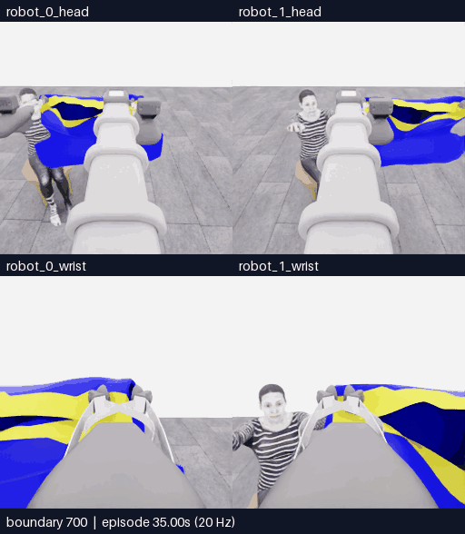

**새 구간 전체 700~721경계 · 22프레임 · 4.4초 반복 · 4배 느리게 · GIF 1.07MB.** 새 물리 진행 1.05초는 모델 이동 8전이, 제어기 중립 12전이, 종료 정리 1전이입니다. 3회 모델 호출 중 2개 결정만 적용했고, 중단 뒤 마지막 반환 행동은 폐기했습니다. 적용된 두 행동은 이동 베이스만 사용해 리프트·손목 목표 추종 개선은 시험하지 않았습니다. 공식 점수율 상태는 `no_contact / null`입니다.

[**정확한 행동 출처·중단 이유·E13 비교·다음 E15 계획**](20261106-astra-hem-settle-001.ko.md) · [새 구간 MP4](assets/20261106-astra-hem-settle-001/event.mp4) · [전체 기록](../collection/attempts/20261106-astra-hem-settle-001/README.ko.md) · [영상 출처](assets/20261106-astra-hem-settle-001/provenance.json)

## E13 · 현재 손목 depth 추가, 진입·복구 반복 뒤 모델 종료

**5/50 · 첫 소매 0 · 착의 `success=false` · 810/810전이 검사 통과.** 현재 양쪽 손목 depth 패널을 추가하고 앞·왼쪽 정렬, 내려보기, 팔 신장·형태 복구를 반복했습니다. 손의 테두리 통과는 확인하지 못했고 모델이 18번째 판단에서 `blocked`로 종료했습니다.

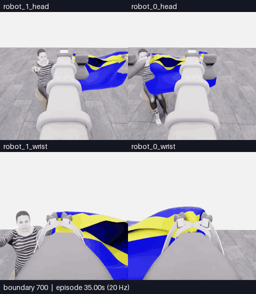

**새 구간 전체 700~810경계 · 111프레임 · 22.2초 반복 · 4배 느리게 · GIF 5.95MB.** 새 물리 진행 5.50초는 모델의 16개 움직임과 6전이 중립 대기로 구성됩니다. 18회 호출 뒤 종료 판단이 파일을 정상 마감했으며 SIGTERM·별도 종료 중립 전이는 없습니다. 첫 접촉 범위 판정은 에피소드 상대 35.8125초로 20Hz 경계와 정확히 일치하지 않으며, 손 진입이나 프로젝트 최초 성과를 뜻하지 않습니다. 최종 점수율은 `no_dressing_points / 0 points/s`입니다.

첫 호출의 실제 16장은 **현재 RGB 5장 + 이번 재실행의 과거 RGB 10장 + 현재 손목 depth 패널 1장**입니다. 이후에는 현재 RGB 5장과 depth 패널 1장을 전달했습니다. E12와 다른 행동이 나왔지만 추가 입력의 과제 개선 효과는 확인하지 못했습니다.

[**E12와 비교·실제 depth 입력·실패와 종료**](20261106-astra-hem-depth-001.ko.md) · [새 구간 MP4](assets/20261106-astra-hem-depth-001/event.mp4) · [첫 호출 실제 16이미지](../collection/attempts/20261106-astra-hem-depth-001/first-call-images.json) · [전체 기록](../collection/attempts/20261106-astra-hem-depth-001/README.ko.md) · [영상 출처](assets/20261106-astra-hem-depth-001/provenance.json)

## E12 · 밑단 진입 시도, 접촉 범위 판정 뒤에도 5점 유지

**5/50 · 첫 소매 0 · 착의 `success=false` · 781/781전이 검사 통과.** 몸통의 밑단 입구로 손을 넣는 경로를 시도했습니다. 평가기의 충돌 메시 접촉 범위 조건은 충족했지만, 두 차례 진입 시도와 복구 뒤에도 손이 입구를 통과했다는 증거는 확인하지 못했습니다.

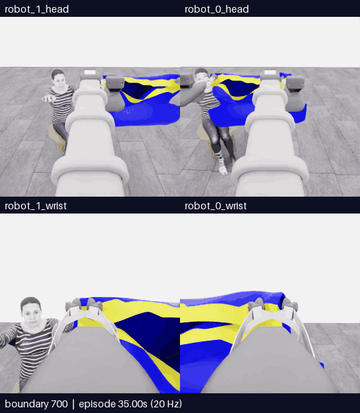

**새 구간 전체 700~781경계 · 82프레임 · 16.4초 반복 · 4배 느리게 · GIF 4.69MB.** 새 물리 진행 4.05초는 모델 행동 80전이와 종료 중립 1전이입니다. 첫 접촉 범위 판정은 에피소드 상대 36.65초, 733경계이며 실제 solver 접촉·손 진입의 증명은 아닙니다. E07에도 접촉 판정이 있어 최초 성과로 집계하지 않습니다. 최종 점수율은 `no_dressing_points / 0 points/s`로 E10·E11의 `no_contact / null`과 구분합니다.

[**E10·E11 비교·진입 실패·종료 경위**](20261106-astra-hem-route-001.ko.md) · [새 구간 MP4](assets/20261106-astra-hem-route-001/event.mp4) · [첫 호출 실제 15이미지](../collection/attempts/20261106-astra-hem-route-001/first-call-images.json) · [전체 기록](../collection/attempts/20261106-astra-hem-route-001/README.ko.md) · [영상 출처](assets/20261106-astra-hem-route-001/provenance.json)

## E11 · 과거 관측으로 소매 후보를 구분했지만 5점 유지

**5/50 · 첫 소매 0 · 착의 `success=false` · 777/777전이 검사 통과.** 이번 재실행의 초기 옷 사진을 추가하자 모델은 밑단과 측면 소매 후보를 구분해 설명했습니다. 그러나 11개 완료 행동 구간에서 손 통과·추가 득점은 확인하지 못했고, 감독 프로세스가 비교 구간을 종료했습니다. 표현의 구체화와 검증된 물리적 개선은 별개입니다.

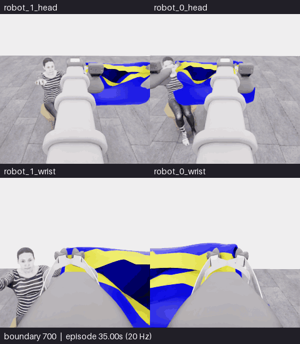

**새 구간 전체 700~777경계 · 78프레임 · 15.6초 반복 · 4배 느리게 · GIF 3.96MB.** 새 물리 진행 3.85초는 모델 행동 76전이와 종료 중립 1전이를 포함합니다. E10과 같은 카메라 배치이며 모델 대기는 제외합니다. 점수율은 `no_contact / null`로, 0점/초가 아닙니다.

[**E10과의 비교·실패 원인·정확한 종료 경위**](20261106-astra-sleeve-history-001.ko.md) · [새 구간 MP4](assets/20261106-astra-sleeve-history-001/event.mp4) · [전체 기록](../collection/attempts/20261106-astra-sleeve-history-001/README.ko.md) · [영상 출처](assets/20261106-astra-sleeve-history-001/provenance.json)

## E10 · 5→10점 시도, 소매 식별 실패로 종료

**5/50 유지 · 첫 소매 0 · 새 8개 움직임 후 9번째 판단에서 종료.** 자세·시야 조정을 반복했으나 소매와 손의 관계를 확인하지 못했습니다. 750/750전이 기술 검사 통과와 착의 실패를 구분합니다.

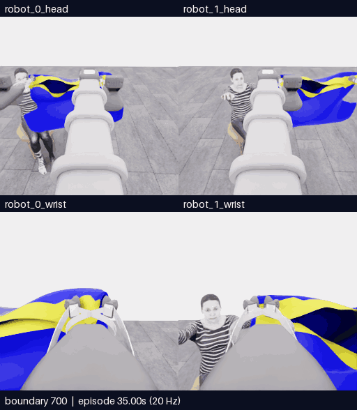

**새 구간 전체 700~750경계 · 10.2초 반복 · 4배 느리게 · GIF 2.54MB.** 모델 대기 제외, 새 물리 진행 2.50초. 아래 E07과 같은 카메라 배치입니다.

[**결과·실패 원인·다음 비교 방법**](20261106-astra-sleeve-branch700-003.ko.md) · [새 구간 MP4](assets/20261106-astra-sleeve-branch700-003/event.mp4) · [전체 기록](../collection/attempts/20261106-astra-sleeve-branch700-003/README.ko.md) · [변환 근거](assets/20261106-astra-sleeve-branch700-003/provenance.json)

## 참고 영상 · E07의 평평한 옷에서 초기 들기까지

아래는 **이전 E07의 참고 영상**이며 E11의 새 행동이나 새 득점이 아닙니다. 테이블 위 옷의 전체 외곽과 들어 올린 가장자리의 연결을 비교합니다. E11 actor에는 이 원본 영상을 복사하지 않았으며, E11의 새 재실행 264·320경계에서 직접 얻은 카메라 사진을 제공했습니다.

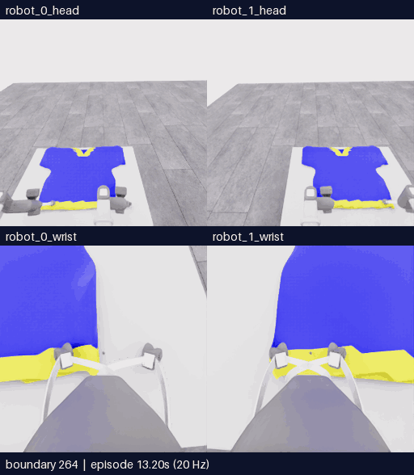

**원본 E07 264~320경계 · 57프레임 · 11.4초 반복 · 4배 느리게 · GIF 3.08MB.** V형 무늬가 있는 쪽과 넓은 반대편 가장자리의 위치를 추적할 수 있습니다. 잡은 구멍이 소매인지 밑단인지에 대한 판단은 영상에서 추론하며 내부 기하로 확인한 정답 라벨이 아닙니다.

[참고 구간 MP4](assets/20261106-e07-flat-to-lift/event.mp4) · [출처·변환 근거](assets/20261106-e07-flat-to-lift/provenance.json) · [E11 입력 비교와 실행 조건](../project/sessions/20261106-resume10.ko.md)

## E07 · 양쪽 머리·손목으로 보는 손 근처 접근

**같은 시각의 네 카메라를 함께 봅니다.** 위쪽은 로봇 0·1의 머리, 아래쪽은 로봇 0·1의 손목입니다. 옷과 각 그리퍼, 마네킹 손의 관계를 overview보다 가까이 확인할 수 있습니다.

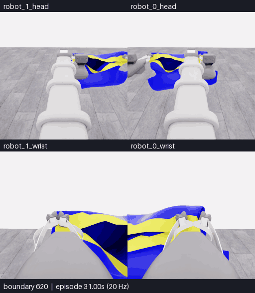

**자동 반복 16.2초 · 경계 620~700 · 81프레임 · 5fps · 4배 느리게 · 약 4.58MB.** 선택 구간의 모든 원본 프레임을 유지했습니다. 카메라당 원본 256×256, 합성 화면 512×588이며 이름·전이 경계·상대 시간은 영상 바깥 띠에 표시합니다.

[**네 카메라 16.2초 MP4 열기**](assets/20261106-astra-coordinated-fresh-001-multiview/event.mp4) · [원본 SHA·정확한 경계·변환 조건](assets/20261106-astra-coordinated-fresh-001-multiview/provenance.json) · [사건 영상 내보내기](EVENT_EXPORT.ko.md)

**이 영상은 기존 E07의 접근 구간입니다. 새 시도나 소매 성공 영상이 아닙니다.** 아래의 더 긴 overview는 경계 356~700, 전체 원본 MP4는 1,067프레임을 보여 줍니다. 같은 실행의 다른 보기이므로 독립 시연으로 추가 집계하지 않습니다.

## E07 · 공동 운반과 손 근처 접근

**관측한 사건:** 픽업 첫 5점 경계 → 손목 회전·천 감김 → 반대 회전 복구 → 함께 회전·전진 → 마네킹 손 근처 접근.

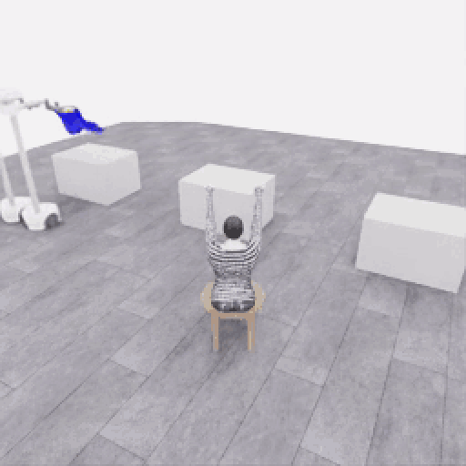

**자동 반복 69.0초 · 경계 356~700 · 345프레임 · 5fps · 4배 느리게.** 약 6.25MB. 전체 1,067프레임 중 일부이며 선택 구간 내부의 프레임 생략은 없습니다. 이 GIF에는 이후 소매 진입 시도가 포함되지 않습니다.

[**전체 213.4초 MP4 열기**](../collection/attempts/20261106-astra-coordinated-fresh-001/overview.mp4) · [구간·행동·원본 관측](20261106-astra-coordinated-fresh-001.ko.md) · [정확한 득점·접근 프레임](../collection/milestones/20261106-astra-coordinated-fresh-001/README.ko.md) · [GIF 변환 출처](assets/20261106-astra-coordinated-fresh-001/provenance.json)

**결과:** 공식 원점수 5/50, 착의 `success=false`, 최종 점수율 0 points/s. 양쪽 손끝 가까이에 옷을 유지하며 이동하는 모습은 확인했지만, 이 점수나 영상이 지속적인 양쪽 파지·소매 통과를 인증하지는 않습니다. 이후 소매 의도 24개 구간·254전이의 모델 판단은 모두 `uncertain`이었습니다. [종료 검토](../collection/reviews/20261106-astra-coordinated-fresh-001.ko.md)

## E05 · 파지 실패에서 재파지·픽업 5점까지

**관측한 사건:** 로봇 0 접근 → 첫 파지 실패 → 재접근·닫기 → 들기·유지 → 픽업 5점 확인 후 종료.

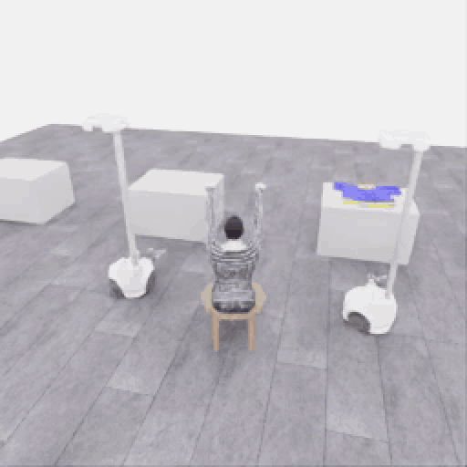

**자동 반복 50.6초 · 전체 253프레임 · 5fps · 4배 느리게.** 약 4.08MB. 원본 물리 진행은 12.65초입니다.

[**전체 50.6초 MP4 열기**](../collection/attempts/20261106-astra-pickup-hold5-001/overview.mp4) · [시간대별 행동·원본 관측](20261106-astra-pickup-hold5-001.ko.md) · [첫 5점 경계 246](../collection/milestones/20261106-astra-pickup-hold5-001/README.ko.md) · [GIF 변환 출처](assets/20261106-astra-pickup-hold5-001/provenance.json)

**결과:** 공식 원점수 5/50, 착의 `success=false`. 로봇 0만 옷자락을 들었으며 두 로봇의 협력 들기 시연은 아닙니다. 공식 유지 시간은 3.35초이며 프롬프트의 5초 목표와 구분합니다. [종료 검토](../collection/reviews/20261106-astra-pickup-hold5-001.ko.md)

## 사람 시연 · 양쪽 파지와 운반

**관측한 사건:** 두 로봇 접근 → 양쪽 파지·들기 → 마네킹 방향 운반. 사람이 조작한 고정 연습 배치의 부분 시연입니다.

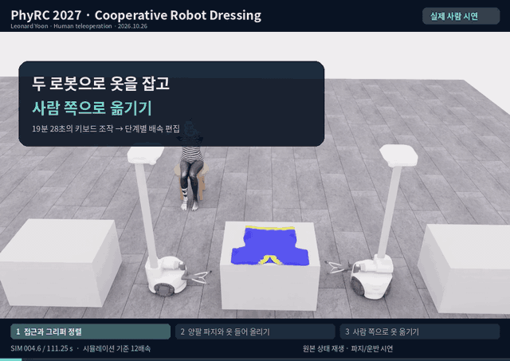

**자동 반복 33.0초 · 640×453 · 4fps.** 약 4.82MB. 원본 기록을 재생해 렌더링한 편집 영상이며 구간별 배속이 다릅니다.

[**33.08초 MP4 열기**](../videos/20261026-human-pickup-transport.mp4) · [장면·제어 출처](20261026-human-pickup-transport.ko.md) · [GIF 변환 출처](assets/20261026-human-pickup-transport/provenance.json)

**결과:** 공식 점수·전체 착의 성공 미확인. E05·E07과 동일한 평가 조건의 비교 표본으로 집계하지 않습니다.

## 첫 착의 시도 · 접근과 파지 미확인

**관측한 사건:** 접근 → 그리퍼 닫기 → 작은 시험 들기 → 재정렬. 실패 과정도 함께 보존합니다.

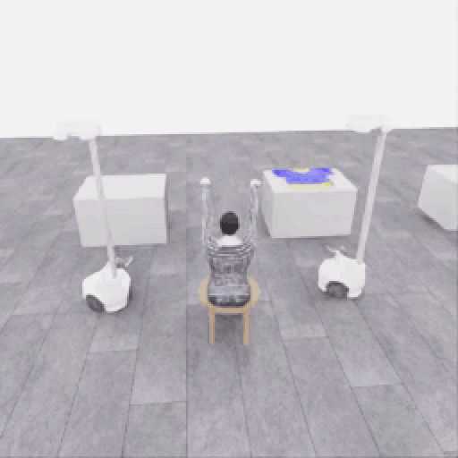

**자동 반복 33.4초 · 전체 167프레임 · 5fps · 4배 느리게.** 물리 진행 8.35초, 완료 판단 15개입니다.

[**전체 33.4초 MP4 열기**](../collection/attempts/20261106-astra-dressing-001/overview.mp4) · [관측·최종 행동](20261106-astra-dressing-001.ko.md) · [GIF 변환 출처](assets/20261106-astra-dressing-001/provenance.json)

**결과:** 공식 0/50점, 착의 `success=false`. 파지 성공은 확인하지 못했습니다.

## 연결 시험 · 작은 움직임·정지·종료

다음 두 영상은 과제 시연과 구분한 연결 시험입니다. 물리 진행은 각각 3전이·0.15초이며 20배 느리게 표시합니다. 파지·착의를 시도한 자료가 아닙니다.

| 비교 | r5 · 세 번 판단 | plan3 · 한 번 판단 |
|---|---|---|
| 모델 호출 | 3회 | 1회 |
| 적용 구간 | 작은 리프트 → 정지 → 종료 | 한 응답에서 미리 계획한 작은 리프트 → 정지 → 종료 |
| 공식 결과 | 0/50 · `success=false` | 0/50 · `success=false` |

**r5 · 세 번 판단한 연결 시험**

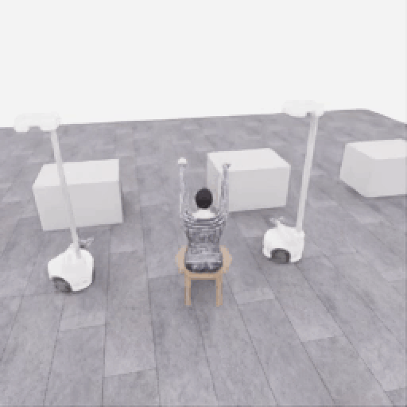

자동 반복 3초 · 1fps. [MP4 열기](../collection/attempts/20261106-codex-robot-wiring-r5/overview.mp4) · [세 응답·시작과 종료](20261106-codex-robot-wiring-r5.ko.md) · [GIF 출처](assets/20261106-codex-robot-wiring-r5/provenance.json)

**plan3 · 한 응답에 담은 세 행동**

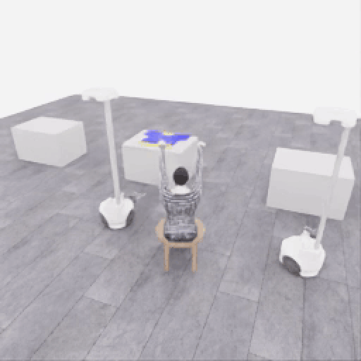

자동 반복 3초 · 1fps. [MP4 열기](../collection/attempts/20261106-exec-plan3-wiring-001/overview.mp4) · [실제 행동 목록](20261106-exec-plan3-wiring-001.ko.md) · [GIF 출처](assets/20261106-exec-plan3-wiring-001/provenance.json)

plan3는 중간 관측으로 다시 판단하는 조건부 계획이 아닙니다. 이 두 연결 시험만으로 착의 성능이나 일반적인 호출 효율 향상을 주장하지 않습니다.

## 새 사건을 추가하는 기준

새 득점, 파지 상실, 복구, 소매 접근의 변화, 실행 종료를 확인하면 **실제로 저장한 해당 구간**을 이 페이지에 추가합니다. 사건마다 실행 ID·카메라·전이 범위·배속·공식 평가 상태·원본 링크를 함께 남깁니다. 중간 기록은 중간 결과로 표시하고, 최종 평가와 파일 검사는 종료 뒤 갱신합니다. 소매 통과나 10점은 별도 평가로 확인된 뒤 게시하며, 같은 실행의 여러 클립을 독립 시연으로 세지 않습니다.

<!-- 새 사건 게시 양식: 실제 미디어와 출처 확인 후 이 주석 위의 적절한 위치에 추가.
## 실행 ID · 관측한 사건
**관측한 사건:** 공개 관측에서 확인한 변화. 모델의 판단은 별도로 표시.

자동 반복 길이 · 카메라 · 전이 경계 · 프레임 수 · fps · 배속 · 선택 구간 여부.
[MP4 열기](실제 상대경로) · [관측·행동](실제 상대경로) · [출처](실제 상대경로)
**결과:** 확인 시점·중간/최종·원점수·success·기술 검사 상태. 미확인 값은 미확인으로 유지.
-->
