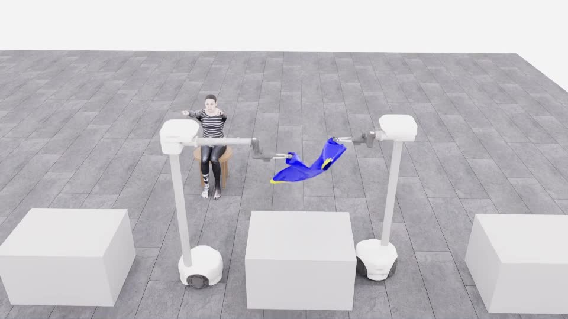
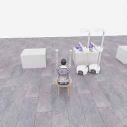
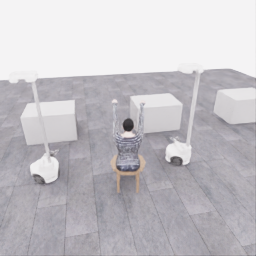
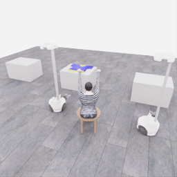

# 공개 시연 갤러리

[저장소 소개](../../README.md) · [상세 수집 기록](../collection/README.ko.md)

두 로봇이 옷에 접근하고, 잡고, 옮기는 실제 기록을 영상과 장면으로 살펴봅니다. 사람의 부분 시연, Astra의 과제 시도, 짧은 연결 시험을 각각 표시했습니다. 이 갤러리는 참가자 저장소의 공개 기록입니다.

| 보기 | 제어 | 확인한 과정 | 평가 상태 |
|---|---|---|---|
| [사람의 파지·들기·운반](20261026-human-pickup-transport.ko.md) | 사람이 두 로봇을 조작 | 고정 연습 배치의 접근 → 양쪽 파지 → 들기 → 운반 | 공식 점수·전체 착의 성공 미확인 |
| [Astra의 접근·파지 시도](20261106-astra-dressing-001.ko.md) | `gpt-6-astra` / `ultra` | 접근 → 닫기 → 시험 들기 → 다시 접근 | 공식 0/50점 · `success=false` |
| [Astra의 작은 움직임·정지](20261106-codex-robot-wiring-r5.ko.md) | `gpt-6-astra` / `ultra` | 작은 리프트 명령 → 정지 → 종료 | 연결 시험 · 공식 0/50점 · `success=false` |
| [한 응답에 담은 세 행동](20261106-exec-plan3-wiring-001.ko.md) | `gpt-6-astra` / `ultra`, 모델 1호출 | 한 목록의 작은 리프트 명령 → 정지 → 종료 | 연결 시험 · 공식 0/50점 · `success=false` |

## 사람의 파지·들기·운반

**[▶ 33.08초 영상](../videos/20261026-human-pickup-transport.mp4)** · [장면과 과정 보기](20261026-human-pickup-transport.ko.md)

옷을 양쪽에서 잡아 들어 올리고 마네킹 쪽으로 운반한 부분 시연입니다. 원본 기록을 재생해 렌더링한 편집 영상이며 구간별 배속이 다릅니다. 공식 점수와 전체 착의 성공은 확인하지 않았습니다.

## Astra의 접근·파지 시도

**[▶ 33.4초 영상](../collection/attempts/20261106-astra-dressing-001/overview.mp4)** · [원본 관측과 짧은 행동 응답 보기](20261106-astra-dressing-001.ko.md)

15개 완료 판단에서 접근·그리퍼 닫기·작은 시험 들기·재정렬을 시도했습니다. 파지 성공은 확인되지 않았으며 공식 결과는 **0점·success=false**입니다. 8.35초의 물리 진행을 **4배 느리게** 보여 줍니다.

## Astra의 작은 움직임·정지

**[▶ 3초 영상](../collection/attempts/20261106-codex-robot-wiring-r5/overview.mp4)** · [세 응답과 시작·종료 화면 보기](20261106-codex-robot-wiring-r5.ko.md)

모델의 행동 응답을 로봇에 전달하고 정지·종료하는 연결 시험입니다. 3전이·0.15초의 물리 진행을 **20배 느리게** 보여 주며, 움직임이 매우 작습니다. 파지나 착의를 시도한 자료가 아닙니다.

## 한 응답에 담은 세 행동

**[▶ 3초 영상](../collection/attempts/20261106-exec-plan3-wiring-001/overview.mp4)** · [한 번에 받은 행동 목록 보기](20261106-exec-plan3-wiring-001.ko.md)

모델 호출 1회에서 세 구간을 미리 받아 적용했습니다. 총 3전이·0.15초를 **20배 느리게** 보여 주는 연결 시험이며, 중간 관측을 보고 다시 판단하는 조건부 계획은 아닙니다.

각 영상의 배속은 시뮬레이션 시간 기준입니다. 모델 응답을 기다린 실제 시간은 Astra 영상에 포함되지 않습니다. 자료별 페이지에 원본 화면과 출처를 연결했으며, 재현·분석은 [상세 수집 기록](../collection/README.ko.md)에서 확인할 수 있습니다.
