# PhyRC 2027 · 시연 영상 보관함

시연 36까지의 기록을 최신순으로 볼 수 있습니다. 페이지에서 재생되는 GIF는 640×345이며, 왼쪽에는 전체 장면, 오른쪽에는 R1과 R0의 머리·손목 카메라를 배치했습니다.

[시연 계획으로 돌아가기](../../README.md) · [시연 분석](#시연-분석) · [시연 영상](#시연-영상)

## 시연 분석

### 시연 33–36 결과

| 시연 | 시작 슬롯 | 방법 | 종료 전이 | 로컬 평가 |
| --- | --- | --- | --- | --- |
| [36](#시연-36) | 시연 25의 1,200전이 | 실제 소매 출구 옆의 파란 천으로 팔꿈치 쪽을 유도 | 269 | 0/50 · 착의 성공 `false` |
| [35](#시연-35) | 시연 25의 1,200전이 | 바깥 노란 밑단을 잡고 전완을 따라 유도 | 263 | 0/50 · 착의 성공 `false` |
| [34](#시연-34) | 시연 26의 2,905전이 종료 슬롯 사용 계획 | 목·어깨 착의 | 종료 기록 미확인 | 미확인 |
| [33](#시연-33) | 시연 25의 1,200전이 슬롯 사용 계획 | 양팔 착의 후 목·어깨 진행 | 종료 기록 미확인 | 미확인 |

시연 35·36은 같은 슬롯에서 복원·정착한 뒤 각각 새 0전이부터 기록했습니다. 35에서는 노란 밑단과 파란 몸판의 주름이, 36에서는 집게 옆 파란 경계가 움직였습니다. 마지막 관측에서 손끝이나 소매 출구가 가려져 두 방법 모두 **같은 소매 끝이 팔꿈치 너머에 도달했는지 미확인**입니다. 두 회차의 로컬 평가는 유효했고 HDF5 전수 기술 검증을 통과했습니다. 다음 시연 37·38은 이 두 접근을 이어가면서 손끝과 소매 출구를 함께 확인합니다. [종료 관찰과 후속 계획](../active/20261127-demo37-38-plan.ko.md)

### 이전 시연 분석

시연 28–32는 완료된 기록과 최종 평가를 검증했습니다. 시연 32는 시연 31과 같은 시작점 및 프롬프트로 반복했습니다. 시연 25–27은 로컬 평가에서 각각 5/50점을 기록했습니다.

| 분석 | 확인할 내용 |
|---|---|
| [시연 33·34 동시 실행 계획](../active/20261127-demo33-34-plan.ko.md) | 예정 시작 슬롯, 저장 경계와 동시 실행 조건 |
| [시연 26–32 마감과 자료 복원](../active/20261126-demo26-32-handoff.ko.md) | 종료 결과, 반복 출발점, 새 서버에서 자료를 찾는 방법 |
| [시연 25–27 · 체크포인트와 재파지](../active/20261126-demo25-27-analysis.ko.md) | 시연 25·26의 저장 지점, 같은 행동의 재생과 분기 자세 차이, 팔꿈치에서 목·어깨로 이어가기 위한 관찰 기준 |
| [시연 27·28 · 동시 실행 속도 비교](../active/20261126-demo28-concurrency.ko.md) | 연속 재생과 GPT 제어의 부하 차이, 시연 28 단독 실행 대비 전이 속도와 GPT 응답 시간 |
| [시연 24–25 종료](../active/20261126-demo24-25-closeout.ko.md) | 팔꿈치 우선 재파지 두 가지와 원본 보관 |
| [시연 19–23 종료](../active/20261126-demo19-23-closeout.ko.md) | 양팔 착의의 관찰 한계와 구간 집계 |
| [시연 1–20 상세 분석](../active/20261125-demo1-20-analysis.ko.md) | 20개 시연의 소매·어깨 진행과 주요 장면 |

## 시연 영상

| 시연 | 시연 | 시연 | 시연 | 시연 | 시연 |
| --- | --- | --- | --- | --- | --- |
| [시연 36](#시연-36) | [시연 35](#시연-35) | [시연 34](#시연-34) | [시연 33](#시연-33) | [시연 32](#시연-32) | [시연 31](#시연-31) |
| [시연 30](#시연-30) | [시연 29](#시연-29) | [시연 28](#시연-28) | [시연 27](#시연-27) | [시연 26](#시연-26) | [시연 25](#시연-25) |
| [시연 24](#시연-24) | [시연 23](#시연-23) | [시연 22](#시연-22) | [시연 21](#시연-21) | [시연 20](#시연-20) | [시연 19](#시연-19) |
| [시연 18](#시연-18) | [시연 17](#시연-17) | [시연 16](#시연-16) | [시연 15](#시연-15) | [시연 14](#시연-14) | [시연 13](#시연-13) |
| [시연 12](#시연-12) | [시연 11](#시연-11) | [시연 10](#시연-10) | [시연 9](#시연-9) | [시연 8](#시연-8) | [시연 7](#시연-7) |
| [시연 6](#시연-6) | [시연 5](#시연-5) | [시연 4](#시연-4) | [시연 3](#시연-3) | [시연 2](#시연-2) | [시연 1](#시연-1) |

### 시연 36

**소매 가까이에서 팔꿈치로 직접 유도** · 0–269전이 · 로컬 0/50점

시연 25의 1,200전이 슬롯에서 시작했습니다. 반대편은 몸통 밑단을 지지하고 작업 쪽은 소매 출구 옆 파란 천을 겨냥했습니다. 마지막에 집게 옆 파란 경계가 따라 움직였고 손끝이나 소매 출구는 가려졌습니다. 269전이 종료 슬롯을 보존했습니다.

**영상 게시 상태** · GitHub GIF 미게시

### 시연 35

**바깥 밑단으로 팔꿈치 쪽 유도** · 0–263전이 · 로컬 0/50점

시연 25의 1,200전이 슬롯에서 시작했습니다. 작업 쪽 노란 밑단의 바깥 끝을 이용해 전완을 따라 천을 유도했습니다. 마지막에 노란 밑단과 파란 몸판 주름이 움직였습니다. 손끝이나 소매 출구는 가려졌고, 사용자 종료 요청 시점인 263전이에 슬롯을 저장했습니다.

**영상 게시 상태** · GitHub GIF 미게시

### 시연 34

**목·어깨 착의 계획** · 결과 및 영상 미확인

시연 26의 2,905전이 종료 슬롯에서 시작하는 계획입니다. [실행 계획](../active/20261127-demo33-34-plan.ko.md#출발점과-기준)

### 시연 33

**양팔 착의 후 목·어깨 진행 계획** · 결과 및 영상 미확인

시연 25의 1,200전이 슬롯을 복원한 뒤 새 행동 1,146전이를 진행하는 계획입니다. [실행 계획](../active/20261127-demo33-34-plan.ko.md#출발점과-기준)

### 시연 32

**시연 31의 시작 슬롯과 첫 파지 지시로 반복** · 0–302전이 · 0/50점 · 4배속

시연 28의 299전이 슬롯을 다시 불러왔습니다. 종료 직전 왼쪽 턱이 노란 끝 주변에서 닫혔고, 천과 턱이 겹쳐 실제 물림 위치와 소매 통과는 확인되지 않았습니다.

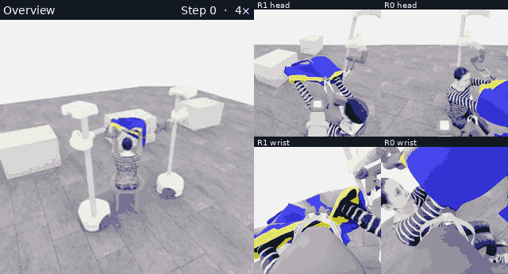

### 시연 31

**노란 밑단의 실제 바깥 끝을 확인하며 재파지** · 0–1,133전이 · 5/50점 · 4배속

시연 28의 299전이 슬롯에서 시작했습니다. 반대편을 지지한 채 노란 띠 끝을 손목과 헤드 카메라에서 추적했습니다. 종료 직전 검토에서 끝점은 열린 왼쪽 턱보다 뒤에 있었고, 양쪽 소매 통과는 확인되지 않았습니다.

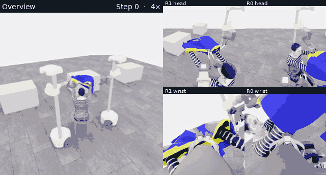

### 시연 30

**안정된 경로에서 긴 동작으로 팔꿈치 쪽 전진** · 0–1,029전이 · 5/50점 · 4배속

시연 28의 299전이 슬롯에서 시작했습니다. 경로가 분명한 구간에서 한 행동에 12–20전이를 사용하도록 기본값을 적용했습니다. 왼쪽 밑단이 집게를 따라 움직였고, 종료 직전 오른쪽 밑단은 열린 턱 가까이에 보였습니다.

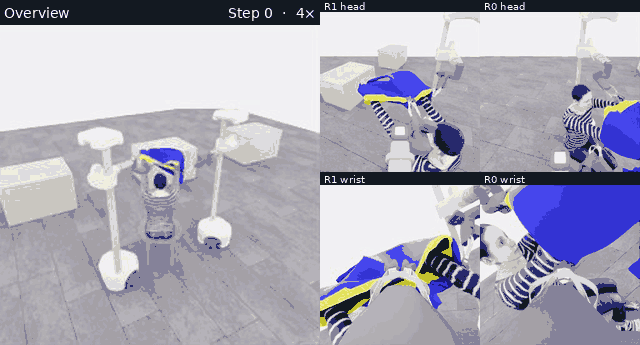

### 시연 29

**밑단 양끝으로 양팔 착의 깊이 맞추기** · 0–336전이 · 5/50점 · 2배속

시연 28의 299전이 슬롯에서 시작했습니다. 반대편 지지를 유지하면서 왼쪽 끝을 잡고 양팔을 맞췄습니다. 종료 검토에서 왼쪽 노란 끝은 턱 곁에 있었고 양쪽 손끝과 소매 테두리는 가려졌습니다.

### 시연 28

**시연 25의 1,200전이 슬롯에서 양팔 우선 시도** · 0–299전이 · 0/50점 · 2배속

슬롯 복원·정착 후 0전이부터 기록했습니다. 종료 시 셔츠가 들린 상태에서 노란 가장자리가 전완 위로 들려 보였고, 소매 출구 통과는 확인되지 않았습니다. 299전이 종료 슬롯은 시연 29–32의 시작점으로 사용했습니다.

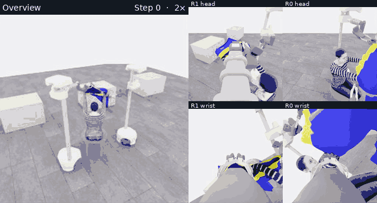

### 시연 27

**양팔을 팔꿈치 쪽으로 맞추기** · 2,346–2,389전이 · 5/50점 · 2배속

시연 25를 2,346전이까지 재생한 뒤, R1이 지지하는 동안 R0가 열린 집게를 오른쪽 밑단 가까이 옮겼습니다. 새 파지를 확인하기 전에 종료했습니다.

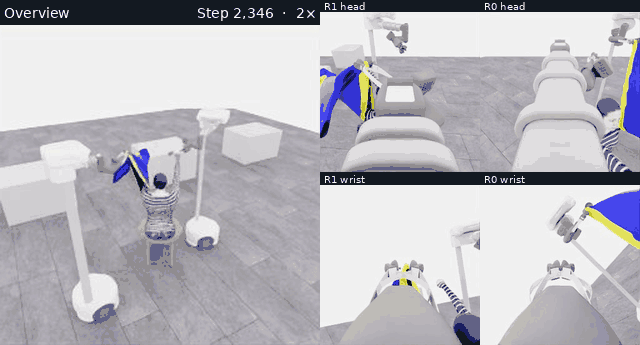

### 시연 26

**밑단 중앙을 들어 목부터 착의하기** · 2,346–2,905전이 · 5/50점 · 2배속

R1이 왼쪽을 받치는 동안 R0가 오른쪽 밑단을 다시 잡았습니다. 두 밑단을 함께 들어 머리 쪽으로 옮겼고, 실제 목둘레 통과와 어깨 안착은 확인하기 어려웠습니다.

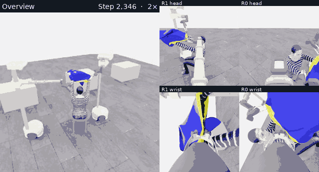

### 시연 25

**왼쪽 밑단 바깥 끝을 다시 잡고 양팔 맞추기** · 1,300–2,346전이 · 5/50점

시연 20의 1,300전이에서 분기했습니다. R0가 오른쪽 지지를 유지하는 동안 R1이 왼손 쪽 노란 밑단의 바깥쪽 접힘을 다시 잡았습니다. 왼쪽 가장자리는 전완을 따라 팔꿈치 부근까지 가까워 보였고, 종료 때 오른쪽 가장자리는 팔 굽힘 아래에 남았습니다. 양쪽 팔꿈치까지의 덮임과 소매·목 통과는 확인되지 않았습니다.

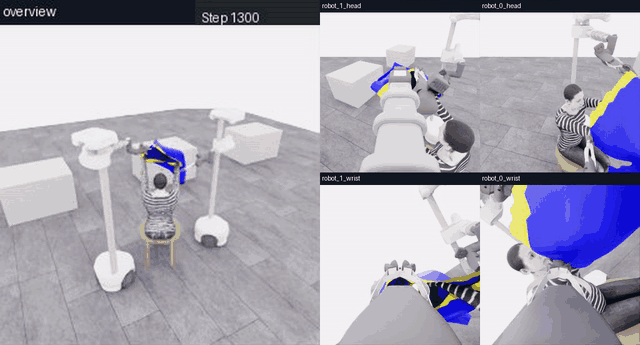

### 시연 24

**오른쪽을 받치고 왼쪽 밑단을 팔꿈치 쪽으로 조정** · 1,300–1,450전이 · 5/50점

시연 20의 1,300전이에서 분기해 왼팔을 먼저 맞추는 순서를 시험했습니다. R1 쪽 노란 밑단의 틈은 보였고 오른쪽 파란 몸판은 R0 집게 가까이에 남았습니다. 왼쪽 전완과 밑단이 만나는 지점은 끝까지 비슷해 팔꿈치 쪽 전진은 확인되지 않았습니다.

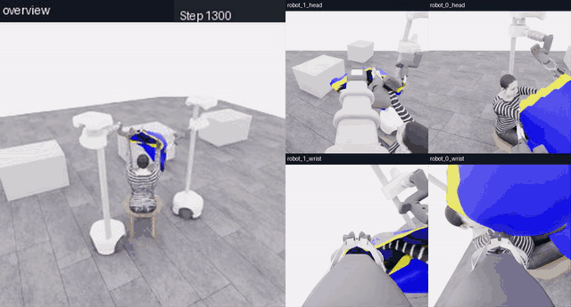

### 시연 23

**각 로봇이 자기 쪽 팔을 맡아 착의** · 1,500–1,901전이 · 5/50점

시연 21의 1,500전이에서 분기했습니다. 왼쪽 집게가 밑단을 조정하는 동안 오른쪽 지지는 유지돼 보였습니다. 왼손과 팔꿈치까지의 덮임이 가려져 양쪽 팔꿈치와 목 착의는 확인되지 않았습니다.

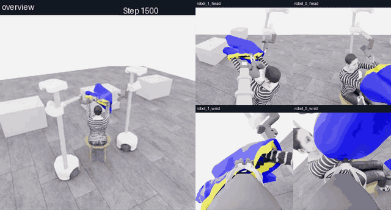

### 시연 22

**왼팔 쪽 밑단을 팔꿈치 방향으로 조정** · 1,500–1,711전이 · 5/50점

왼팔 쪽 천의 움직임은 보였으나 팔꿈치까지 더 덮였는지는 확인되지 않았습니다. 관찰된 로봇의 이동 방향을 시연 23의 교정 조건에 반영했습니다.

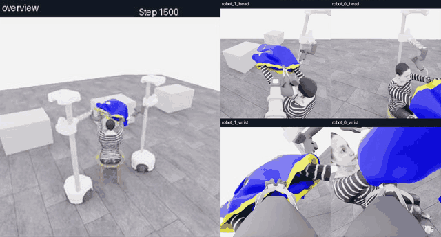

### 시연 21

**양팔을 번갈아 입히기** · 1,300–1,592전이 · 5/50점

양쪽 집게를 번갈아 조정했습니다. 종료 구간에서 왼쪽 천의 지지는 유지된 것으로 보였고 양손의 소매 통과는 가려졌습니다.

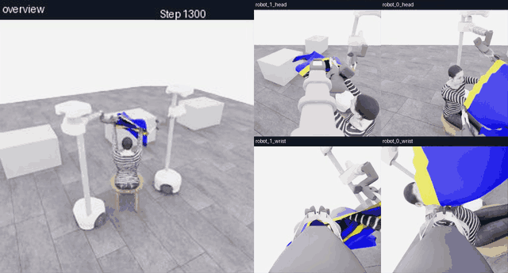

### 시연 20

**시연 13의 419전이에서 재시도** · 0–4,440전이 · 5/50점

419전이까지 시연 13을 재생했고, 이후 새 행동으로 4,021전이를 기록했습니다. 3,109–3,407전이에서 양팔 끝을 천 쪽으로 추적할 수 있었고 두 밑단이 어깨 쪽으로 조금 이동했습니다. 후반에는 R0의 아랫단 재파지가 불확실했고, 양쪽 소매와 목의 통과는 공식 평가에서 인정되지 않았습니다.

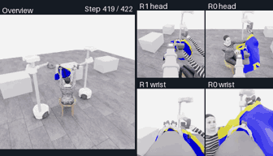

### 시연 19

**왼쪽 지지를 유지하며 오른손 쪽 밑단 조정** · 577–652전이 · 5/50점

R1이 윗단을 받치는 동안 R0가 오른손 앞의 노란 밑단을 조정했습니다. 종료 시 오른손 마디가 보였고 왼손목은 가려졌습니다.

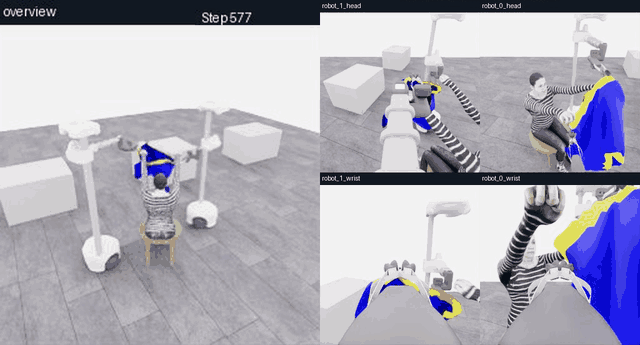

### 시연 18

**오른손 쪽 로봇만 조정** · 541–577전이 · 5/50점

R1이 왼쪽에서 천을 받치고 R0가 오른손 쪽을 조정했습니다.

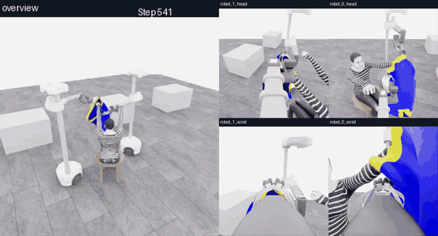

### 시연 17

**두 로봇을 오른손 쪽으로 이동** · 419–612전이 · 5/50점

두 로봇이 오른손 쪽으로 이동했습니다. 541전이에서 양쪽 테가 각 집게에 남았고 오른손은 밖에 보였습니다.

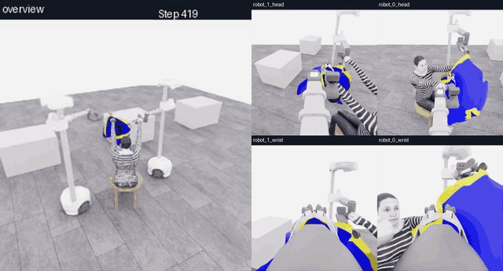

### 시연 16

**왼쪽 지지 집게를 짧게 이동** · 637–674전이 · 5/50점

왼손 쪽 R1 집게를 오른손 방향으로 짧게 옮겼습니다. 오른손 앞 여유가 늘었는지는 뚜렷하지 않았습니다.

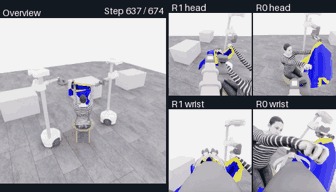

### 시연 15

**한쪽을 받치며 반대편 조정** · 419–646전이 · 5/50점

한쪽 지지를 유지하면서 반대편을 짧게 조정했습니다. 637전이에서 오른손 마디가 밑단 밖에 보였습니다.

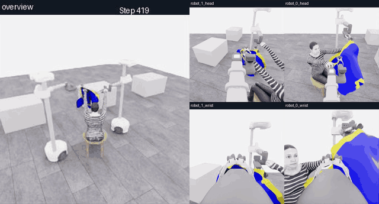

### 시연 14

**아랫단을 받치고 윗단 조정** · 0–669전이 · 5/50점

R0가 아랫단을 지지하고 R1이 윗단을 조정했습니다. 후반에도 오른손은 셔츠 밖에 보였고 왼손목은 가려졌습니다.

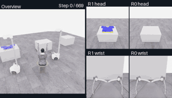

### 시연 13

**밑단의 바깥 끝을 다시 잡기** · 419–689전이 · 5/50점

다른 쪽에서 천을 받친 채 아랫단의 노란 끝을 다시 잡았습니다. 496전이(`hold-0014`)에 밑단 끝이 R0의 집게를 따라왔고, 이후 오른손 쪽으로 옮겼습니다. 마지막 구간에서 아랫단이 오른주먹 아래로 왔고 윗단은 주먹 옆에 남았습니다. 오른손가락은 드러나 있고 왼손목 덮임은 가려져 있습니다.

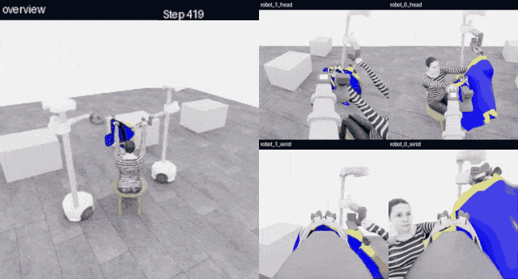

### 시연 12

**앞 이동을 줄이고 윗단을 들어 조정하기** · 419–524전이 · 5/50점

아랫단을 받치면서 윗단을 위로 올렸습니다. 조작 후에도 오른손 마디가 노란 테두리 밖에 보였습니다. 왼팔 끝에 천이 남았고 손목 전체의 덮임은 가려졌습니다.

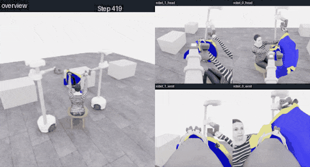

### 시연 11

**오른손 앞으로 입구를 넓혀 당기기** · 419–512전이 · 5/50점

오른손 끝 앞에서 입구를 먼저 벌리고 당겼습니다. 마지막 구간에서 윗단과 아랫단 사이로 오른주먹이 보였고, 아랫단은 손 마디 아래에 남았습니다.

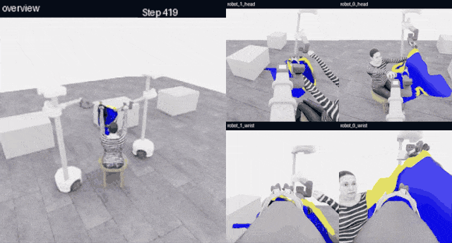

### 시연 10

**다른 손 쪽을 받치며 오른손 덮기** · 419–494전이 · 5/50점

R0가 아랫단을 받치고 R1이 윗단을 오른손 끝 쪽으로 옮겼습니다. 끝 장면에서 윗단은 오른손 옆에 머물고 손 마디가 보였습니다.

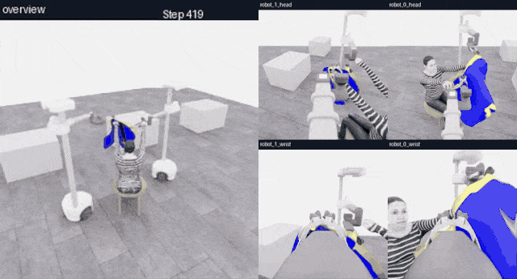

### 시연 9

**새 장면에서 양쪽 밑단 파지** · 0–907전이 · 5/50점

419전이에서 노란 두 테두리 사이의 파란 천이 보였고 먼손 끝은 밑단 밖에 있었습니다. 시연 10–13은 이 지점을 기준으로 오른손 접근 방식을 바꿨습니다. 마지막에는 가까운 주먹이 밑단 밖에 보였습니다.

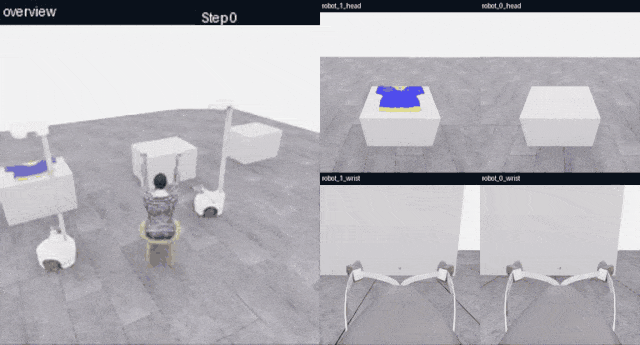

### 시연 8

**한쪽 밑단을 받치며 반대 손에 맞추기** · 521–532전이 · 5/50점

시연 7의 521전이를 재실행한 장면부터 새 동작을 적용했습니다. R0는 윗단을 받치고 R1은 아랫단을 낮은 손끝 쪽으로 옮겼습니다. 자유 가장자리와 손끝이 일부 가려져 두 손목의 진입 깊이는 확인되지 않았습니다.

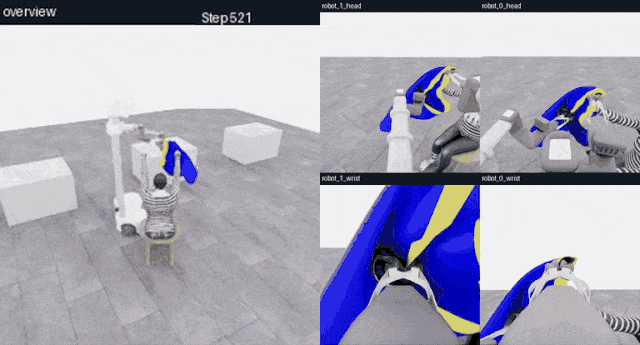

### 시연 7

**Sol Ultra로 양손에 밑단 옮기기** · 0–988전이 · 5/50점

521전이의 R1 손목 영상에서 가까운 손목이 노란 두 가장자리 사이로 보였습니다. 낮은 손은 밑단 밖에 남았고 가까운 팔이 옷을 받치고 있는지는 확인하지 못했습니다. 이 장면이 시연 8의 분기점입니다.

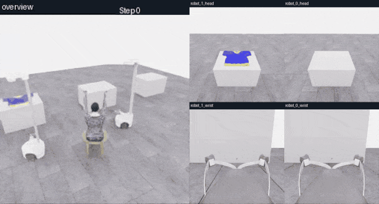

### 시연 6

**밑단을 벌려 첫 손목에 얕게 걸치기** · 0–608전이 · 5/50점

205–213전이에 벌어진 노란 테두리 사이로 파란 안쪽 면이 보였습니다. 한 손목 아래의 밑단은 가려졌고 다른 손은 몸판 바깥에 남았습니다. [시연 6의 구간 기록](../active/20261124-series-results.json)

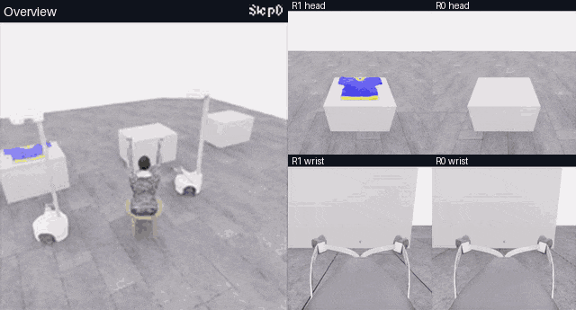

### 시연 5

**카메라 설명을 추가한 양손목 접근** · 0–487전이 · 5/50점

두 로봇이 옷을 들어 양손 앞으로 옮겼습니다. 감속을 지시한 뒤에도 R1 집게가 전진했고 마지막에는 두 손끝이 천 밖에 보였습니다. [시연 5의 구간 기록](../active/20261124-series-results.json)

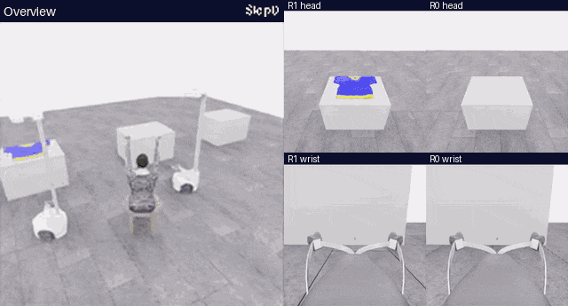

### 시연 4

**한쪽을 받치며 반대 손목 다시 걸기** · 0–1,023전이 · 5/50점

712–728전이에 먼손의 손가락이 노란 밑단 밖으로 드러났고 가까운 손끝은 파란 천에 가려졌습니다. 이후 한쪽 지지를 유지하며 놓친 쪽을 다시 맞췄습니다. [시연 4의 구간 기록](../active/20261124-series-results.json)

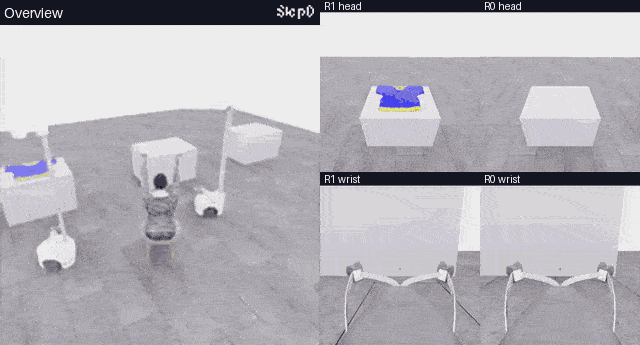

### 시연 3

**GPT 단독으로 양팔 먼저 걸치기** · 0–608전이 · 5/50점

301전이에 옷이 양쪽 전완에 걸쳐 보였지만 한쪽 손목은 가려져 있었습니다. 어깨 쪽으로 더 이동하자 손목이 천 위로 다시 드러났고, 첫 소매와 목은 0점이었습니다. 종료할 때 R1은 밑단을 지지하고 R0은 접힌 천을 풀었습니다. [실패·복구 구간 비교](../active/20261123-recovery-review.ko.md)

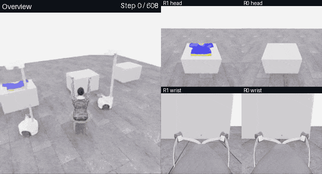

### 시연 2

**GPT 단독으로 한 팔 먼저 입히기** · 0–2,195전이 · 20/50점

왼팔의 첫 소매와 반대쪽 어깨, 왼쪽 위팔까지 득점했습니다. 옷이 정수리까지 올라간 뒤 반대팔을 시도했고, 목과 두 번째 소매는 각각 0점이었습니다. [시연 2 점수와 장면별 분석](../active/20261123-demonstrations.ko.md)

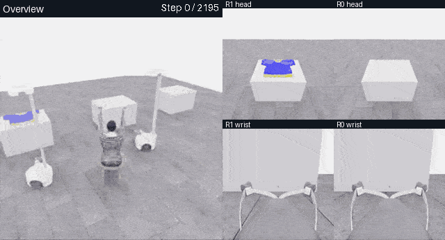

### 시연 1

**사용자 피드백으로 밑단 파지** · 0–1,655전이 · 5/50점

두 로봇이 사용자 피드백을 받아 옷을 집고 손 앞까지 옮겼습니다. 630전이에 픽업을 인정받았고, 첫 소매 통과는 0점이었습니다. [시연 1 분석](../active/guided-retrospective.json)

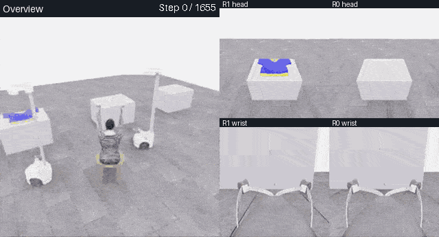

## 영상 추가 기준

새 회차가 종료되고 검증되면 공개 카메라로 구성한 영상을 이 목록 상단에 추가합니다. **640×345**, 전체 화면 왼쪽, R1과 R0의 머리·손목 화면 오른쪽이라는 배치를 이어갑니다. 실제 표시하는 전이 범위, 원점수, 재생 배속을 함께 적습니다. 분기 영상은 새 행동이 시작된 지점부터 보여 줍니다. 정책의 20전이는 시뮬레이션 시간 1초입니다.
