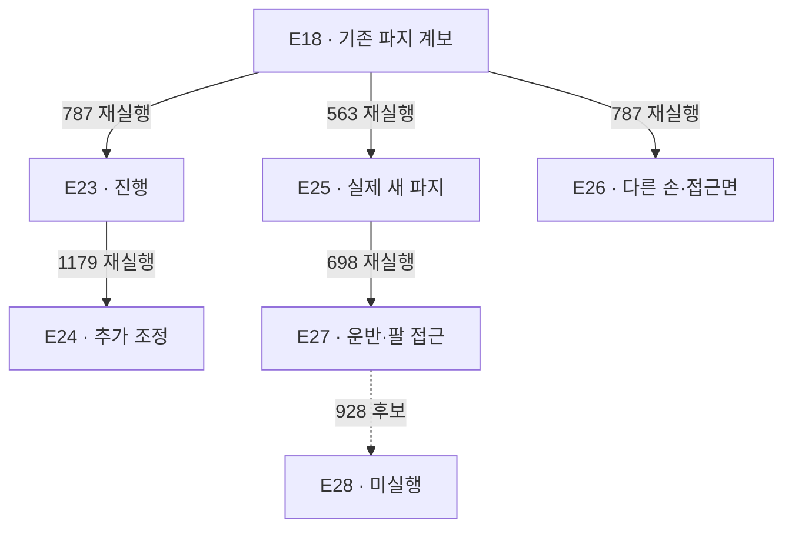

> **실행 이력.** 아래 계획·중지·재개 표현은 해당 시점의 기록입니다. 최신 상태는 [STATUS](STATUS.md), 다음 목표는 [COLLECTION_PLAN](../COLLECTION_PLAN.md)을 따릅니다.

# 수집과 개발 이력

[저장소 소개](../../README.md) · [시간순 시각 갤러리](../gallery/README.ko.md) · [기술 발표](PRESENTATION.ko.md) · [현재 상태](STATUS.md) · [수집 파이프라인](../collection/guides/astra-end-to-end.ko.md)

사람의 원격 조작에서 시작해 Astra의 공개 관측 기반 자동 시연으로 발전한 과정을 찾는 색인입니다. **최신 실제 실행은 E27이며 최고 원점수는 5/50, 착의 득점은 0, `success=false`입니다. E28은 준비한 후보로 미시작·실행 보류 상태입니다.** [11월 7일 마감](SESSION_WRAPUP_20261107.ko.md)과 [현재 상태](STATUS.md)를 실행 여부의 기준으로 삼습니다.

이 문서의 표는 당시 한 일과 결과를 시간순으로 정리합니다. 과거 리뷰의 “다음 작업”은 당시 계획이며, 현재의 재개 명령이 아닙니다. `20261106-…` 같은 run ID의 날짜와 한국 현지 날짜가 다를 수 있어 자동 수집의 연속 세션은 **11월 6–7일**로 묶었습니다. 최신 E27은 **11월 7일 15:58:14–16:39:05 KST**에 실행됐습니다.

## 1. 날짜별로 보는 큰 흐름

| 시기 | 조작 주체·개발 주제 | 실제로 한 일 | 확인 범위와 원문 |
|---|---|---|---|
| 10월 22일 | 환경·학습 연결 | L40S 공식 환경과 기록 경로를 구성하고 scripted 63전이로 π0.5 가중치를 30회 갱신했습니다. 저장·재로딩·짧은 정책 실행·제출 ZIP 빌드 경로를 확인했습니다. | 착의 성능 학습, 900초 완주, Codabench 제출 완료가 아닙니다. [첫 구현 세션](sessions/20261022-bootstrap.md) |
| 10월 23일 | 사람·Chrome 연결 | 클린 서버 복원 후 Chrome 키보드 조작과 사람 입력 형식 12전이를 검증했습니다. 긴 검사는 1,460행동·로봇 시간 73초에서 중단했습니다. | 성공 시연이나 전체 평가 완료가 아닙니다. [복원·형식·중단 기록](sessions/20261023-clean-start.md) |
| 10월 26일 | 사람·두 로봇 시연 | 옷을 잡고 들어 마네킹 쪽으로 운반했습니다. 대표 원본은 2,225전이·111.25로봇초, 편집 영상은 33초입니다. | 옷 양옆 고정 연습 배치. 소매·목 통과 및 공식 점수는 미확인입니다. [시연](DEMO_20261026.ko.md) · [갤러리](../gallery/20261026-human-pickup-transport.ko.md) · [종료 인계](END_20261026.ko.md) |
| 11월 3일 | 사람·UI 복구·속도 | L40S에서 Chrome UI를 복원하고 live 누적 RTF 약 0.115를 기록했습니다. | 이전 짧은 표본 대비 약 10% 높았으나 하드웨어의 엄격한 인과 비교는 아닙니다. 해당 원본의 RGB-D 학습 승인·착의 성능도 미검증입니다. [종료·속도·연결](END_20261103.ko.md) |
| 11월 4일 | 문서·자동 수집 설계 | 실제 사람 시연과 점수 지도를 README에 연결하고 다이어그램을 SVG로 정리했습니다. | 이 시점의 Astra 수집은 설계였습니다. [당시 변경](https://github.com/leonyoon-3dai/PhyRC_2027_phase1/commit/f79f61bccab5ad171b86598ac48dcfd03aef6a4a) |
| 11월 6–7일 · E00–E09 | Astra·연결에서 첫 5점 | CLI를 실제 관측·행동·기록과 연결하고 픽업 유지 조건을 보정했습니다. 한 로봇 픽업5, 새 두 로봇 협력·운반을 기록했습니다. 연결·시작·종료 실패도 보존했습니다. | 첫 착의 득점은 없습니다. [초기 수집 일지](../collection/sessions/2026-11-06.md) |
| 11월 6–7일 · E10–E17 | Astra·관측·지지·준비 | E09 종료 오류를 수정한 뒤 과거 RGB, 밑단 경로, depth 패널, 중립 대기, 초기 준비, 순차 지지·재파지를 비교했습니다. | 각 기능의 실제 적용과 착의 성공은 별도입니다. [재개 기록](sessions/20261106-resume10.ko.md) · [E15 당시 마감](SESSION_WRAPUP_20261106.ko.md) |
| 11월 6–7일 · E18–E24 | Astra·깊이 질의·경로·진행 | 정확한 픽셀 depth 질의와 명명된 행동을 적용했습니다. 목 후보 파지, 높은 접근·하강, 짧은 탐색, 더 목적을 향한 이동과 복구를 시험했습니다. | 최대5점·착의0. [주제별 근거](#6-주제별로-다시-찾기)와 아래 개별 리뷰를 봅니다. |
| 11월 7일 · E25–E27 | Astra·새 파지에서 운반·접근 | E25에서 실제 새 경계 재파지와 국소 천 동행을 확인하고 E27에서 테이블 이탈·운반·팔 접근까지 연결했습니다. E26은 다른 손·접근면과 보상 관측을 비교했습니다. | E27 5/50·1,159전이 QC 통과. 연속 소매 통과는 미확인입니다. [최신 마감](SESSION_WRAPUP_20261107.ko.md) |
| E27 이후 · 현재 | 오프라인 검토·후속 후보 | 원본 백업의 재다운로드·해시 검증을 마쳤습니다. E27/928의 같은 팔 진행 후보 E28은 코드·CPU 검사까지 준비됐습니다. | **새 GPU 시연·학습은 중지, E28 미실행.** CPU 검사와 실제 착의 성능을 구분합니다. [후보 범위](../collection/research/2026-11-07-e27-single-arm-continuation.ko.md) |

10월의 63전이·30회 갱신은 **학습 연결 시험**입니다. 11월 Astra 시연으로 새 정책을 학습한 성과와 합치지 않습니다. [이전 결과](RESULTS.ko.md), [이전 README](../../README.history.ko.md), 날짜가 붙은 종료 문서는 당시의 기록으로 보존합니다.

## 2. E00–E09: 연결 시험과 첫 픽업

`전이`는 관측→행동→다음 관측의 0.05초 기록입니다. 모델의 한 판단이 여러 전이를 실행할 수 있으므로 전이 수·모델 호출 수·시연 수는 다릅니다. 아래 점수는 **로컬 공식 평가기 결과**이며 공식 리더보드 결과가 아닙니다.

| 실험 | 변경·질문 | 결과와 남긴 근거 | 해석의 한계 |
|---|---|---|---|
| 실제 CLI·wiring | 이미지와 JSON 응답을 실제 로봇 경로에 연결할 수 있나? | 합성 이미지 2턴·같은 세션 재개 후, wiring r5의 3결정·3전이·0.15로봇초 정상 마감·QC를 확인했습니다. | 0점 연결 시험입니다. 초기 r1–r4 실패를 과제 성공률에 섞지 않습니다. [방법 비교](../collection/experiments/2026-11-06-method-comparison.ko.md) · [wiring 갤러리](../gallery/20261106-codex-robot-wiring-r5.ko.md) |
| E00 | 첫 실제 착의 수집 | 사용자 중단 후 167전이·8.35로봇초, 파일 정상 보존·QC 통과·0점입니다. | 착의 성공이 아닙니다. [화면·기록](../gallery/20261106-astra-dressing-001.ko.md) |
| E01 | 사용량과 호출 시간의 계측 보완 | 토큰을 thread 누계 차분으로 집계하고 입력 준비·CLI 실행·결과 해석을 분리했습니다. | actor 경로 전체가 순수 모델 내부 추론 시간은 아닙니다. [정정 근거](../collection/corrections/20261106-token-accounting.ko.md) |
| E02 | AppServer의 상주 호출 경로 | r1–r5 호환성 시험의 수용 응답은 0이었고 이후 기본 backend는 `exec`입니다. | 실패한 연결 방식입니다. [호환성 기록](../collection/experiments/2026-11-06-app-server-probe.ko.md) |
| E03 | 한 응답에 고정 행동 목록 | 한 호출의 3구간을 적용하고 3/3전이를 검사했습니다. | 중간 관측에 반응하는 조건부 복구 제어기는 아닙니다. [갤러리](../gallery/20261106-exec-plan3-wiring-001.ko.md) |
| [E04 픽업 유지](../collection/reviews/20261106-astra-pickup-plan2-001.ko.md) | 들어 올리면 바로 5점인가? | 168전이·8.40로봇초·실제582.025초, QC 통과·0점. 공식 유효 유지2.9초였습니다. | 3초 조건 미달. 모델 완료 판단과 공식 결과가 달랐습니다. |
| [E05 유지 여유](../collection/reviews/20261106-astra-pickup-hold5-001.ko.md) | 유지 목표에 여유를 주기 | **최초 한 로봇 픽업5**, 253전이·12.65로봇초·실제828.300초, QC253/253. 유효 유지3.35초입니다. | 목표5초와 실제 유효 유지3.35초를 구분합니다. 착의0·success=false·무접촉 rate=null입니다. |
| [E06 이어가기](../collection/reviews/20261106-astra-dressing-continue-001.ko.md) | E05 행동을 재실행해 계속하기 | 386전이 =253재실행+132모델+1정리, 19.30로봇초·실제840.451초. 전략 변경 중단 후 파일·QC 정상입니다. | 5점은 재실행 중 획득했습니다. 독립된 새 픽업 성공 자료로 중복 집계하지 않습니다. |
| [E07 새 협력](../collection/reviews/20261106-astra-coordinated-fresh-001.ko.md) | 처음부터 두 로봇으로 잡고 옮기기 | **1,067전이·53.35로봇초·73호출·80구간**, 실제5,034.038초. 픽업5·착의0·success=false, QC1,067/1,067입니다. | 이후 분기 계보의 원본. 공동 운반은 관측했지만 소매 득점은 없습니다. |
| [E08 시작 실패](../collection/experiments/2026-11-06-continuation-startup-retry.ko.md) | E07/700에서 분기 | 설정 누락으로 환경·기록기·actor 시작 전 실패, 0호출·0전이·실제0.465758초입니다. | 평가 미시작이므로 임의의 과제0점으로 채우지 않습니다. |
| [E09 부분 자료](../collection/reviews/20261106-astra-coordinated-branch700-002.ko.md) | 설정을 보완해 재실행 | 사용자 중지 중 종료 응답 불일치, 141부분 전이·7.05로봇초·실제200.424초, 파일 미완료·QC 실패입니다. | ACK120과 저장141은 다른 지표입니다. 저장141=재실행140+중립1, 새 모델 호출0. 원본은 고치지 않고 학습에서 제외했습니다. |

E09 종료 오류는 후속 코드에서 수정하고 실제 신호·파이프·기록기를 포함한 CPU 회귀 검사를 거쳤습니다. 수정된 프로그램과 실패 원본을 구분해 보존합니다. [환경 복원 측정](sessions/20261106-l40s-restore.json) · [재개 상세](sessions/20261106-resume10.ko.md)

11월6일 환경 복원 당시 build·prepare·smoke와 Mac Chrome WebRTC를 확인했습니다. 초기3개 에피소드·63전이는 기록 연결 검사이며 아래 과제 시연의 성공 수로 합치지 않습니다. E07에서 재사용한 근거는 다음과 같습니다.

| E07의 경계·측정 | 실제 뜻 | 후속 활용 |
|---|---|---|
| 경계356 /17.80로봇초 | 첫 공식 pickup +5 | [득점 프레임·실제 행동](../collection/milestones/20261106-astra-coordinated-fresh-001/README.ko.md) |
| 경계700 /35.00로봇초 | 공동 운반 뒤 마네킹 앞 공개 관측 | E10–E14 분기. 정렬 완료나 새 득점은 아님 |
| first_sleeve 의도24구간 |254전이·12.70로봇초, 시각 판단은 모두 uncertain |24개 독립 실패 에피소드가 아님 |
| 전체83.90분 | actor3,737.894초·환경1,202.314초·잔차93.830초 | 호출 경로와 환경 비용을 분리. 순수 모델 내부 추론시간이 아님 |
| 전체 공개 영상 |1,067프레임·5fps·213.4초·4배 느린 재생 | [전체 시도 패키지](../collection/attempts/20261106-astra-coordinated-fresh-001/README.ko.md). 실제 호출 대기는 영상에서 제외 |

## 3. E10–E17: 관측과 출발 조건을 바꾸기

E10 이후는 E07의 행동을 새 환경에서 재실행한 분기입니다. **정확한 천 상태 checkpoint 복원이 아닙니다.** 시작 경계·예산·종료 방식도 달라 아래를 엄격한 단일 변수 ablation이나 독립 성공률 표본으로 해석하지 않습니다.

| 실험 | 무엇을 바꿨나 | 전체 전이 = 재실행 + 새 구간 | 결과·관찰·종료 |
|---|---|---|---|
| [E10 소매 식별](../gallery/20261106-astra-sleeve-branch700-003.ko.md) | E07/700에서 소매를 식별해 접근 | 750 =700+50 | 5점·착의0, 실제27분08.840초. 진행·가시성 부족으로 모델 종료, no_contact/rate=null입니다. |
| [E11 과거 RGB](../gallery/20261106-astra-sleeve-history-001.ko.md) | 새 재실행 중 얻은264·320경계 RGB를 첫 호출에 추가 | 777 =700+77 | 5점·착의0, 실제30분35.100초. 새 구간=모델76+정리1, 비교 감독 종료입니다. |
| [E12 밑단 경로](../gallery/20261106-astra-hem-route-001.ko.md) | 몸통 밑단을 통한 진입 경로 | 781 =700+81 | 5점·착의0, 실제32분55.678초. 모델80+정리1, 비교 감독 종료. 접촉은 생겼지만 손 통과 증거는 아닙니다. |
| [E13 depth 패널](../gallery/20261106-astra-hem-depth-001.ko.md) | 현재 원본 해상도 손목 depth 패널 | 810 =700+110 | 5점·착의0, 실제33분30.295초, 모델 종료. 가려진 면을 depth가 보여 주지는 않습니다. |
| [E14 중립 대기](../gallery/20261106-astra-hem-settle-001.ko.md) | 동작 뒤 중립6전이 =0.3로봇초 | 721 =700+21 | 5점·착의0, 실제13분57.047초. 모델8+정착12+정리1. 두 베이스 동작 뒤 전략 변경 종료이며 모든 관절의 정착 효과를 입증한 것은 아닙니다. |
| [E15 초기 준비](../collection/reviews/20261106-astra-opening264-001.ko.md) | 더 이른 E07/264부터 층·입구 준비 | 611 =264+347 | 5점·착의0, 실제28분29.785초. 모델221+정착126, 24판단=23action+finish. 가림·형상 변화 후 열고 철수했습니다. |
| [E16 순차 지지](../collection/reviews/20261106-astra-support264-002.ko.md) | E07/264에서 한쪽씩 들기·R0 재파지 | 516 =264+252 | **0점**, 실제32.66분. 재파지 뒤 R0 실제+26.50mm와 국소 천 동행을 관측했지만 연속 입구·독립 양측 지지는 미확인, 모델 종료입니다. |
| [E17 다른 rim](../collection/reviews/20261106-astra-layer352-001.ko.md) | E16/352에서 다른 lower-rim 후보를 향해 재파지 | 452 =352+100 | **5점**, 실제13.74분. 공동 들기+21.09/+21.34mm. 닫힘이 계속 변해 지지 해석에 혼입이 남았고 운반 전 종료했습니다. |

E10–E17의 기록은 전수 기술 검사를 통과했지만 학습 승인과는 별개입니다. E15 입력은 **현재 RGB5+손목 depth 패널1+공개 상태+depth 요약**이며 과거 이미지 주입은 없었습니다. E15의 모델 경로1,105.822초·환경548.946초, 소스 `fa3fb85a…`, 당시 시작 전 CPU208개·모델 없는 GPU6/6전이 검사는 그 실행 시점의 근거입니다. 현재 코드의 검사 결과로 재표기하지 않습니다.

E15 전체30.55로봇초 중 새 모델 행동은11.05초, 자동 중립은6.30초입니다. E11·E12·E14는 진행 중 호출의 응답을 수거했지만 새 물리 행동으로 적용하지 않은 채 중단을 마감했습니다. 중단 응답 수와 실제 적용 행동 수를 같게 집계하지 않습니다.

## 4. E18–E24: 정확한 깊이, 명명된 행동, 접근 경로

| 실험 | 직접 부모와 변경 | 전체 / 새 전이 | 결과와 핵심 교훈 |
|---|---|---:|---|
| [E18 depth·운반](../collection/reviews/20261106-astra-guide470-depth-001.ko.md) | E16/470. 지지·가이드 전략, 첫 실제 과제 픽셀 질의 | 928 /458 | **5점**, 실제31.04분. 질의3회20유효점, 물리0. 운반·접근했으나 설명 없는 R1 roll+1 반복으로 감독 중단했습니다. 전략 이름과 달리 새 가이드 재파지는0회입니다. |
| [E19 명명 행동](../collection/reviews/20261107-astra-entry801-named-001.ko.md) | E18/801. index 대신 이름으로 행동 출력 | 932 /131 | **5점**, 실제26.29분. 12 act 변환 모두 일치, 세 번 접근·복구했지만 소매 통과0, 모델 종료입니다. |
| [E20 목 후보](../collection/reviews/20261107-astra-neckline470-named-001.ko.md) | E18/470. 목 후보 두 곳 실제 재파지 | 726 /256 | **0점**, 실제29.72분. 파지 위치는 실제 바꿨지만 연속 목 입구 미확인. 운반·머리 통과 전 종료했으므로 목 경로 전체의 불가능성을 입증한 것이 아닙니다. |
| [E21 높은 접근](../collection/reviews/20261107-astra-overhead470-named-001.ko.md) | E18/470. 높게 운반·두 하강·테이블 복귀 | 1,111 /641 | **5점**, 실제52.49분. 접촉·복구·R1 새 경계 닫기까지 실행. 40판단 예산으로 끝나 새 파지 지지 시험은 못 했습니다. E20 파지를 이어받지 않았습니다. |
| [E22 작은 탐색](../collection/reviews/20261107-astra-probe787-named-001.ko.md) | E18/787. 작은 전진·시점 보정 | 813 /26 | **5점**, 새1.30로봇초·실제17.21분. 18판단 예산 중4판단에서 종료. 한 번의 작은 전진으로 진입 불가능을 확인한 것은 아닙니다. |
| [E23 과제 진행](../collection/reviews/20261107-astra-progress787-named-001.ko.md) | E18/787. 더 목적을 향한 유한 이동 | 1,180 /393 | **5점**, 실제31분46.180초, 18판단 예산 종료. 1055·1077에서 손·전완 노출이 늘었지만 화면의 옆 구멍 후보를 공식 소매로 확정하지 못했습니다. |
| [E24 추가 진행](../collection/reviews/20261107-astra-progress1179-named-001.ko.md) | E23/1179. 같은 파지로 접근·후퇴·경사·복구 | 1,610 /431 | **5점**, 실제50분25.996초, 감독 종료·파일 정상·QC1,610. 1517겹침→1535가림→1609/1610부분 복구. 마지막 질의 뒤 응답은 물리 행동으로 적용되지 않았습니다. |

E18의 최초 픽업5는 경계543에서 발생했고563은 그 뒤 첫 완결된 판단 경계입니다. **E18/470은0점** 출발점입니다. E19–E22의 총78 act가 named→정규 배열과 일치한 것은 명령 변환의 확인이며 착의 성공률이 아닙니다. `guide`·`first_sleeve`·`shoulder` 같은 stage는 의도 라벨입니다.

## 5. E25–E27: 새 파지의 들기에서 운반·팔 접근까지

| 실험 | 실제 바꾼 것 | 확인한 진전 | 남은 한계·근거 |
|---|---|---|---|
| [E25 새 경계 재파지](../collection/reviews/20261107-astra-opposing563-named-001.ko.md) | E18/563에서 R1 열기→낮은 경계로 위치 선택→한 번 보정→재닫기→단독 들기 | 698전이=563재실행+93모델+42정착. 국소 들기 실제+26.62mm와 천 동행, 최종5점. 실제20분25.594초입니다. | 테이블 지지·계속되는 닫힘이 섞여 독립 하중 지지는 미확인입니다. 원본 E25에서는 운반을 시험하지 않았습니다. 30판단 중14사용 후 모델 finish입니다. |
| [E26 다른 손·접근면](../collection/reviews/20261107-astra-hand-swap787-named-001.ko.md) | E18/787에서 기존 파지를 유지하고 상대 배치·하강·전진·보상 자세·관측 회전 | 1,139전이=787재실행+232모델+120정착. 경계953의 두 손 재노출, 보상 동작 후 시야 부분 복구. 최종5점·실제50분51.141초입니다. | R1 guide/R0 support는 유지됐으므로 역할 교환은 아닙니다. 새 파지0회, 손 정체·연속 전완·소매 통과는 미확인입니다. |
| [E27 새 파지 운반](../collection/reviews/20261107-astra-regrasp698-progress-named-001.ko.md) | E25/698의 행동을 새 환경에서 재실행하고 새 파지로 상승·운반·팔 접근 | **1,159전이=698재실행+334모델+126정착+1정리**, 새461전이·23.05로봇초. 790테이블 이탈, 928팔–노란 경계 관계, 후반 일부 추종·가시성 복구. | **5/50·착의0·success=false**, QC1,159/1,159오류0. 22act·23calls·질의1회6유효점. 모델 finish0, 판단 예산으로 종료했습니다. 실제40분50.624초입니다. |

E27의928은 전완이 노란 경계 사이 큰 공간을 가로지르는 유용한 장면이지만 소매 정체·연속 통과·그 경계의 정확 점수는 미확인입니다. D11에서 다른 손으로 목표가 바뀌었고 후반 D17·D20·D21에 관절 오차·시야 일부 회복도 있었습니다. **끝까지 같은 가림이었다거나, 목표 전환 하나가 실패 원인이라고 단정하지 않습니다.** `operator_finished`도 모델의 자율 성공 선언이 아니라 수집 종료 프로토콜과 구분해야 합니다.

E28의 같은 팔 진행 후보는 E27/928·과거 관측890/906·24판단/max1600·named/query/wrist panel로 준비됐지만 **미시작·실행 보류**입니다. 후보의325 CPU 검사와 통합166소스 해시 일치는 실제 착의 개선이 아닙니다. 별도 손목 방향 보조의335검사는 미통합 연구 후보이며 현재 코드 검사 수에 더하지 않습니다.

## 6. 주제별로 다시 찾기

| 설명할 주제 | 대표 변화 | 읽을 기록 |
|---|---|---|
| 사람 원격 조작 | Chrome·키 입력·저속 피드백·두 로봇 운반 | [10월26일 시연](DEMO_20261026.ko.md) · [사람 갤러리](../gallery/20261026-human-pickup-transport.ko.md) |
| GPT 자동 시연의 전체 경로 | 공개 입력→격리 actor→JSON→검증→짧은 실행→기록 | [Astra end-to-end](../collection/guides/astra-end-to-end.ko.md) · [코드 지도](CODE_MAP.ko.md) |
| 명령·실제 상태·정착 | E14중립, E17닫힘, E24목표와 실제의 차이, E27추종 복구 | [중립 진단](../collection/experiments/2026-11-06-move-settle.ko.md) · [E24](../collection/reviews/20261107-astra-progress1179-named-001.ko.md) · [E27](../collection/reviews/20261107-astra-regrasp698-progress-named-001.ko.md) |
| 깊이·가림·의미 | E11요약 손실→E13패널→E18정확 픽셀 질의 | [depth 입력](../collection/research/2026-11-06-wrist-depth-input.ko.md) · [픽셀 질의](../collection/research/2026-11-06-pixel-depth-query.ko.md) |
| 실제 재파지와 파지 이름 | E16/17/20/25의 실제 release·이동·close, E18/19 guide는 새 재파지0회 | [E25](../collection/reviews/20261107-astra-opposing563-named-001.ko.md) · [출발점 검토](../collection/catalog/README.ko.md) |
| 접근·복구·목표 순서 | 목 준비, 위쪽 하강, 짧은 탐색, 더 큰 진행, 같은 팔 후보 | [시간순 갤러리](../gallery/README.ko.md) · [E28 후보](../collection/research/2026-11-07-e27-single-arm-continuation.ko.md) |
| 데이터 품질·학습 전환 | 기술 QC·공식점수·시각리뷰·학습승인 분리 | [수집 안내](../collection/README.ko.md) · [catalog](../collection/catalog/README.ko.md) |
| 재현·보존 | 고정 소스·자산·원본·백업 revision과 재다운로드 해시 | [복원](START_HERE.ko.md) · [최신 마감](SESSION_WRAPUP_20261107.ko.md) |

## 7. 자료 규모와 보존 상태

현재 [catalog 정본](../collection/catalog/catalog.v1.json)은 **35실행 /13출발점 /20방법 /38시도 연결**을 담습니다. 실제35실행에는 시연24·연결시험10·시작실패1이 포함됩니다. 시도 연결38건은 완료29·실패6·계획3이며, 성공 시연38개가 아닙니다. 기술 QC는29통과·1실패·5미확인, 공개 검수 출발점의 학습 승인은 모두 `unreviewed`입니다.

E07 이후 공개 출발점은 같은 계보입니다. 중복 prefix·인접 프레임을 독립 성공 시연으로 세거나 train/validation 양쪽에 나눠 성능을 과장하지 않습니다. E27의 전체57.95로봇초 중34.90초는698행동 재실행, 새 구간은23.05초입니다.

| 보존 묶음 | 확인한 범위 | 확인 근거 |
|---|---|---|
| 초기 자산·E07 전체 | 약11.78GB. 클린 서버에서5,166파일 병합·자산 SHA·E07 전체 QC·prefix700을 확인했습니다. | [초기 백업 검증](sessions/20261106-remote-backup-verification.json) · [복원 절차](START_HERE.ko.md) |
| E10–E15 | 별도 백업입니다. E15 원본1,417,350,617bytes, 당시 연구·미적용 후보4,600,121bytes를 구분했습니다. | [E15 검증](sessions/20261106-e15-backup-verification.json) · [연구 후보 검증](sessions/20261106-private-research-backup-verification.json) |
| E27 | 원본2,823,483,370bytes, 고정 revision `6506b15378417c445bb8e84dbc43990a0c0fd291`에서 재다운로드·254구성 파일 해시 검증을 완료했습니다. | [E27 백업 검증](sessions/20261107-e27-backup-verification.json) |
| 후속 후보·마감 | 한 팔 후보와 미통합 손목 보조를 실제 시연과 분리해 보존했습니다. 수집 프로세스 종료 확인과 클라우드 서버 전원 종료 확인은 별개입니다. | [최신 마감의 보존 범위](SESSION_WRAPUP_20261107.ko.md#서버가-없어도-남는-자료) |

GitHub clone만으로 큰 원본과 모든 자산이 복원되지는 않습니다. 재개 때는 고정 revision·SHA·권한·인증·작은 wiring을 다시 확인하고, 새 현재 관측에서 지지와 배치를 읽습니다. 지금 자동 재개하거나 새 학습을 시작하지 않습니다.

## 8. 앞으로 이력을 쌓는 규칙

1. 날짜별 표에는 **무엇을 바꿨는지, 무엇이 실제로 확인됐는지, 남은 한계, 원문 링크**를 한 행으로 추가합니다. 상세 로그를 모든 문서에 복제하지 않습니다.
2. 새 실행은 고유 run ID·직접 부모·source group·소스/설정 해시·변경 조건을 남깁니다. 재실행 prefix·새 모델 행동·정착·마감을 분리합니다.
3. 파일 완료·기술 QC·공식 원점수·점수율 상태·착의 성공·시각 검수·학습 승인을 각각 기록합니다. 빠진 값을 성공이나0으로 채우지 않습니다.
4. 실패 원본과 당시 문서는 보존하고, 수정된 해석과 후속 결과를 날짜가 있는 링크로 연결합니다.
5. README는 첫 이해와 대표 영상, 갤러리는 시각 변화, STATUS는 현재 중단·재개 조건, 이 문서는 이력, 기술 문서는 구현 설명을 담당합니다.
6. 조사·후보 코드·CPU 검사·실제 CLI/GPU 적용·과제 성능 개선을 구분합니다. **현재는 E27 종료·E28 미실행·새 baseline 미학습**입니다.
