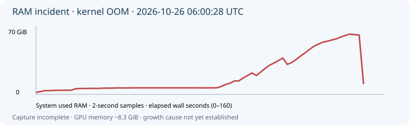

# 실행 성능과 물리 점검

[첫 화면](../../README.md) · [오늘 세션](sessions/20261026-live.md)


## 오늘 확인한 것

공식 build 169.02초, prepare 8.81초, smoke 355.79초로 각각 exit 0과 실제 `PHYRC-SMOKE-PASS`를 확인했습니다. smoke는 두 로봇 이동, 그리퍼 토글, 저장·복원 오차 0, 의복 좌표 유한값을 검증했습니다. 착의 접촉 전 과정의 안정성·현실 정확도 검증은 아닙니다. [측정 JSON](sessions/20261026-setup-metrics.json)

초기화 중 20Hz/10초 py-spy 표본 199개는 모두 Isaac Sim `SimulationApp.update()`에 있었습니다. Python 표본만으로 내부 물리·렌더링·shader 작업을 분리할 수 없습니다. native profiler는 심볼 처리 대기로 수집이 시작되지 않아 중단했으며, 추가적인 native 병목 결론은 없습니다. 프로파일링이 포함된 cold smoke 시간은 엄밀한 무계측 기준선이 아닙니다.

## RAM 부족 종료 · 확인된 실패



사용자가 두 로봇 조작을 확인한 첫 스트림이 06:00:28 UTC에 커널 global OOM으로 강제 종료됐습니다. 시스템 사용 RAM이 약 7.4 → 21 → 43 → 66GiB로 증가했습니다. 커널이 기록한 해당 프로세스 anonymous RSS는 약 65.46GiB, 당시 GPU 메모리는 약 8.3GiB였습니다. 메모리 증가 원인은 아직 미확정입니다. [원본 수치 요약](sessions/20261026-oom-metrics.json)

원본 archive는 184개 committed chunk·2,944개 raw frame이 남았지만 `complete=false`입니다. 정상 종료·전이 수·학습 데이터 완성을 주장하지 않습니다. 원본은 변경하지 않고 보존합니다.

넓은 조작 시점으로 재시작하고 프로세스 RSS·가용 RAM을 추가 기록합니다. 이번 실행은 RSS 40GiB 이상 또는 가용 RAM 16GiB 미만이면 기존 SIGTERM handler로 정상 종료·저장을 요청합니다. 물리/제어 변경이 아니라 작업 종료 장치이며 실제 저장 완료는 별도 확인합니다.

## 수집을 방해하지 않는 관찰

오늘 스트림은 CPU·RAM·GPU 사용량을 2초마다, 앱 update 수와 실제 `World.current_time` 진행을 약 5초 간격으로 기록합니다. 초기화·멈춤·리셋 구간은 구분하고 `simulation_s_per_wall_s`로 실제 진행 속도를 봅니다. 앱 update 수를 브라우저 영상 FPS나 물리 step 수로 부르지 않습니다. 사람 조작 세션에는 정책 추론이 없습니다.

로컬 로그: `output/runs/20261026-live-stream/resources.jsonl`, `output/sessions/20261026-live/stream-performance.jsonl`. 연결 정보가 포함된 전체 로그는 그대로 공개하지 않습니다. 초기 simulation time 1초 이하 구간을 제외한 첫 17개 창에서 실제 86.32초 동안 simulation 9.05초 진행, 평균 **0.105배속(실제 9.54초당 simulation 1초)**을 측정했습니다. 녹화·스트리밍을 켠 단일 세션 표본이며 사용자 입력/뷰어 연결 상태를 통제한 비교 실험은 아닙니다. 실제 정책 추론 지연은 미측정입니다.


[속도 표본 JSON](sessions/20261026-stream-metrics.json). 10초/20Hz warm Python 표본에서 main thread 199개 중 155개(약 78%)의 최하단 Python 프레임이 `SimulationApp.update()`였습니다. archive writer와 다른 스레드는 별도 프로파일이며 이 비율은 전체 CPU 점유율이 아닙니다. 내부 물리/렌더링 구분에는 추가 계측이 필요합니다.

## 약 10배 느린 이유 · 실제 구간별 진단


같은 고정 연습 배치, 중립 명령, 물리 240Hz/제어 60Hz에서 120개 control frame씩 실행했습니다. 초기 simulation 0.5초 이후 약 10초의 wall 창을 사용했습니다. 정책은 전혀 실행하지 않았습니다. [수치 JSON](sessions/20261026-runtime-components.json)

| 조건 | simulation / wall | simulation 1초의 실제 비용 | control 한 번 |
|---|---:|---:|---:|
| 1280×720, 기록 ON | 0.1045배 | 9.57초 | 159.5ms |
| 960×540, 기록 ON | 0.1067배 | 9.37초 | 156.2ms |
| 1280×720, 기록 OFF | 0.1187배 | 8.43초 | 140.5ms |

해상도 축소 조건은 약 2%, 기록 OFF 조건은 약 14% 빨랐습니다. 단 각 조건 한 번, 짧은 창이고 CPU 영상 편집 동시 작업의 차이도 있어 인과적 개선량이나 통계적 우위로 확정하지 않습니다. 화질 저하에 비해 해상도 효과가 작아 사용자 재실행은 1280×720을 유지했습니다. 데이터 수집이 목적이므로 기록 OFF를 운영 개선으로 적용하지 않았습니다.

### 어디에 시간이 걸렸나

1280×720/기록 ON의 같은 warm 창을 기준으로 한 host wall 계측입니다.

| 구간 | wall 비중 | 해석 |
|---|---:|---|
| 물리 late-pre → early-post 이벤트 사이 | 약 59.9% | physics 한 번 평균 23.9ms. 순수 GPU kernel만이 아니라 내부 동기화·dispatch도 포함 |
| 공식 cloth pre/post 제어·guard | 약 7.3% | 240Hz로 실행되는 제어와 의복 안전 처리 |
| 매 물리 step 원본 기록 callback | 약 3.9% | 로봇·의복 상태 GPU→CPU 읽기, 배열 복사와 기록 queue 등 |
| 그 외 app update | 약 22.5% | 화면 렌더링·Kit·기타 내부 처리. 순수 렌더 시간으로 단정하지 않음 |
| app 바깥 제어·20Hz 관측 경계·나머지 | 약 6.4% | 입력 제어, public observation/원본 경계 처리 등 |

60Hz control은 한 번에 16.67ms의 실제 예산을 써야 실시간입니다. 그러나 현재는 **한 번에 약 159.5ms**가 걸립니다. 한 control 안에는 physics 4회가 있고, 계측한 물리 이벤트 구간만 약 **4×23.9 = 95.6ms**입니다. 따라서 네트워크 응답만 빨라져도 전체가 실시간으로 바뀌지 않습니다. 공식 의복은 15,878 vertices/31,344 triangles와 64 solver iterations의 workload를 갖습니다. 이 수치 자체가 개별 병목 원인의 증명은 아니지만 계산량의 맥락입니다.

물리 처리 주변과 GPU/CPU 동기화 비용이 현재 가장 큰 측정 구간입니다. RAM이 부족해서 매번 느린 것은 아닙니다. 이후 긴 사람 시연은 RSS 약 8.4–8.7GiB로 안정적이었고, 새 OOM은 관찰하지 않았습니다. 최초 OOM의 메모리 증가 원인은 여전히 미확정입니다. CPU 단일 코어·GPU solver·driver 동기화 중 어느 것이 주원인인지는 Nsight 같은 세부 계측이 더 필요합니다.

### 조작 반응과 이동 속도는 다른 문제

HTTP 수신 표시는 네트워크 수신 확인입니다. 다음 app/control update까지 현재 약 150ms 전후를 기다릴 수 있고, 20Hz 행동 경계도 있습니다. 이전 브리지는 짧은 press/release를 같은 update에서 모두 처리해 이동이 사라질 수 있었습니다. 새 브리지는 움직임 키의 짧은 탭을 최소 3 update 동안 유지해 적어도 한 정책 경계를 지나게 합니다. blur·watchdog은 즉시 해제하며, 그리퍼·종료 같은 일회성 명령은 늘리지 않습니다.

정밀 모드와 화면 버튼은 입력 누락과 방향 혼동을 줄이는 개선입니다. 실제 반응 지연 감소량, 유저 작업 시간 개선량은 다음 사람 시도로 검증합니다. 로봇의 공식 최대 속도·가속·주파수·solver·형상·action 규격을 올려 빠르게 만들지는 않았습니다.

### 다음 개선 후보

1. 같은 조건의 반복 계측으로 baseline 변동과 재현성을 확인합니다.
2. physics 이벤트와 CUDA/driver 동기화를 Nsight Systems로 나눠 봅니다.
3. host thread/CPU affinity·cache·렌더러 설정 후보를 하나씩 비교합니다. 공식 physics/action/evaluation과 센서 시간 정렬은 유지합니다.
4. 원본 기록 queue와 상태 읽기의 비용을 재되 무손실·무누락 검사를 유지합니다.
5. 실제 정책 추론 시간은 모델 복원 후 별도 측정합니다. 현재 사람 세션에는 추론 병목이 없습니다.

## 별도 고정 스텝 진단

`participant/ops/profile_runtime.py`를 추가했습니다. CLI·구문·합성 통계 계산은 확인했으며 실제 simulator 실행은 아직입니다. 수집 종료·저장 뒤 동일 GPU에서 순차 실행합니다.

```bash
.venv/bin/python participant/ops/run.py --id 20261026-runtime-zero-100 --   ./run.sh python /project/participant/ops/profile_runtime.py   --steps 100 --warmup 10 --seed 42   --output /output/profiling/20261026-zero-100
```

기본은 중립 행동으로 환경 비용만 측정합니다. 실제 정책 추론은 복원된 adapter를 `--policy`와 필요 시 `--checkpoint`로 지정하고 같은 설정에서 별도 측정합니다. 모델 파일 복원 전에는 추론 속도를 주장하지 않습니다.

기록 항목: 시작/모델 로드/reset, 최초 추론, warm 추론·환경 step·제어/물리 구간·관측 구간의 평균/중앙값/95백분위수, simulation/wall 비율, 실제 완료 step 수. tick 시간에는 제어와 평가 callback도 포함되므로 순수 물리 kernel 시간으로 해석하지 않습니다. 기본은 공식 평가 callback을 켜며 `--without-evaluator`는 다른 workload로 표시합니다. 고정 스텝 진단은 공식 900초 검사나 유효 최종 점수가 아닙니다.

## 개선 비교 원칙

같은 source·image·seed·카메라·recording·정책·평가기·warmup을 고정하고 한 번에 한 설정만 바꿉니다. cold 초기화와 warm 실행을 분리합니다. host thread/affinity/cache는 후보이며 효과는 아직 미검증입니다. 물리 주파수·solver·의복/로봇 형상·행동 한계·평가기·관측 정렬을 속도 개선 목적으로 변경하지 않습니다.
