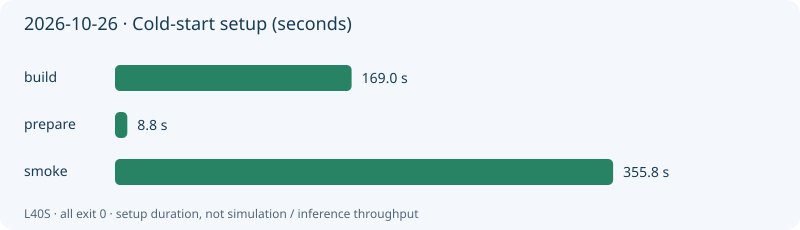
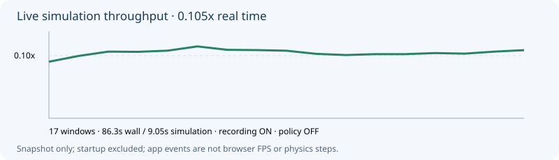

# 실행 성능과 물리 점검

[첫 화면](../../README.md) · [오늘 세션](sessions/20261026-live.md)



## 오늘 확인한 것

공식 build 169.02초, prepare 8.81초, smoke 355.79초로 각각 exit 0과 실제 `PHYRC-SMOKE-PASS`를 확인했습니다. smoke는 두 로봇 이동, 그리퍼 토글, 저장·복원 오차 0, 의복 좌표 유한값을 검증했습니다. 착의 접촉 전 과정의 안정성·현실 정확도 검증은 아닙니다. [측정 JSON](sessions/20261026-setup-metrics.json)

초기화 중 20Hz/10초 py-spy 표본 199개는 모두 Isaac Sim `SimulationApp.update()`에 있었습니다. Python 표본만으로 내부 물리·렌더링·shader 작업을 분리할 수 없습니다. native profiler는 심볼 처리 대기로 수집이 시작되지 않아 중단했으며, 추가적인 native 병목 결론은 없습니다. 프로파일링이 포함된 cold smoke 시간은 엄밀한 무계측 기준선이 아닙니다.

## 수집을 방해하지 않는 관찰

오늘 스트림은 CPU·RAM·GPU 사용량을 2초마다, 앱 update 수와 실제 `World.current_time` 진행을 약 5초 간격으로 기록합니다. 초기화·멈춤·리셋 구간은 구분하고 `simulation_s_per_wall_s`로 실제 진행 속도를 봅니다. 앱 update 수를 브라우저 영상 FPS나 물리 step 수로 부르지 않습니다. 사람 조작 세션에는 정책 추론이 없습니다.

로컬 로그: `output/runs/20261026-live-stream/resources.jsonl`, `output/sessions/20261026-live/stream-performance.jsonl`. 연결 정보가 포함된 전체 로그는 그대로 공개하지 않습니다. 초기 simulation time 1초 이하 구간을 제외한 첫 17개 창에서 실제 86.32초 동안 simulation 9.05초 진행, 평균 **0.105배속(실제 9.54초당 simulation 1초)**을 측정했습니다. 녹화·스트리밍을 켠 단일 세션 표본이며 사용자 입력/뷰어 연결 상태를 통제한 비교 실험은 아닙니다. 실제 정책 추론 지연은 미측정입니다.



[속도 표본 JSON](sessions/20261026-stream-metrics.json). 10초/20Hz warm Python 표본에서 main thread 199개 중 155개(약 78%)의 최하단 Python 프레임이 `SimulationApp.update()`였습니다. archive writer와 다른 스레드는 별도 프로파일이며 이 비율은 전체 CPU 점유율이 아닙니다. 내부 물리/렌더링 구분에는 추가 계측이 필요합니다.

## 별도 고정 스텝 진단

`participant/ops/profile_runtime.py`를 추가했습니다. CLI·구문·합성 통계 계산은 확인했으며 실제 simulator 실행은 아직입니다. 수집 종료·저장 뒤 동일 GPU에서 순차 실행합니다.

```bash
.venv/bin/python participant/ops/run.py --id 20261026-runtime-zero-100 --   ./run.sh python /project/participant/ops/profile_runtime.py   --steps 100 --warmup 10 --seed 42   --output /output/profiling/20261026-zero-100
```

기본은 중립 행동으로 환경 비용만 측정합니다. 실제 정책 추론은 복원된 adapter를 `--policy`와 필요 시 `--checkpoint`로 지정하고 같은 설정에서 별도 측정합니다. 모델 파일 복원 전에는 추론 속도를 주장하지 않습니다.

기록 항목: 시작/모델 로드/reset, 최초 추론, warm 추론·환경 step·제어/물리 구간·관측 구간의 평균/중앙값/95백분위수, simulation/wall 비율, 실제 완료 step 수. tick 시간에는 제어와 평가 callback도 포함되므로 순수 물리 kernel 시간으로 해석하지 않습니다. 기본은 공식 평가 callback을 켜며 `--without-evaluator`는 다른 workload로 표시합니다. 고정 스텝 진단은 공식 900초 검사나 유효 최종 점수가 아닙니다.

## 개선 비교 원칙

같은 source·image·seed·카메라·recording·정책·평가기·warmup을 고정하고 한 번에 한 설정만 바꿉니다. cold 초기화와 warm 실행을 분리합니다. host thread/affinity/cache는 후보이며 효과는 아직 미검증입니다. 물리 주파수·solver·의복/로봇 형상·행동 한계·평가기·관측 정렬을 속도 개선 목적으로 변경하지 않습니다.
