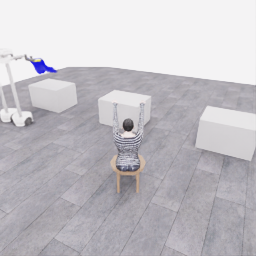
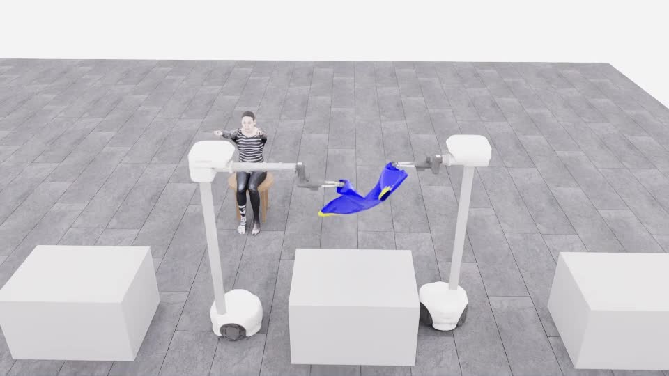
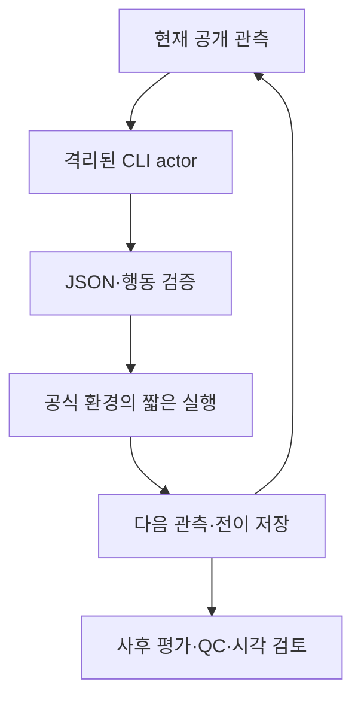
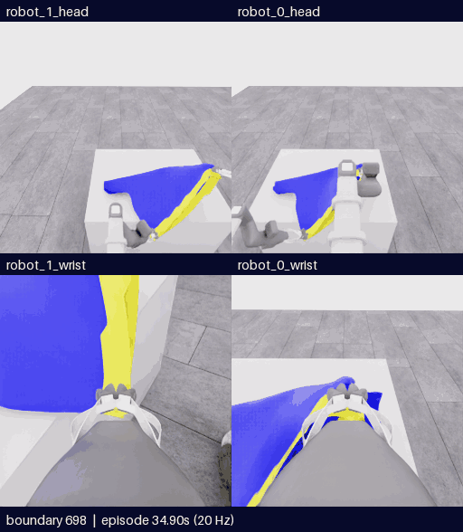
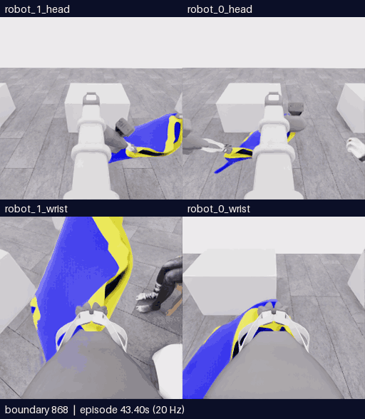

# 기술 발표 가이드

[처음 화면](../../README.md) · [시간순 시각 갤러리](../gallery/README.ko.md) · [날짜별 이력](HISTORY.ko.md) · [Astra 전체 경로](../collection/guides/astra-end-to-end.ko.md) · [코드 지도](CODE_MAP.ko.md)

이 문서는 저장소를 보며 **과제 정의, 직접 조작과 GPT 자동 시연, 데이터 수집 구현, 실험 해석, 다음 검증**을 설명하는 12장 구성입니다. 이미지와 수치의 근거를 바로 열 수 있게 연결했습니다. 별도 발표 파일이 없어도 각 절을 한 장의 발표 내용으로 사용할 수 있습니다.

**현재 결론:** 로컬 공식 평가기로 픽업5/50을 확인했습니다. 실제 재파지·협력 운반·접근·시야 복구를 기록했지만 착의 득점은0, 전체 성공은false입니다. E28은 미실행이고 최신 자동 시연으로 학습한 새 정책 성능도 아직 없습니다.

## 발표 시간에 따른 동선

| 시간 | 사용할 절 | 전달할 중심 |
|---|---|---|
| 5분 | 1 →2 →3 →5 →7 →10 →12 | 어떤 문제인지, 무엇을 구현했고 어디까지 확인했는지 |
| 15분 | 1–12 전체 | 방법이 바뀐 이유, 관측·행동·데이터의 실제 연결, 실패에서 얻은 근거 |
| 기술 질의 | 4–6·9–11 + 코드 지도 | 입력·출력 계약, CLI 루프, 시간·정합성·학습 경계 |

영상은 전체를 재생하기보다 설명할 사건 구간만 엽니다. **5fps 미리보기는20Hz 자료를4배 느리게 재생**하고 모델 대기 시간은 제외합니다. 원본 episode·출발 경계·카메라를 먼저 말하면 영상 속 움직임을 따라가기 쉽습니다.

분할 화면을 설명할 때는 **왼쪽 robot_1·오른쪽 robot_0**을 먼저 짚습니다.4분할은 위가 머리·아래가 손목입니다. 같은 카메라의 시간순 비교는 시간 순서를 유지하며, 이 배치는 로봇 번호·명령 행·픽셀을 뒤집는 변경이 아닙니다.

## 1. 어떤 챌린지인가

**한 문장:** “두 대의 Stretch 4가 공개 RGB-D와 로봇 상태만 보고 앉은 마네킹에게 티셔츠를 입히는 시뮬레이션 과제입니다.”

| 보여줄 내용 | 말할 핵심 |
|---|---|
| 로봇2대·옷·마네킹 | 이동·관절 제어와 변형되는 옷의 접촉을 함께 다뤄야 합니다. |
| 50점 점수 지도 | 픽업5는 준비 성과입니다. 손의 소매 통과, 목 통과, 앞면 방향 등 착의 항목이 따로 있습니다. |
| 순위 기준 | 픽업을 뺀 착의 점수를 첫 접촉→마지막 착의 득점의 로봇 시간으로 나눕니다. |

**기술 질문:** 픽업5점과 전체 착의 성공은 왜 다른가? 두 로봇의 협력이 필요한 이유는 무엇인가?

**표현 경계:** 현재5점은 로컬 공식 평가기 결과입니다. 공식 리더보드 성과로 바꾸어 말하지 않습니다. [과제·점수](CHALLENGE_GUIDE.ko.md) · [평가 정의](../competition/EVALUATION.md)

## 2. 지금까지 무엇을 만들었나

**한 문장:** “사람이 조작하는 경로에서 출발해, Astra가 실제 공개 관측을 읽고 짧게 행동하며 그 전후를 저장하는 수집 시스템을 만들었습니다.”

| 발전 | 실제 남은 결과 |
|---|---|
| 환경·정책 연결 | 클린 서버 복원, 기록·저장·짧은 정책 실행·학습 연결 시험 |
| 사람 시연 | 10월26일 두 로봇 집기·들기·운반 원본2,225전이 |
| 자동 시연 | 실제 CLI→행동→환경→다음 관측, 첫 픽업5 |
| 실패를 비교 가능한 자료로 전환 | 분기 계보·출처별 전이·QC·영상·리뷰·해시 백업 |

**기술 질문:** 작업을 단순 스크립트가 아니라 다시 분석할 수 있는 시스템으로 만든 부분은 무엇인가?

**표현 경계:** scripted63전이·30갱신은 연결 시험입니다. 최신 Astra 시연으로 착의 정책을 학습했다는 뜻이 아닙니다. [전체 이력](HISTORY.ko.md)

## 3. 사람 직접 조작과 Astra 자동 조작의 차이

| 항목 | 사람 원격 조작 | Astra 자동 시연 |
|---|---|---|
| 장면 해석 | 사람이 화면을 보고 판단 | `gpt-6-astra`가 지정 공개 RGB-D·상태를 읽음 |
| 명령 | Chrome 키보드 입력 | CLI JSON의 짧은 행동, 이후 named action |
| 수집 운영 | 기본 deferred export, ESC 후 READY까지 대기 | `collector_stream`으로 실행 중 obs/action/next_obs 즉시 저장 |
| 주요 어려움 | 많은 키·두 로봇 전환·느린 시각 피드백 | 가림·입구 정체·명령 의미·목표 유지·모델 호출 비용 |
| 현재 검토 | 사람 편집 영상과 원본 | Chrome/WebRTC OFF, 선별 공개 영상·리뷰 |

**기술 질문:** 두 경로를 공통 학습 데이터로 만들려면 무엇을 같게 맞춰야 하나?

**표현 경계:** 실시간 사람–AI 제어권 handoff가 구현됐다고 말하지 않습니다. 한 환경을 동시에 두 제어원이 조작하지 않습니다. [사람 시연](DEMO_20261026.ko.md) · [수집 방식](../collection/README.ko.md)

## 4. GPT는 무엇을 보고 무엇을 출력하나

**한 문장:** “GPT에게 시뮬레이터 전체를 주지 않고, 지정 공개 관측을 전달해 공식 행동 인터페이스로만 움직이게 했습니다.”

| 관측·행동 | 계약 | 설명 |
|---|---|---|
| 공개 RGB | `(5,256,256,3)` | 개요·양 머리·양 손목 |
| depth·valid | 각각 `(5,256,256,1)` | 광축 Z와 유효성; 가려진 표면은 볼 수 없음 |
| 관절 위치·속도 | 각각 `(2,13)` | 실제 측정 상태 |
| 제어기 목표·이전 명령 | 각각 `(2,9)` | 현재 실제 위치와 구분 |
| 공식 행동 | `float32 (2,9)` | 로봇2대×명령9개=18개 |

**기술 질문:** 명령9개인데 측정 관절13개인 이유는 무엇인가? 속도 비율을 위치 목표로 오해하면 어떤 문제가 생기나?

**표현 경계:** 모델은 평가 JSON·audit·숨은 천 기하·seed를 입력으로 받지 않습니다. 사후 검수와 actor 입력을 분리합니다. [공개 계약](../../config/policy_interface.json) · [기술 단계](../collection/guides/astra-end-to-end.ko.md)

## 5. Astra 시연은 end-to-end로 어떻게 돌아가나

**설명 순서:** 현재 관측 준비 → Astra 호출 → 필요하면 같은 관측의 픽셀 depth 질의 → 이름을 공식 배열로 변환 → 제한 검사 → 여러20Hz 전이 실행 → 다음 관측 저장 → 다시 판단합니다. 실행이 끝난 뒤 공식점수·파일검사·영상검토를 별도로 수행합니다.

**기술 질문:** 한 번의 GPT 호출과 하나의 전이는 왜 다른가? 질의 중에는 로봇 시간이 진행되는가?

**표현 경계:** 모델 호출은 매0.05초마다 하는 것이 아닙니다. 한 판단이 여러 전이를 실행하며, depth 질의의 물리 진행은0이지만 추가 호출 대기는 있습니다. [함수별 코드 지도](CODE_MAP.ko.md) · [단계별 상세](../collection/guides/astra-end-to-end.ko.md)

## 6. 인터페이스 개선: 더 정확히 묻고, 이름으로 명령하기

| 실제 문제 | 바꾼 구현 | 확인한 것과 한계 |
|---|---|---|
| 작은 depth 격자 안에 서로 다른 표면이 섞임 | 현재 손목 depth 패널, 이후 최대8점의 픽셀 depth 질의 | E18 실제 질의3회20유효점. 가려진 소매의 정답은 아님 |
| 전진 설명에 없던 roll+1이 배열에 포함됨 | `wrist_roll`, `gripper` 같은 정확한 이름으로 출력 | E19–E22의78 act 변환 모두 일치. 착의 성공과는 별도 |
| 명령0이면 즉시 정지한다고 오해하기 쉬움 | 목표·실제 상태·중립 전이를 나눠 기록 | 중립6=0.3로봇초이지 전체 정착 인증은 아님 |

**기술 질문:** named action의 책임 범위는 어디까지인가? 카메라 optical Z와 3차원 거리의 차이는 무엇인가?

**표현 경계:** named adapter는 값 재배열이며 새 IK나 의도 수정기가 아닙니다. 픽셀 질의는 새 센서·숨은 기하가 아닙니다. [named 코드](../../participant/collection/named_actions.py) · [depth 코드](../../participant/collection/depth_query.py) · [E18 리뷰](../collection/reviews/20261106-astra-guide470-depth-001.ko.md)

## 7. 첫 5점에서 무엇을 배웠나

**한 문장:** “실제 동작을 했다는 것과 평가 조건을 만족했다는 것은 달랐고, 이를 로그로 확인하면서 유지시간과 협력 동작을 정리했습니다.”

| 비교 | 관측한 결과 |
|---|---|
| E04 | 유효 유지2.9초로 3초 조건 미달,0점 |
| E05 | 여유를 둔 유지 목표 뒤 유효3.35초, 최초 픽업5 |
| E07 | 새 두 로봇 협력·운반,1,067전이·53.35로봇초·픽업5 |

**기술 질문:** 평가 이벤트와 모델의 `finish_episode`를 어떻게 분리했나? 픽업 후 소매로 가는 데 무엇이 추가로 필요한가?

**표현 경계:** 픽업5를 양쪽 파지의 독립 하중 지지나 통과 가능한 입구 확보로 해석하지 않습니다. [E04–E07 기록](HISTORY.ko.md#2-e00e09-연결-시험과-첫-픽업) · [E07 리뷰](../collection/reviews/20261106-astra-coordinated-fresh-001.ko.md)

## 8. 새 파지에서 운반까지: E25→E27

**한 문장:** “E25의 국소 들기 증거를 E27에서 실제 테이블 이탈·운반 유지로 확장했습니다.”

1. E25는 열기→새 낮은 경계로 위치 선택→한 번 보정→닫기→한쪽 들기를 실행했습니다.
2. 한쪽 실제 상승+26.62mm와 주변 천 동행은 확인했지만 테이블 기여·닫힘 변화가 있어 독립 지지는 미확인이었습니다.
3. E27은 E25 행동을 새 환경에서 재실행한 뒤 들어 운반했습니다.790에서 테이블 밖 몸판과 파지 유지가 보였습니다.

**기술 질문:** 재파지가 “잘됐다”는 근거의 강도는 어떻게 나누나? 과거 행동 재실행과 천 상태 checkpoint 복원은 왜 다른가?

**표현 경계:** 운반을 확인한 성과를 E25의 원래 경계에 소급해 독립 하중 인증으로 만들지 않습니다. [E25](../collection/reviews/20261107-astra-opposing563-named-001.ko.md) · [E27](../collection/reviews/20261107-astra-regrasp698-progress-named-001.ko.md) · [영상 출처](../gallery/assets/20261107-e27-lift-transport/provenance.json)

## 9. 아직 5점인 이유를 어떻게 분석했나

**한 문장:** “옷을 움직이는 부분 기능은 확보했지만, 같은 손이 올바른 입구를 연속 통과했다는 관측·득점으로 연결하지 못했습니다.”

| 실제로 보인 것 | 아직 단정할 수 없는 것 |
|---|---|
| E27/928에서 전완–노란 경계 사이 공간 관계 | 정확한 소매 정체·연속 통과·그 경계의 정확 점수 |
| D11 다른 손으로 목표 전환 | 목표 전환이 실패를 일으켰다는 인과 |
| D17 관절 추종, D20·D21 부분 시야 복구 | 전체 성공 또는 완전한 입구 복원 |
| E26 보상 자세로 손 일부 재노출 | 천의 같은 물질점 고정이나 소매 통과 |

**기술 질문:** 관측 가림과 물리적 진입 실패를 어떻게 구별할 것인가? command/target/actual을 따로 보는 이유는 무엇인가?

**표현 경계:** “모델이 옷을 전혀 이해 못한다”, “모든 재파지가 실패했다”, “끝까지 같은 가림이었다”는 식으로 확대하지 않습니다. [E27 상세](../collection/reviews/20261107-astra-regrasp698-progress-named-001.ko.md) · [E26 상세](../collection/reviews/20261107-astra-hand-swap787-named-001.ko.md)

## 10. 수집한 데이터를 어떻게 신뢰하고 관리하나

**한 문장:** “정상 파일, 과제 성공, 좋은 행동, 학습 승인을 네 가지 별도 상태로 관리합니다.”

| 층 | E27의 사례 |
|---|---|
| 전수 기술 QC |1,159/1,159전이 검사·오류0 |
| 공식 평가 | raw5·착의0·success=false |
| 시각 검토 | 새 파지 운반·팔 접근·가림·목표 전환·부분 복구 |
| 학습 승인 | `unreviewed` |

E27 전체1,159전이=698재실행+334모델+126정착+1정리입니다. 새 후속 기록은461전이·23.05로봇초이며 전체를 새 전문가 시연으로 세지 않습니다. 같은 계보·prefix·인접 프레임을 train/validation 양쪽에 나눠 독립 성능을 주장하지 않습니다.

**기술 질문:** QC는 어떤 오류를 잡고 어떤 오류를 못 잡나? 실패·복구 구간을 BC 정답과 어떻게 구분할 것인가?

**표현 경계:**35실행에는 연결·시작 실패가 포함되고,38시도 연결에는 계획3개가 포함됩니다.35개 성공 시연이 아닙니다. [데이터 목록](../collection/catalog/README.ko.md) · [QC 코드](../../participant/collection/validate_capture.py)

## 11. 시간 비용과 정책 학습 전환에서 남은 일

| 설명할 수치 | 의미 |
|---|---|
| E27 전체57.95로봇초 / 실제40분50.624초 | wall에는 재실행·모델 호출·환경·정리가 포함됨 |
| actor 경로1,348.906초 / 환경1,046.466초 | 순수 추론·순수 물리 시간으로 부르지 않음 |
| Astra 입력 RGB5+depth / 현재 π0.5 RGB3+state32 | 교사의 행동 근거가 학생에게도 관측 가능한지 검토 필요 |
| 실제 행동18→모델32 |14개0padding이며 로봇 자유도 추가가 아님 |

**다음 학습 순서:** 좋은 하위 기술·오류·복구를 검수 → prefix 중복 관리와 source-group 분할 → 교사·학생 관측 차이 확인 → 작은 pickup/운반 baseline 검증 → 착의 득점 구간을 확보해 확장합니다. SFT나 RL을 적용했다는 계획과 실제 개선 결과를 분리합니다.

**기술 질문:** 왜 GPU를 늘리는 것만으로 전체 대기를 해결하기 어렵나? 데이터가 없는 다음 행동을 imitation만으로 배울 수 있나?

**표현 경계:** 최신 시연으로 새 baseline이나 RL 개선을 완료한 상태가 아닙니다. [π0.5 데이터 경로](../../participant/pi05/data.py) · [전처리](../../participant/pi05/preprocessing.py) · [초기 학습 기록](sessions/20261022-bootstrap.md)

## 12. 다음 실험의 질문과 현재 중단 위치

**한 문장:** “다음은 같은 팔의 유용한 관계를 더 이어갈 수 있는지 비교하고, 확인 가능한 착의 마일스톤 하나를 추가하는 것입니다.”

| 현재 | 다음 검토 |
|---|---|
| E27 마감·새 수집 중지 | 오프라인 리뷰 후 출발점·예산·전략 재선택 |
| E27/928의 같은 팔 진행 E28 후보 | 과거890/906만 사용, 미래 관측을 출발 actor에 주지 않음 |
| 후보 CPU325·통합166소스 해시 일치 | 실제 GPU·모델·착의 개선은 미검증 |
| 픽업5·착의0 | 첫 소매+5 등 실제 착의 항목을 추가하고 전후 관측·행동·평가 증거 보존 |

완벽한 시야가 생길 때까지 무한정 기다리는 규칙이 아니라, 공개 관측의 추적 근거를 갱신하며 유한한 접근·복구를 비교합니다. 같은 목표를 유지하는 효과도 아직 검증할 가설입니다. E28은 실행 예약이 아닙니다.

**기술 질문:** 다음 한 번의 실행이 답해야 할 질문은 무엇인가? 점수가 같아도 어떤 자료가 남으면 유용한가?

**표현 경계:** 같은 source group의 한 번 비교로 일반화 성능을 주장하지 않습니다. 클린 서버 재개 시 새 현재 관측과 원본 해시를 다시 검사합니다. [후보 근거](../collection/research/2026-11-07-e27-single-arm-continuation.ko.md) · [최신 마감](SESSION_WRAPUP_20261107.ko.md) · [복원](START_HERE.ko.md)

## 발표 전에 마지막으로 맞출 것

1. 최고 성과와 최신 결과를 분리합니다. 둘 다 현재5점이지만, 새 파지·운반·복구는 서로 다른 실험의 증거입니다.
2. 화면에는 episode·경계·카메라를 붙이고, 말로는 **보이는 사실 → 해석 → 미확인 → 다음 비교** 순서를 지킵니다.
3. source group·전이·호출·판단·영상 길이·wall time을 같은 숫자로 설명하지 않습니다.
4. 구현 코드와 후보, CPU 검사와 실제 과제 효과, 기술 QC와 학습 승인을 구분합니다.
5. 각 장의 원문·코드 링크를 열어 조건을 확인하고, 상세 로그 대신 최종 행동·공개 관측·검증 근거로 설명합니다.
