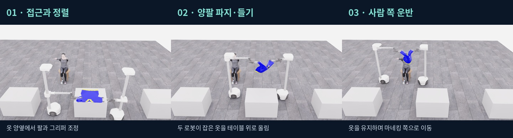

# 시연 결과

[첫 화면으로](../../README.md) · [바로 조작하기](LIVE.ko.md)

아직 검증된 착의 성공 시연은 없습니다. 성공 영상으로 표시하기 전에 실제 원본과 저장·검수 결과를 연결합니다.

| 날짜 | 확인한 결과 | 영상·데이터·한계 |
|---|---|---|
| 2026-10-23 | 크롬 사람 조작과 로봇 이동, 데이터 형식 검증 | [원본·검수·복원 기록](sessions/20261023-clean-start.md). 3구간·12전이의 형식 시험이며 착의 시연이 아닙니다. |
| 2026-10-26 | 크롬 두 로봇 조작 확인. 다음 세션 원본 정상 보존 | 3개 episode·727전이·36.35초, 비영 명령 110개. [원본 검사](sessions/20261026-wide-raw-check.json). RGB-D export·학습 적합성 검수는 대기. |
| 2026-10-26 | 첫 녹화 RAM 부족 중단 | [RAM 진단과 그래프](PERFORMANCE.ko.md). complete=false 원본 보존. |

새 결과에는 대표 영상/장면, 시도한 동작, 성공·부분 성공·실패, 실제 전이 수, 저장 완료 여부와 검수 근거를 함께 기록합니다. 실패·중단 원본도 보존하며, 데이터가 확보된 범위만 공개합니다. 공식 착의 성공과 집기·들기 같은 부분 동작은 구분합니다.

명령 활동 도표이며 실제 착의 진행률·성공률이 아닙니다. 정상 보존한 원본은 초기 공식 배치에서의 조작 연습입니다. 이후 옷 옆 로봇·정면 카메라 연습 배치는 사용자 요청으로 별도 수집하며 공식 평가 결과로 해석하지 않습니다.

## 2026-10-26 · 양팔 파지·들기·사람 쪽 운반

[33초 자막 시연 영상](../videos/20261026-human-pickup-transport.mp4) · [과정과 편집 설명](DEMO_20261026.ko.md)

원본 run `20261026T061140_546693Z_ab9e06`: 2,225 transitions/111.25 simulation seconds, collection wall 1,168.119초, raw 28,928 states, complete=true. 원본 reader 전체 검사와 기록 상태 재생을 마쳤습니다. 실제 사람 조작의 부분 과제 성과이며 전체 착의·자율 정책·공식 점수 결과는 아닙니다. 이 run의 RGB-D 학습 파일 변환·검수와 큰 원본 원격 업로드는 아직입니다.

## 오늘 종료와 다음 시도

사용자 요청으로 시연을 종료했습니다. 마지막 UI 연습 1,851전이·92.55 simulation seconds의 원본을 complete=true로 보존했습니다. 오늘 정상 인간 연습은 합계 4개 수집·6개 episode·5,571전이입니다. UI는 조금 나아졌지만 추가 개선이 필요하다는 사용자 피드백을 기록합니다. 다음 클린 서버에서 재시도한 뒤 개선 우선순위를 정합니다. [보존·복원 인계](END_20261026.ko.md).
