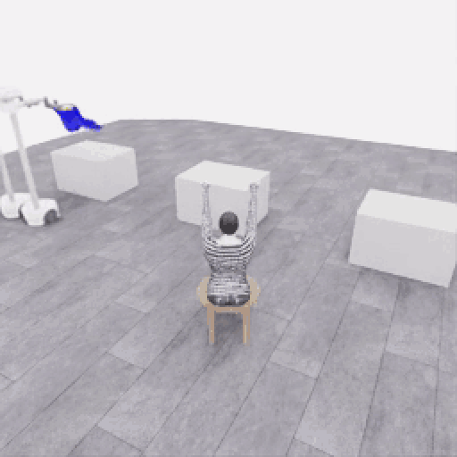
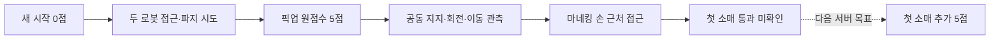

# 2026-11-06 작업 정리 · 다음 서버 인계

[메인](../../README.md) · [데모 갤러리](../gallery/README.ko.md) · [상세 수집 일지](../collection/sessions/2026-11-06.md) · [클린 서버 복원](START_HERE.ko.md) · [현재 상태](STATUS.md)

**사용자 요청으로 수집을 중단했습니다. 다음 목표는 첫 소매 통과입니다.** 최고 원점수는 **5/50**, 첫 소매 점수는 **0**, 전체 착의 성공은 아직 없습니다. 기록·연구·기술 검사와 과제 성공을 구분합니다.

## 먼저 볼 장면

**E07 · 첫 5점 경계 → 공동 회전·이동 → 마네킹 접근.** 경계 356~700의 345프레임을 4배 느리게 반복합니다. 약 6.25MB·69초이며 전체 시도의 일부입니다. [전체 1,067프레임 영상·프롬프트·행동](../collection/attempts/20261106-astra-coordinated-fresh-001/README.ko.md) · [정확한 득점 장면](../collection/milestones/20261106-astra-coordinated-fresh-001/README.ko.md)

그림은 E07에서 관측한 과정과 다음 목표를 구분한 것입니다. 양쪽 파지의 안정성이나 소매 통과를 공식 점수 없이 인증하지 않습니다. 메인 README의 공식 시연은 점수 지도 위에서 바로 재생할 수 있습니다.

## 이번에 확보한 결과

| 기록 | 확인한 결과 | 보존·활용 범위 |
|---|---|---|
| E04 · 유지 시간 탐색 | 2.9초 유지, 원점수 0 | 168전이 검사 통과. 3초 조건에 못 미친 실패 보존 |
| E05 · 한 로봇 픽업 | 원점수 5, 실제 유지 3.35초 | 253전이 검사 통과. 협력 시연과 구분한 [기존 갤러리](../gallery/20261106-astra-pickup-hold5-001.ko.md) 유지 |
| E06 · 기존 행동 재실행 | 새 평가에서 원점수 5 | 사용자 지시로 새 협력 시도로 전환. 386전이 검사 통과 |
| **E07 · 새 협력 시도** | **원점수 5, 공동 운반·접근 관측** | **1,067/1,067전이 검사 통과**, 80개 구간·73회 호출. 결정 예산 종료 |
| E08 · 접근 구간 분기 | 영상 송출 설정 누락으로 시작 실패 | 모델 호출·물리전이 0, [실패 원인 보존](../collection/experiments/2026-11-06-continuation-startup-retry.ko.md) |
| E09 · 설정 복구 후 분기 | 사용자 중단 중 종료 응답 정합성 오류 | 141전이 보존·기술 검사 실패. 700전이 재실행 미완료, 모델 호출 0. [종료 검토](../collection/reviews/20261106-astra-coordinated-branch700-002.ko.md) |

E07의 전체 경과는 **83분 54초**, 물리 진행은 **53.35초**입니다. actor 호출 계측 합계 62분 18초에는 입력 준비·CLI·서비스 요청/응답이 포함됩니다. 모델 내부 추론 시간은 별도로 제공되지 않았습니다. 원점수 5와 달리 **공식 최종 점수율은 0점/초**, `success=false`입니다. [종료 검토·시간·사용량](../collection/reviews/20261106-astra-coordinated-fresh-001.ko.md)

소매 단계로 이름 붙인 24개 행동 구간·254전이에서는 모델의 시각 판단이 모두 `uncertain`이었습니다. 이 개수는 독립 실패 에피소드 수가 아닙니다. 손·옷 구멍의 가림과 접힘, 파지 유지·옷 방향 조정이 다음 관측 기반 개선 대상입니다.

## 구축한 수집 구조

| 기능 | 현재 확인 상태 | 바로가기 |
|---|---|---|
| 격리된 행동 모델 | Astra `ultra`, 지정 RGB 5장·공개 로봇 상태·depth 요약, 평가 입력 분리 | [입력·경계와 기록](../collection/README.ko.md) |
| 여러 행동을 한 호출에서 생성 | wiring 1호출·3구간 확인, E07은 73호출로 80구간 | [방법별 E00~E09](../collection/experiments/2026-11-06-method-comparison.ko.md) |
| 호출·환경 시간과 사용량 | thread 누계 차분, 미확정 호출 별도, 실제 행동 단위 기록 | [첫 5점까지 시간](../collection/experiments/2026-11-06-first5-time-breakdown.ko.md) |
| 점수 경계·재실행 출처 | 정확 프레임·원본 SHA·부모 시도·source group 기록 | [재실행·분기](../collection/guides/continuation-and-branches.ko.md) |
| 브라우저 라이브 관찰 | 조작 UI를 숨기고 진행 패널 제공, 관찰과 actor 입력 분리 | [송출 실측·한계](../collection/experiments/2026-11-06-streaming-benchmark-result.ko.md) |
| 공개 자료 | 반복 GIF·전체 MP4·원본 PNG·프롬프트·최종 행동·점수·실패 검토 | [갤러리](../gallery/README.ko.md) · [상세 일지](../collection/sessions/2026-11-06.md) |

## 연구 시도와 적용 여부

| 방법 | 이번에 한 일 | 현재 행동 모델 적용 |
|---|---|---|
| 공식 데모 분석 | 공동 접근·들기·운반 순서 분석, 참고 영상·출처 보존 | 전략 설명에 반영. 영상·내부 좌표를 actor에 공급하지 않음 |
| 공개 depth 역투영·옷 색/가장자리 후보 | B1/B1b/B1c 오프라인 구현·고정 프레임 실험, 보수적 후보 기권 기록 | 미적용 |
| 행동 채널에 이름 사용 | 공식 배열과 값이 같은 변환기·CPU 검사, Astra 4호출 ABBA 연결 시험 | 미적용. 실제 소매 성공률 개선 근거 없음 |
| 스켈레톤·추적·3D 인체 | 연구 방법·허용 입력·단계적 적용 계획 조사 | 모델 실행·성능 검증 전 |
| Stanford OpenWAM | 공개 모델·입출력·가중치·라이선스·서버 적합성 조사 | 설치·가중치 다운로드·추론·학습 모두 미실행 |

[공식 데모 전략](../collection/experiments/2026-11-06-official-demo-strategy.ko.md) · [명명 행동 4호출 결과](../collection/experiments/2026-11-06-action-encoding-cli-probe.ko.md) · [OpenWAM 분석](../collection/research/openwam-feasibility.ko.md) · [전체 연구·실험 목차](../collection/README.ko.md)

## 다음 서버에서의 순서

1. [설치·복원 안내](START_HERE.ko.md)에 따라 고정 소스·공식 자산·Docker·CLI를 준비하고 CPU 검사와 smoke를 새 서버에서 확인합니다.
2. **E09의 pending 응답·종료 순서 문제를 먼저 수정하고 회귀 검증합니다.** 이번 세션에서는 원본을 불완전 상태 그대로 보존했으며 수정 완료나 재검증을 주장하지 않습니다.
3. E07 원본과 메타데이터를 복원하고 SHA256·전체 전이 검사를 다시 확인합니다. GitHub의 작은 공개 영상만으로 행동 재실행 원본을 대체할 수 없습니다.
4. 새 네트워크의 송출 주소·origin을 확인한 뒤 관찰 화면을 연결합니다. 이전 서버의 주소·포트·인증을 새 환경에 그대로 사용하지 않습니다.
5. **새 run ID로 E07의 700전이 행동을 재실행**하고, 현재 공개 관측에서 두 로봇의 파지·손과 소매 위치를 다시 확인해 소매 통과를 시도합니다. 정확한 물리 checkpoint 복원은 아닙니다.

현재 중단 상태는 사용자의 휴식 요청에 따른 것입니다. 자동 재시도는 실행하지 않습니다. E09의 `new_recorded_suffix_steps=21`은 새 모델 시연이 아닙니다. 저장된 앞 140개는 부모 행동 재실행, 마지막 1개는 중립 정리이며 ACK는 120개까지 확인됐습니다. 원본·실패·출처 관계를 유지합니다.

VLA baseline → RL → world model은 수집 시스템과 분리된 후속 계획입니다. 점수 경계별 다양한 경로를 같은 source group 안에 보존하고, 실제 성공·기술 검사·학습 사용 승인을 별도 레이블로 유지합니다.

## 보존과 저장소 접속

GitHub 연결 도구와 서버의 인증된 `gh`에서 같은 저장소·`main`을 각각 조회했습니다. 코드·한국어 기록·공개 GIF/MP4/PNG는 GitHub에 게시하고, 큰 원본과 신뢰된 평가 메타데이터는 별도 비공개 전송 묶음으로 보존합니다.

기존 HF 데이터 저장소는 공개이며 오늘 원본의 비공개 백업 대상으로 사용하지 않았습니다. 원본 전송 묶음에는 자산·시도별 데이터·공개 모델 입력·최종 행동·실패 상태를 포함하고 인증 파일·숨겨진 모델 추론·세션 DB는 제외합니다. **비공개 원격 업로드와 고정 revision의 재다운로드 해시 검증을 완료했습니다.** 기존 서버 원본도 유지합니다. 새 서버 설치·GPU smoke는 다음 세션에서 검증합니다. [복원 안내](START_HERE.ko.md) · [현재 상태](STATUS.md)

로컬 전송 파일은 **11.78GB**, 원본 5,166개와 범위 설명·체크섬 목록을 포함한 5,168개 파일입니다. 압축을 실제로 읽어 모든 파일의 SHA256을 확인하고 새 폴더에 복원한 뒤 E07의 700전이 입력도 읽었습니다. [비공개 HF 백업](https://huggingface.co/datasets/leonayoon/phyrc-2027-phase1-private-backup)의 고정 revision `e1d32f9f9ea82438f90bc379452abf83a150999b`에서 재다운로드한 11.78GB도 원본 SHA256과 일치합니다. [보존 검증 기록](sessions/20261106-transfer-snapshot.json) · [원격 검증 결과](sessions/20261106-remote-backup-verification.json) · [자산 의존성 검사](sessions/20261106-transfer-assets-check.json)
