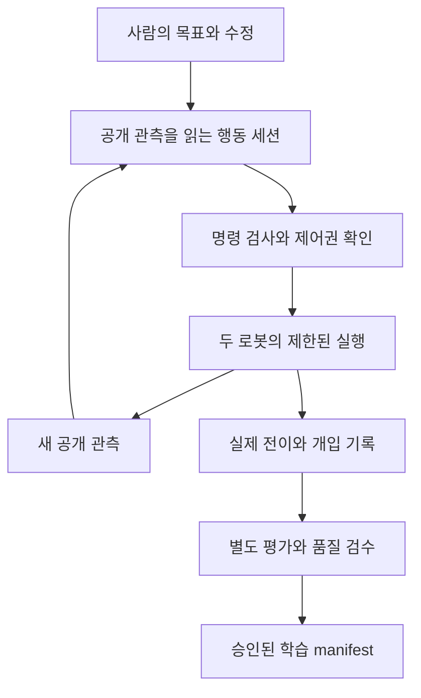

# 자연어 시연 수집과 데이터 보존

[전체 개발 컨텍스트](../CODEX_CONTEXT.ko.md) | [공식 데이터 구조](../../competition/DATA.md) | [공식 평가](../../competition/EVALUATION.md) | [규칙](../../competition/RULES.md)

기준: 2026-11-06 / 코드 `f79f61b`. 아래에서 **현재 구현**과 **추가할 기능**을 구분합니다. 자동 착의 성공이나 정확한 물리 되감기를 이미 달성한 것으로 해석하지 않습니다.

## 1. 사람은 목표와 수정을, 실행기는 실제 명령과 기록을 담당

추가할 사용자 흐름은 다음과 같습니다.

평가 결과를 행동 세션에 되돌리는 화살표는 두지 않습니다. 사람의 수정도 공개 영상과 로봇 상태에 근거한 명령으로 남깁니다. 개발 세션에서 본 옷 입자나 평가기 기하를 행동 조언에 섞지 않습니다.

| 자연어 예시 | 실행기가 처리할 일 | 데이터에 남길 것 |
|---|---|---|
| “두 로봇 모두 옷 쪽으로 조금 이동” | 공개 관측으로 방향을 판단하고 짧은 `(2,9)` 명령 실행 | 목표, 실제 action, 적용 step과 새 관측 |
| “왼쪽 로봇 팔을 조금 더 높여” | 어느 robot ID인지 확인 가능한 표현으로 변환하고 lift만 작게 변경 | 사용자 수정 시각과 제어권 변경 |
| “그리퍼를 열어” | 대상 로봇의 gripper에 명시적 open 명령 | 의도 변경과 실제 명령. 파지 해제 여부는 별도 관측 |
| “여기까지 저장” | 원본 유지, segment 경계와 검수 대기 표시 | 원본 episode와 시작/끝 step |
| “이 구간은 쓰지 말고 다시” | 구간을 제외 상태로 표시하고 새 시도를 시작 | 실패 구간도 삭제하지 않고 제외 사유 보존 |
| “조금 전 상태로 돌아가” | 지원되는 복원 경로와 정확도를 확인. 불가하면 새 episode로 재시작 | 부모 episode/slot과 복원 방식, 안정화 구간 |

이 표의 자연어 router, segment 관리와 제어권 전환은 **구현할 설계**입니다. 현재 그대로 실행할 명령은 없습니다.

## 2. 현재 재사용할 코드

| 경로 | 현재 제공하는 것 | 추가할 것 |
|---|---|---|
| [`participant/collection/boundary.py`](../../../participant/collection/boundary.py) | 공개 관측 복사, action 검사, `observe/act/stop/finish_episode` | 프로세스와 파일 접근 격리, 제어권 관리 |
| [`scripts/collect_operator.py`](../../../scripts/collect_operator.py) | JSON Lines I/O, 즉시 센서 기록, 기본 400 step | 별도 CLI client와 evaluator, 더 긴 실행의 명시적 설정 |
| [`participant/collection/gpt_client.py`](../../../participant/collection/gpt_client.py) | API 기반 작은 명령 시험 | 별도의 Codex CLI 연결. API 코드를 CLI 연결로 오인하지 않음 |
| [`training_dataset.py`](../../../src/PhyRC_Sim/Policy/training_dataset.py) | 관측, 실제 action, 다음 관측의 HDF5 기록 | 승인된 시연의 전수 QC 및 catalog |
| [`scripts/evaluate_policy.py`](../../../scripts/evaluate_policy.py) | `EvaluationSession.for_policy(...)` 연결의 참고 경로 | 자동 수집의 같은 시도에 평가를 연결하되 결과는 별도 저장 |

`act`는 1~20 step을 허용합니다. 처음에는 1~10 step, 접촉 부근에서는 더 짧게 시작합니다. `stop()`은 모든 동작을 0으로 한 **한 step**을 실행하며 gripper 의도는 유지합니다. 물리 일시정지나 이미 보낸 긴 호출의 즉시 취소와 같지 않습니다. 중단 응답성을 위해 한 번에 실행하는 길이를 제한하고 step 사이에 취소를 확인하는 설계를 검토합니다.

현재 자동 수집기는 `DressingEnv`에 evaluator를 연결하지 않으며 reward/info도 모델에게 전달하지 않습니다. `raw_archive=False`이므로 현재 자동 기록을 나중에 raw replay evaluator로 재채점할 수 있다고 가정하면 안 됩니다.

## 3. Codex CLI 연결의 구현 계약

- 서버에 설치된 `codex exec --help`에서 이미지 첨부, 구조화 출력, 세션 재개의 실제 옵션을 확인합니다. 문서에 없는 플래그를 추정하지 않습니다.
- 개발용 세션은 코드와 진단을 담당합니다. 행동용 세션은 별도 작업 공간에서 허용 관측과 제한된 도구만 사용합니다. shell이나 저장소 전체 접근으로 audit를 읽을 수 있으면 격리가 완료된 것이 아닙니다.
- `--json` 이벤트 스트림 전체를 action JSON으로 파싱하지 않습니다. 최종 구조화 출력의 스키마를 검사합니다.
- 에피소드별 명시적 세션 ID를 사용합니다. 새 episode와 복원 분기에서는 행동 문맥을 초기화하고, 부모 episode/slot 출처는 별도 메타데이터에 기록합니다.
- malformed JSON, 잘못된 shape, NaN/Inf, 범위 초과, timeout, 중복 응답을 거절합니다. request ID와 observation step을 대조해 오래된 응답을 새 상태에 실행하지 않습니다.
- 추론 대기 중 물리가 정지하는지 실제로 측정합니다. 진행한다면 관측 시각과 실행 시각의 차이를 기록하고, 정지한다면 wall-clock 비용과 simulation time을 분리합니다.
- 사람의 개입은 자동 실행과 배타적으로 전환합니다. 두 producer가 동시에 명령을 보내지 않게 하나의 arbiter가 실행권을 갖습니다.
- teacher의 영상 history와 학생의 단일 프레임 입력 차이를 기록합니다. 학생이 볼 수 없는 과거 정보에만 의존한 동작은 단순 BC로 복제하기 어려울 수 있습니다.

## 4. 0점에서 50점까지: 점수와 성공을 분리

공식 `pickup-excluded-last-award-v9` 기준입니다. 아래 순서는 설명을 위한 예시이며 강제된 획득 순서가 아닙니다.

| 항목 | 점수 | 예시 누적 | 확인할 의미 |
|---|---:|---:|---|
| pickup | 5 | 5 | 같은 gripper로 파지 지점보다 5 cm 들어 3 simulation초 유지 |
| first_sleeve | 5 | 10 | 첫 손이 소매를 통과. 손목과 손끝이 밖에 나왔는지 확인 |
| opposite_shoulder | 5 | 15 | 옷 일부가 반대 어깨 관절을 넘어감 |
| second_sleeve | 5 | 20 | 다른 손이 다른 소매로 나옴 |
| left_upper_arm | 5 | 25 | 왼쪽 위팔 일부를 소매가 덮음 |
| right_upper_arm | 5 | 30 | 오른쪽 위팔 일부를 소매가 덮음 |
| neck | 10 | 40 | 올바른 목 구멍 통과가 확인됨 |
| front_orientation | 10 | 50 | 머리가 나온 상태에서 옷 앞면 방향을 0.5초 유지 |

점수는 한 번 얻으면 남습니다. 최종 `success`는 양손이 서로 다른 소매 밖에 있고 머리와 목이 나와 있으며 앞뒤 방향이 맞는 상태를 **동시에 0.5초** 충족했는지 확인합니다. 달성 후 마지막 프레임에서도 계속 유지되는지는 별도 질문입니다.

`points/s = (raw_points - earned_pickup_points) / (last_dressing_award_time - first_contact_time)`

분자는 최대 45점입니다. `no_contact` 등 null rate를 제외해 평균을 높이지 않고 실패로 포함합니다. 이 시간 분모, 에피소드 전체 simulation time, 추론에 사용한 wall time과 평가 실행 예산을 구분합니다. 다른 시작 상태에서 얻은 구간 점수를 더해 한 번의 완주로 보고하지 않습니다.

## 5. 저장, 재생, 복원은 각각 다름

| 작업 | 보장할 수 있는 범위 | 보장하지 않는 것 |
|---|---|---|
| 원본 및 HDF5 저장 | 기록한 값, 코드 및 출처의 보존 | 진행 중 solver 상태의 정확한 복원 |
| raw replay / 재렌더링 | 저장된 상태로 영상과 평가를 재구성 | 새로운 physics solve가 같은 궤적을 재현 |
| save slot에서 재시작 | 저장된 로봇과 옷 상태를 불러와 새 시도 | FEM 내부 이력, 속도 ramp까지 bitwise 재현 |
| 학습 checkpoint 복원 | 모델, optimizer, step 등의 저장 상태 | dataloader cursor와 완전히 동일한 샘플 순서 |

현재 `Teleop_TShirt_Stretch4_Env.py`에 `save_state_slot/load_state_slot`과 F1~F5 경로가 있습니다. 하지만 브라우저 bridge의 허용키에 F1~F5가 없고 Codex collection 도구에도 slot 명령이 없습니다. `environment.py::_reset_slot`은 FEM 이력이 bitwise 복원되지 않음을 명시하며 안정화 후 새 episode를 시작합니다. held key, base ramp와 일부 명령 이력도 그대로 돌아오지 않습니다.

**먼저 구현할 비파괴 관리**:

1. 원본 episode는 수정하지 않고 segment의 시작/끝 step, 상태, 제외 사유만 manifest로 관리합니다.
2. 복원 시 새 episode ID와 `parent_episode_id`, `checkpoint_id`, 출처 그룹을 기록합니다.
3. 복원 직후 joint, 공개 RGB-D, gripper 의도와 짧은 무입력 응답을 확인합니다. solver 안정화 구간을 학습 구간과 분리합니다.
4. 옷과 grasp 상태가 기대대로 유지되지 않으면 정확한 되감기라고 표시하지 않고 reset 재시도나 복구 시연으로 기록합니다.
5. reset/restore로 공식 live attempt가 invalid 종료되고 새 평가가 시작되는 규칙을 유지합니다.

구간을 “조합”한다는 것은 기본적으로 학습 dataset에 여러 segment를 포함한다는 뜻입니다. 불연속 물리 상태 사이를 하나의 연속 transition으로 이어 붙이지 않습니다. 이어서 실행할 행동이 필요하면 실제 연결 동작을 다시 수행하고 기록합니다.

## 6. 파일과 시간의 실제 형태

| 항목 | 형태 |
|---|---|
| 원본 행동 | 실행 `(2,9)` float32, 저장 `(N,18)` |
| 저장 계층 | `data/demo_k/obs/<key>`, `next_obs/<key>`, `actions`, `rewards`, `dones`, `terminated`, `truncated` |
| 영상 key 예시 | `overview_rgb`, `robot_0_wrist_depth`, `robot_1_head_depth_valid` |
| 영상 shape | RGB `(N,256,256,3)` uint8, depth `(N,256,256,1)` float32, valid mask bool |
| 상태 예시 | 실행 joint `(2,13)`, 저장 `(N,26)`; 로봇 0 다음 로봇 1 |
| 시간 | `obs[t]`에서 명령을 0.05초 적용하고 `next_obs[t]` 기록. 12 physics ticks |
| 데이터 완료 | 수집 경로별 완료 필드, 파일 및 episode `complete`, hash와 QC를 함께 확인 |

사람 deferred 경로는 `status=ready`와 `complete=true`를 확인합니다. 현재 자동 경로는 `status` 없이 `complete`, HDF5 완료 속성과 hash를 기록합니다. `complete`, `dones=1`, 기본 reward 0은 착의 성공을 뜻하지 않습니다.

HDF5는 실제 학습 컨테이너입니다. CSV는 탐색용 복사본, JSON/JSONL은 설정과 이벤트, Parquet은 이후 catalog나 학습 프레임워크 변환에 사용할 수 있습니다. 파일 확장자만 바꾸어 호환되지는 않습니다. SHA256은 파일 동일성 확인용이며 좋은 시연인지 알려주지는 않습니다.

**저장량 계산 예시, 실측 아님:** 카메라 5개에서 RGB 3 byte, depth 4 byte, mask 1 byte/pixel이면 관측 한 묶음은 `5 × 256 × 256 × 8 = 2.5 MiB`입니다. obs와 next_obs를 모두 저장하면 영상 배열만 transition당 약 5 MiB, 20 Hz에서 약 100 MiB/s의 압축 전 크기입니다. 실제 LZF 압축률, 중복 처리, raw cloth 자료와 RAM buffer를 측정해야 합니다. 모델에 RGB 3개만 보낸다고 기록기의 5개 RGB-D 비용이 자동으로 줄지는 않습니다.

## 7. 품질 승인과 백업

검사는 첫 샘플만 보지 않고 전체 episode에 수행합니다.

- 카메라 순서와 shape, RGB dtype, depth 유효 비율과 범위, 유한한 상태 및 action.
- 0.05초 간격, 12 ticks, episode 경계, `next_obs.previous_action`과 적용 action 일치.
- 긴 정지, 과도한 saturation, 드문 gripper 전환, 누락/반복 영상과 사람 개입 구간.
- 공식 점수의 valid 여부와 success 검증 여부, 시각적 의견을 별도 기록.
- source 종류와 quality 상태를 분리. `approved_pipeline_test`를 실제 시연의 승인 이름으로 재사용하지 않음.
- 같은 원본, 복원 분기, 증강본은 같은 source group에 두고 train/validation을 넘나들지 않게 함.
- 정상 종료 후 hash, 업로드 리비전, 재다운로드 검증을 확인. 인증정보와 private endpoint는 공개 기록에서 제외.

사람 deferred 기록은 raw 저장 후 RGB-D export를 해야 합니다. 자동 수집은 현재 raw 없이 센서를 바로 저장합니다. `check_deferred_dataset.py`는 전자에 적용하며 후자에 같은 검증을 완료했다고 쓰지 않습니다.

## 8. 첫 수집의 통과 기준

작은 이동, 정지, gripper 의도 유지와 전환, 두 로봇 동시 명령, 오류 JSON 거절, timeout, 사람 개입, 정상 종료를 먼저 확인합니다. 그 다음 접근/파지/들기 시도마다 유효 전이 수, 개입 수, 모델 호출 수, inference p50/p95, simulation time, wall time, 점수와 검수 상태를 남깁니다.

수집 효율은 **검수 통과한 시연 시간 / 전체 서버 사용 시간**으로 보며, 연결 시험을 성공 시연 분량에 포함하지 않습니다. GPU나 모델 호출을 실행하지 않은 문서 변경만으로 이 검사를 통과했다고 표시하지 않습니다.
